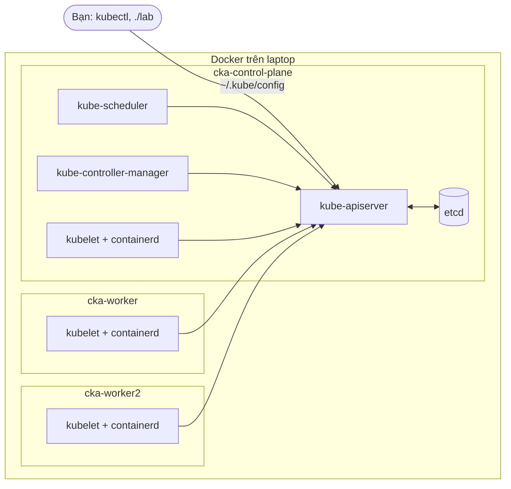
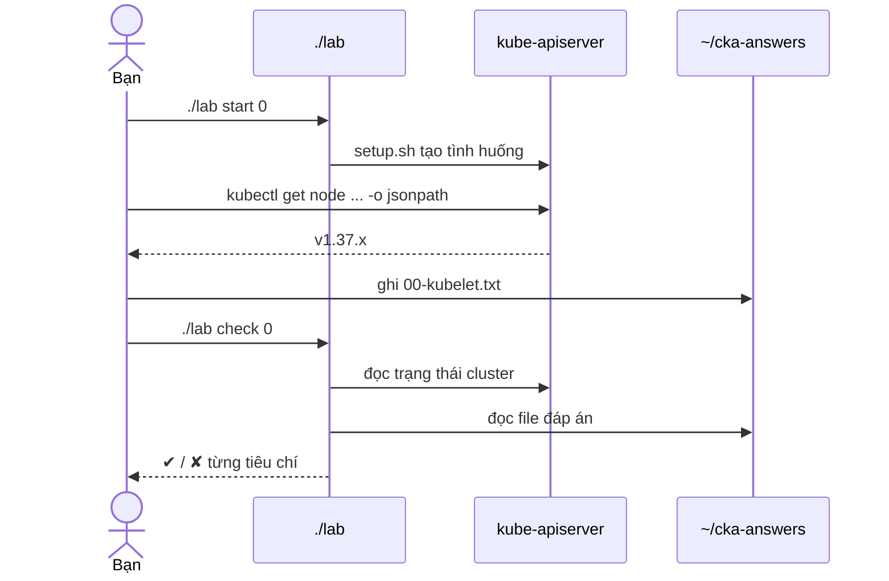

# Lab 00 · Dựng cluster lab và làm quen công cụ

**Cấp độ 0 · Chuẩn bị môi trường** · khoảng 30 phút · môi trường: kind hoặc kubeadm

Mức hỗ trợ: **Cầm tay chỉ việc**. Mỗi bước có lệnh, giải thích vì sao và kết quả bạn sẽ thấy. Lần đầu làm theo từng bước; lần hai đóng phần hướng dẫn lại và tự làm đề bài.

## Mục tiêu

Có một cluster 3 node (1 control plane, 2 worker) chạy Kubernetes v1.37 (phiên bản của đề thi) để làm mọi bài lab, cấu hình terminal giống phòng thi và biết cách dùng `./lab`.

## Kiến thức cần nắm

- **kind** (Kubernetes in Docker) dựng mỗi node thành một container. Bên trong là kubeadm, kubelet chạy bằng systemd và control plane dạng static pod, giống hệt cluster thật. Gần như mọi lab chạy trên kind.
- **Cluster kubeadm trên máy ảo** (thư mục `env/kubeadm`) chỉ cần cho các bài cài đặt, nâng cấp và HA (lab 01, 30, 32).
- `./lab start <id>` dựng tình huống, `./lab check <id>` chấm bài, `./lab reset <id>` dọn dẹp.
- Một số bài yêu cầu ghi đáp án ra file. Thư mục đáp án mặc định là `~/cka-answers`; đổi bằng biến `CKA_ANSWERS`.
- Trong bài, `$CP`, `$NODE1`, `$NODE2` là tên node control plane và hai worker. Nạp chúng bằng `eval "$(./lab env)"`. Với kind, tên là `cka-control-plane`, `cka-worker`, `cka-worker2`.

## Sơ đồ

### Lab dựng gì


Mỗi node của kind là một container Docker. Control plane chạy dưới dạng static pod, do kubelet trên `cka-control-plane` khởi động.

### Luồng hoạt động


Mọi bài đều theo vòng này: `start` dựng tình huống, bạn sửa cluster hoặc ghi file, `check` so trạng thái thật với yêu cầu.

## Chuẩn bị

```bash
./lab start 0
```

## Đề bài

1. Cài Docker, [kind](https://kind.sigs.k8s.io/docs/user/quick-start/#installation) v0.33+ và kubectl v1.37, rồi dựng cluster:
   ```bash
   ./env/kind/up.sh
   ```

2. Cấu hình shell giống phòng thi. Thêm vào `~/.bashrc` rồi `source ~/.bashrc`:
   ```bash
   alias k=kubectl
   source <(kubectl completion bash)
   complete -o default -F __start_kubectl k
   export do="--dry-run=client -o yaml"
   export now="--force --grace-period 0"
   ```

3. Chạy `./lab doctor` và `eval "$(./lab env)"`. Ghi tên node control plane vào `~/cka-answers/00-cp.txt`.

4. Ghi phiên bản kubelet của `$NODE1` (ví dụ `v1.37.0`) vào `~/cka-answers/00-kubelet.txt`. Lấy từ `kubectl get node`, không gõ tay.

5. Vào shell của `$NODE1` bằng `./lab ssh $NODE1`, chạy `crictl ps` để thấy container trên node, rồi `exit`.

## Hướng dẫn từng bước

### Bước 1 · Dựng cluster 3 node

`up.sh` gọi `kind create cluster` với file `env/kind/cluster.yaml` (1 control plane + 2 worker), rồi cài metrics-server cho `kubectl top` và HPA. Thành phần riêng của từng bài (ingress controller, Gateway API…) do `./lab start` của bài đó cài.

```bash
git clone https://github.com/TomJennyDev/cka-labs && cd cka-labs
./env/kind/up.sh
kubectl get nodes -o wide
```

> **Kết quả:** 3 node `cka-control-plane`, `cka-worker`, `cka-worker2` ở trạng thái `Ready`, cột VERSION là `v1.37.x`.

Nếu node đứng `NotReady` quá 2 phút: `kubectl describe node <tên>` và đọc phần `Conditions`.

### Bước 2 · Cấu hình terminal như phòng thi

Phòng thi có sẵn `alias k=kubectl` và bash completion. Hai biến `$do` và `$now` giúp bạn gõ nhanh hơn rất nhiều ở các bài sau.

```bash
cat >> ~/.bashrc <<'EOF'
alias k=kubectl
source <(kubectl completion bash)
complete -o default -F __start_kubectl k
export do="--dry-run=client -o yaml"
export now="--force --grace-period 0"
EOF
source ~/.bashrc
k get no          # thử: gõ "k get no" rồi bấm Tab
```

> **Kết quả:** `k get nodes` chạy được; gõ `k get po -n kube-` rồi bấm Tab thì bash tự điền namespace.

### Bước 3 · Kiểm tra công cụ và nạp tên node

`./lab doctor` kiểm tra kubectl, docker, kind, helm và kết nối cluster. `./lab env` in ra 3 biến `CP`, `NODE1`, `NODE2`; `eval` biến chúng thành biến shell để dùng trong lệnh.

```bash
./lab doctor
eval "$(./lab env)"
echo "$CP $NODE1 $NODE2"
```

> **Kết quả:** `cka-control-plane cka-worker cka-worker2`.

### Bước 4 · Ghi file đáp án đầu tiên

Nhiều bài yêu cầu ghi kết quả ra file. Luôn để lệnh tự sinh nội dung thay vì gõ tay, tránh sai chính tả.

```bash
./lab start 0
mkdir -p ~/cka-answers
echo "$CP" > ~/cka-answers/00-cp.txt
```

### Bước 5 · Lấy một trường bằng jsonpath

`kubectl get -o jsonpath` đọc thẳng một trường trong object. Muốn biết đường dẫn trường, xem `kubectl get node $NODE1 -o yaml` trước.

```bash
kubectl get node "$NODE1" -o yaml | grep -n kubeletVersion       # thấy nó nằm dưới status.nodeInfo
kubectl get node "$NODE1" -o jsonpath='{.status.nodeInfo.kubeletVersion}' > ~/cka-answers/00-kubelet.txt
cat ~/cka-answers/00-kubelet.txt
```

> **Kết quả:** một dòng như `v1.37.0`.

### Bước 6 · Nhìn vào bên trong một node

Mỗi node kind là một container. Bên trong có kubelet và containerd thật. `crictl` là công cụ nói chuyện với container runtime: đề thi hay dùng nó khi kubectl không dùng được.

```bash
./lab ssh "$NODE1"
crictl ps               # các container đang chạy trên node này
systemctl status kubelet --no-pager | head -5
exit
```

> **Kết quả:** thấy container `kube-proxy`, `kindnet-cni`… và kubelet `active (running)`.

### Bước 7 · Chấm bài

```bash
./lab check 0
```
Mọi dòng phải là ✔. Dòng nào ✘ có kèm giá trị hiện tại và giá trị cần có.

## Gợi ý

<details><summary>Lấy phiên bản kubelet</summary>

`kubectl get node $NODE1 -o jsonpath='{.status.nodeInfo.kubeletVersion}'`

</details>

<details><summary>Máy dùng chip Apple</summary>

kind tự chọn image arm64. Cần Docker Desktop hoặc OrbStack với ít nhất 4 CPU và 6 GB RAM.

</details>

## Chấm bài

```bash
./lab check 0
```

Lời giải: [SOLUTION.md](SOLUTION.md) (chỉ mở sau khi đã tự làm).

## Dọn dẹp

```bash
./lab reset 0
```

## Tài liệu

- [kind quick start](https://kind.sigs.k8s.io/docs/user/quick-start/)
- [kubectl cheat sheet](https://kubernetes.io/docs/reference/kubectl/quick-reference/)

---

[Lab 01 · Cài cluster bằng kubeadm trên máy ảo](../01-kubeadm-install/README.md) →
