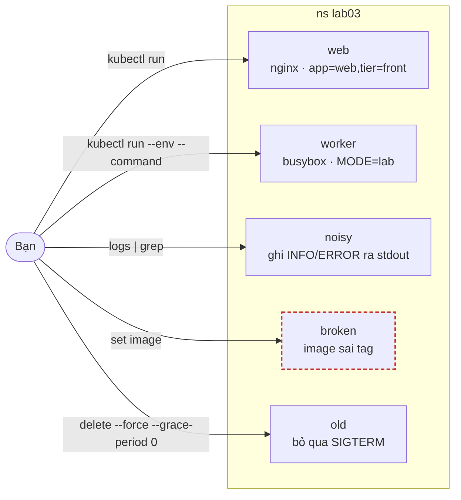
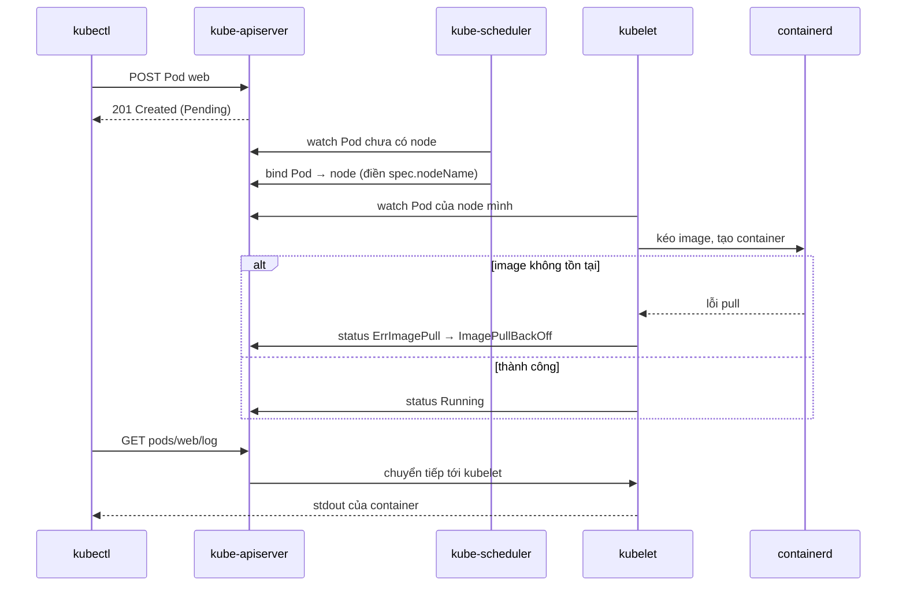

# Lab 03 · Pod, label, log và exec

**Cấp độ 1 · Nền tảng kubectl** · khoảng 25 phút · môi trường: kind hoặc kubeadm

Năng lực CKA: Troubleshooting › Quản lý và đánh giá output, log của container

Mức hỗ trợ: **Cầm tay chỉ việc**. Mỗi bước có lệnh, giải thích vì sao và kết quả bạn sẽ thấy. Lần đầu làm theo từng bước; lần hai đóng phần hướng dẫn lại và tự làm đề bài.

## Mục tiêu

Tạo và sửa Pod thật nhanh bằng lệnh imperative, đọc log, chạy lệnh trong container, và biết field nào của Pod đang chạy thì sửa được.

## Cần làm trước

- [Lab 02 · kubectl, namespace, context và Kubernetes API](../02-kubectl-api/README.md)

## Kiến thức cần nắm

- `kubectl run` tạo Pod; `--labels`, `--env`, `--port`, `--command -- …` bao phủ phần lớn yêu cầu.
- Phần lớn spec của Pod đang chạy là bất biến. Sửa được tại chỗ: `image` của container, `activeDeadlineSeconds`, `tolerations` (chỉ thêm), label và annotation.
- Field khác (command, env, resources…) phải xóa rồi tạo lại: `kubectl get pod x -o yaml > x.yaml`, sửa, `kubectl replace --force -f x.yaml`.
- `kubectl logs` đọc stdout/stderr; `--previous` cho lần chạy trước khi container bị restart; `-c` chọn container.

## Sơ đồ

### Lab dựng gì



### Luồng hoạt động


`kubectl logs` và `kubectl exec` đi qua API server rồi tới kubelet trên node. Log không nằm trong etcd.

## Chuẩn bị

```bash
./lab start 3
```

## Đề bài

1. Trong namespace `lab03`, tạo Pod `web` image `nginx:1.27`, label `app=web` và `tier=front`, khai báo containerPort 80.

2. Tạo Pod `worker` image `busybox:1.36`, biến môi trường `MODE=lab`, chạy lệnh `sh -c 'echo started; sleep 3600'`.

3. Pod `noisy` đang ghi log. Ghi mọi dòng chứa `ERROR` trong log của nó vào `~/cka-answers/03-errors.txt`.

4. Pod `broken` đứng `ImagePullBackOff`. Sửa nó chạy được với image `nginx:1.27` mà **không xóa Pod**.

5. Ghi hostname bên trong container của Pod `web` vào `~/cka-answers/03-hostname.txt` (lấy bằng `kubectl exec`).

6. Xóa ngay Pod `old` (không chờ grace period).

## Hướng dẫn từng bước

### Bước 1 · Tạo Pod bằng kubectl run

`kubectl run` tạo một Pod. `--labels` gắn nhiều label cách nhau dấu phẩy, `--port` khai báo `containerPort`. Muốn xem YAML nó sẽ tạo, thêm `$do`.

```bash
./lab start 3
kubectl run web -n lab03 --image=nginx:1.27 --labels=app=web,tier=front --port=80 $do   # chỉ xem
kubectl run web -n lab03 --image=nginx:1.27 --labels=app=web,tier=front --port=80
kubectl get pod web -n lab03 --show-labels
```

> **Kết quả:** `web 1/1 Running`, labels `app=web,tier=front`.

### Bước 2 · Pod có biến môi trường và lệnh riêng

Mọi thứ sau `--` là lệnh của container. Có `--command` thì lệnh thay **ENTRYPOINT** của image, không có thì nó chỉ thay **CMD**. Với busybox, dùng `--command -- sh -c '…'` cho chắc.

```bash
kubectl run worker -n lab03 --image=busybox:1.36 --env=MODE=lab --command -- sh -c 'echo started; sleep 3600'
kubectl logs worker -n lab03
kubectl exec worker -n lab03 -- printenv MODE
```

> **Kết quả:** log in `started`, biến `MODE` là `lab`.

### Bước 3 · Đọc và lọc log

`kubectl logs` in stdout và stderr của container. Các cờ hay dùng: `-f` theo dõi, `--tail=20`, `--previous` (log của lần chạy trước khi restart), `-c` chọn container.

```bash
kubectl logs noisy -n lab03
kubectl logs noisy -n lab03 | grep ERROR > ~/cka-answers/03-errors.txt
cat ~/cka-answers/03-errors.txt
```

> **Kết quả:** 3 dòng `ERROR timeout calling payments (…)`.

### Bước 4 · Chẩn đoán ImagePullBackOff

Khi Pod không chạy, `describe` là lệnh đầu tiên, và phần **Events** ở cuối cho biết lý do. Image của Pod là trường được phép sửa trực tiếp, nên không cần xóa Pod.

```bash
kubectl get pod broken -n lab03
kubectl describe pod broken -n lab03 | tail -8                 # Failed to pull image "nginx:1.27-does-not-exist"
kubectl get pod broken -n lab03 -o jsonpath='{.spec.containers[*].name}'   # tên container: app
kubectl set image pod/broken -n lab03 app=nginx:1.27
kubectl get pod broken -n lab03 -w                             # Ctrl+C khi thấy Running
```

> **Kết quả:** `broken` chuyển sang `Running`, cột RESTARTS vẫn giữ, và UID không đổi (cùng một Pod).

### Bước 5 · Chạy lệnh trong container

`kubectl exec <pod> -- <lệnh>` chạy lệnh rồi trả kết quả. Thêm `-it` và `sh` để vào shell tương tác.

```bash
kubectl exec web -n lab03 -- hostname > ~/cka-answers/03-hostname.txt
cat ~/cka-answers/03-hostname.txt
```

> **Kết quả:** `web`. Hostname của Pod mặc định trùng tên Pod.

### Bước 6 · Xóa Pod ngay lập tức

Bình thường kubelet gửi SIGTERM rồi chờ 30 giây. Pod `old` cố tình bỏ qua SIGTERM, nên `delete` thường sẽ treo 30 giây. `$now` (đặt ở lab 00) là `--force --grace-period 0`.

```bash
time kubectl delete pod old -n lab03 $now
```

> **Kết quả:** xong trong khoảng 1 giây, kèm cảnh báo `Immediate deletion does not wait for confirmation…`.

### Bước 7 · Chấm bài

```bash
./lab check 3
```

## Gợi ý

<details><summary>Đặt namespace mặc định cho đỡ gõ</summary>

`kubectl config set-context --current --namespace=lab03` (nhớ đổi lại `default` sau lab).

</details>

<details><summary>Sửa image tại chỗ</summary>

`kubectl set image pod/broken <tên-container>=nginx:1.27`. Tên container xem bằng `kubectl get pod broken -o jsonpath='{.spec.containers[*].name}'`.

</details>

## Chấm bài

```bash
./lab check 3
```

Lời giải: [SOLUTION.md](SOLUTION.md) (chỉ mở sau khi đã tự làm).

## Dọn dẹp

```bash
./lab reset 3
```

## Tài liệu

- [Pods](https://kubernetes.io/docs/concepts/workloads/pods/)
- [kubectl run](https://kubernetes.io/docs/reference/kubectl/generated/kubectl_run/)

---

← [Lab 02 · kubectl, namespace, context và Kubernetes API](../02-kubectl-api/README.md) · [Lab 04 · Sinh YAML nhanh và trích xuất bằng jsonpath](../04-yaml-jsonpath/README.md) →
