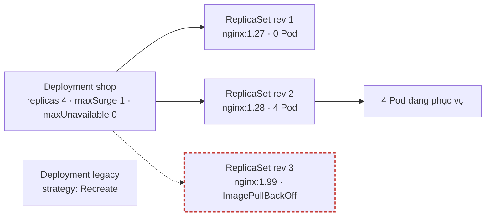
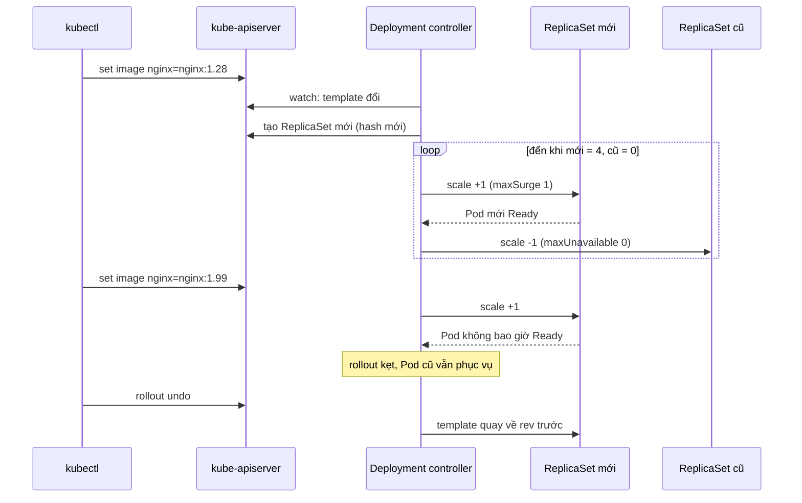

# Lab 05 · Deployment: scale, rolling update, rollback

**Cấp độ 2 · Workloads** · khoảng 30 phút · môi trường: kind hoặc kubeadm

Năng lực CKA: Workloads & Scheduling › Deployment, rolling update, rollback

Mức hỗ trợ: **Cầm tay chỉ việc**. Mỗi bước có lệnh, giải thích vì sao và kết quả bạn sẽ thấy. Lần đầu làm theo từng bước; lần hai đóng phần hướng dẫn lại và tự làm đề bài.

## Mục tiêu

Điều khiển vòng đời một Deployment: scale, chỉnh chiến lược cập nhật, nâng image có ghi chú, nhận ra rollout bị kẹt và quay lại phiên bản tốt.

## Cần làm trước

- [Lab 04 · Sinh YAML nhanh và trích xuất bằng jsonpath](../04-yaml-jsonpath/README.md)

## Kiến thức cần nắm

- Deployment quản lý ReplicaSet; mỗi lần đổi **Pod template** (image, env…) tạo ReplicaSet mới. Đổi `replicas` thì không.
- `RollingUpdate` với `maxSurge` (được tạo dư bao nhiêu Pod) và `maxUnavailable` (được thiếu bao nhiêu Pod sẵn sàng). `maxUnavailable: 0` là không gián đoạn. `Recreate` xóa hết Pod cũ rồi mới tạo mới.
- `kubectl rollout history` đọc annotation `kubernetes.io/change-cause` của từng ReplicaSet. `rollout undo --to-revision=N` quay về một revision; revision đó được đánh số mới.
- Image sai thì Pod mới đứng `ImagePullBackOff`. Với `maxUnavailable: 0`, Pod cũ vẫn phục vụ: rollout kẹt nhưng không sập dịch vụ.

## Sơ đồ

### Lab dựng gì


Mỗi lần đổi Pod template sinh một ReplicaSet mới. ReplicaSet cũ được giữ lại (tối đa `revisionHistoryLimit`) để rollback.

### Luồng hoạt động



## Chuẩn bị

```bash
./lab start 5
```

## Đề bài

1. Scale Deployment `shop` trong namespace `lab05` lên **4** replica.

2. Đặt chiến lược cho `shop`: `RollingUpdate`, `maxSurge: 1`, `maxUnavailable: 0`, và giữ tối đa **5** revision.

3. Nâng `shop` lên `nginx:1.28` với change-cause `nang cap nginx 1.28`. Chờ rollout xong.

4. Một đồng nghiệp đẩy `nginx:1.99` (không tồn tại) lên `shop`. Hãy làm điều đó, quan sát rollout kẹt, rồi **rollback** về revision chạy `nginx:1.28`.

5. Deployment `legacy` không được phép chạy hai phiên bản cùng lúc. Đổi chiến lược của nó sang `Recreate`.

## Hướng dẫn từng bước

### Bước 1 · Xem quan hệ Deployment → ReplicaSet → Pod

Deployment không tạo Pod trực tiếp. Nó tạo một ReplicaSet cho mỗi phiên bản của Pod template, và ReplicaSet giữ đúng số Pod.

```bash
./lab start 5
kubectl get deploy,rs,pods -n lab05 -l app=shop
```

> **Kết quả:** 1 Deployment, 1 ReplicaSet `shop-<hash>`, 2 Pod `shop-<hash>-<id>`. Phần `<hash>` là hash của Pod template.

### Bước 2 · Scale

Scale chỉ đổi `spec.replicas`, không đổi template, nên **không** sinh ReplicaSet mới.

```bash
kubectl scale deploy shop -n lab05 --replicas=4
kubectl get rs -n lab05 -l app=shop
```

> **Kết quả:** vẫn 1 ReplicaSet, DESIRED 4.

### Bước 3 · Đặt chiến lược rolling update

`maxSurge: 1` cho phép tạo thêm tối đa 1 Pod vượt số replica. `maxUnavailable: 0` không cho Pod cũ nào bị tắt trước khi Pod mới Ready. Kết hợp lại thì không bao giờ thiếu Pod phục vụ. `revisionHistoryLimit` là số ReplicaSet cũ được giữ lại để rollback.

```bash
kubectl patch deploy shop -n lab05 -p '{"spec":{"revisionHistoryLimit":5,"strategy":{"type":"RollingUpdate","rollingUpdate":{"maxSurge":1,"maxUnavailable":0}}}}'
kubectl get deploy shop -n lab05 -o jsonpath='{.spec.strategy}{"\n"}{.spec.revisionHistoryLimit}{"\n"}'
```

Làm bằng `kubectl edit deploy shop -n lab05` cũng được. Patch nhanh hơn khi bạn đã thuộc cấu trúc.

### Bước 4 · Nâng phiên bản và ghi lý do

`set image` đổi template, nên Deployment tạo ReplicaSet mới và chuyển Pod dần sang đó. Annotation `kubernetes.io/change-cause` hiện trong cột CHANGE-CAUSE của `rollout history`.

```bash
kubectl get deploy shop -n lab05 -o jsonpath='{.spec.template.spec.containers[0].name}'; echo   # tên container: nginx
kubectl set image deploy/shop -n lab05 nginx=nginx:1.28
kubectl annotate deploy/shop -n lab05 kubernetes.io/change-cause='nang cap nginx 1.28' --overwrite
kubectl rollout status deploy/shop -n lab05
kubectl get rs -n lab05 -l app=shop
```

> **Kết quả:** 2 ReplicaSet: cái mới 4/4, cái cũ 0/0 (được giữ lại để rollback).

### Bước 5 · Quan sát rollout kẹt

Với image không tồn tại, Pod mới không bao giờ Ready. Vì `maxUnavailable: 0`, 4 Pod cũ vẫn phục vụ: ứng dụng không chết.

```bash
kubectl set image deploy/shop -n lab05 nginx=nginx:1.99
kubectl annotate deploy/shop -n lab05 kubernetes.io/change-cause='thu nginx 1.99' --overwrite
kubectl rollout status deploy/shop -n lab05 --timeout=30s       # báo lỗi timeout
kubectl get pods -n lab05 -l app=shop                          # 4 Running + 1 ImagePullBackOff
```

### Bước 6 · Rollback

`rollout undo` quay về revision ngay trước đó. Dùng `--to-revision=N` để chọn revision cụ thể.

```bash
kubectl rollout history deploy/shop -n lab05
kubectl rollout undo deploy/shop -n lab05
kubectl rollout status deploy/shop -n lab05
kubectl get deploy shop -n lab05 -o jsonpath='{.spec.template.spec.containers[0].image}'; echo
```

> **Kết quả:** image trở về `nginx:1.28`. Trong history, revision của 1.28 được đánh số mới (revision cũ được "dời lên").

### Bước 7 · Chiến lược Recreate

`Recreate` tắt hết Pod cũ rồi mới tạo Pod mới, nên hai phiên bản không bao giờ chạy cùng lúc. Đổi sang Recreate phải xóa luôn khối `rollingUpdate`, nếu không API sẽ từ chối.

```bash
kubectl patch deploy legacy -n lab05 -p '{"spec":{"strategy":{"type":"Recreate","rollingUpdate":null}}}'
kubectl get deploy legacy -n lab05 -o jsonpath='{.spec.strategy}'; echo
./lab check 5
```

## Gợi ý

<details><summary>Ghi change-cause</summary>

Sau `kubectl set image`, chạy `kubectl annotate deploy/shop kubernetes.io/change-cause='…' --overwrite`.

</details>

<details><summary>Đổi sang Recreate</summary>

Khi chuyển sang `Recreate` phải xóa luôn khối `rollingUpdate`, nếu không API báo lỗi. `kubectl edit` hoặc patch với `"rollingUpdate": null`.

</details>

## Chấm bài

```bash
./lab check 5
```

Lời giải: [SOLUTION.md](SOLUTION.md) (chỉ mở sau khi đã tự làm).

## Dọn dẹp

```bash
./lab reset 5
```

## Tài liệu

- [Deployments](https://kubernetes.io/docs/concepts/workloads/controllers/deployment/)
- [kubectl rollout](https://kubernetes.io/docs/reference/kubectl/generated/kubectl_rollout/)

---

← [Lab 04 · Sinh YAML nhanh và trích xuất bằng jsonpath](../04-yaml-jsonpath/README.md) · [Lab 06 · ConfigMap và Secret](../06-configmap-secret/README.md) →
