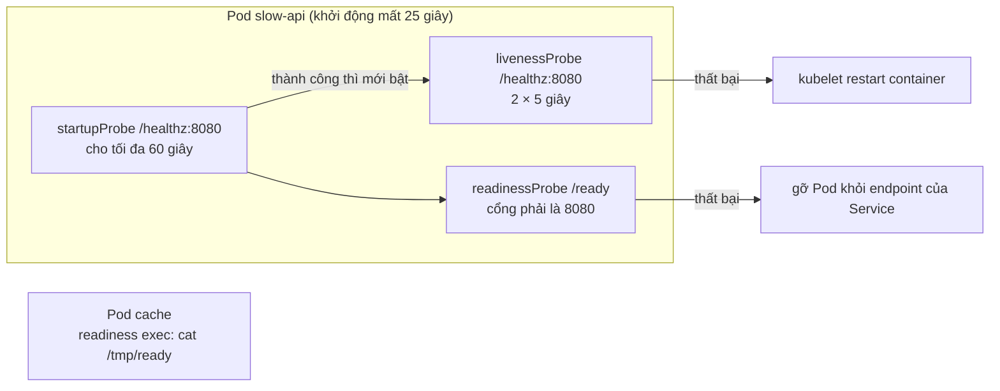
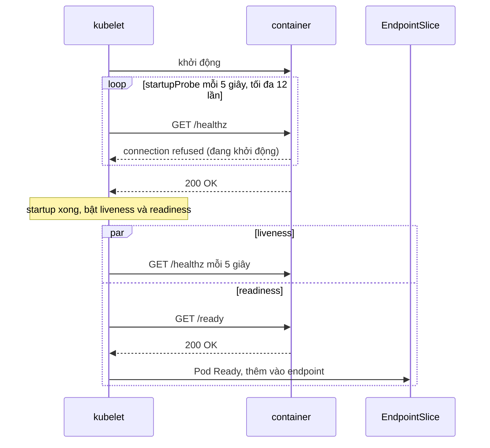

# Lab 07 · Liveness, readiness và startup probe

**Cấp độ 2 · Workloads** · khoảng 30 phút · môi trường: kind hoặc kubeadm

Năng lực CKA: Workloads & Scheduling › Primitive cho ứng dụng tự phục hồi; Troubleshooting › Quản lý và đánh giá output, log của container

Mức hỗ trợ: **Cầm tay chỉ việc**. Mỗi bước có lệnh, giải thích vì sao và kết quả bạn sẽ thấy. Lần đầu làm theo từng bước; lần hai đóng phần hướng dẫn lại và tự làm đề bài.

## Mục tiêu

Chẩn đoán một ứng dụng bị kubelet giết liên tục vì probe sai, sửa bằng startupProbe, và thêm readiness để Service chỉ gửi traffic khi Pod sẵn sàng.

## Cần làm trước

- [Lab 05 · Deployment: scale, rolling update, rollback](../05-deployment-rollout/README.md)

## Kiến thức cần nắm

- **liveness** trượt `failureThreshold` lần liên tiếp thì kubelet giết container. **readiness** trượt chỉ rút Pod khỏi EndpointSlice, không restart. **startup** chặn hai probe kia cho tới khi app khởi động xong; thời gian tối đa = `failureThreshold × periodSeconds`.
- Kiểu probe: `httpGet` (mã 200–399), `tcpSocket`, `exec` (thoát 0), `grpc`. Mặc định `periodSeconds: 10`, `timeoutSeconds: 1`, `failureThreshold: 3`.
- Dấu hiệu probe sai: event `Unhealthy` và `Killing`, RESTARTS tăng dần, `READY 0/1` dù `STATUS Running`.

## Sơ đồ

### Lab dựng gì



### Luồng hoạt động


Không có startupProbe, liveness chạy ngay từ giây đầu và giết container trước khi nó kịp khởi động xong.

## Chuẩn bị

```bash
./lab start 7
```

## Đề bài

1. Deployment `slow-api` trong `lab07` cần khoảng **25 giây** để khởi động và restart liên tục. Tìm probe nào gây restart, ghi tên probe (`liveness`, `readiness` hoặc `startup`) vào `~/cka-answers/07-culprit.txt`.

2. Sửa `slow-api` mà **không** tăng `initialDelaySeconds` của liveness: thêm `startupProbe` HTTP `GET /healthz` cổng 8080, cho phép tối đa ít nhất 60 giây để khởi động.

3. Readiness của `slow-api` đang trỏ sai cổng. Sửa để nó kiểm tra `GET /ready` cổng 8080. Cả 2 Pod phải `READY 1/1` và không restart nữa.

4. Deployment `cache` chưa có readiness. Thêm `readinessProbe` kiểu `exec` chạy `cat /tmp/ready`, chu kỳ 5 giây.

## Hướng dẫn từng bước

### Bước 1 · Ba loại probe làm gì

- **startupProbe**: chạy đầu tiên. Khi nó chưa thành công, kubelet chưa chạy hai probe còn lại. Thất bại quá `failureThreshold` thì kubelet restart container.
- **livenessProbe**: container còn sống không? Thất bại thì kubelet **restart** container.
- **readinessProbe**: container sẵn sàng nhận traffic chưa? Thất bại thì Pod bị **gỡ khỏi Service** (READY 0/1) nhưng không bị restart.

Thời gian tối đa cho một probe là `failureThreshold × periodSeconds`.

### Bước 2 · Quan sát lỗi

```bash
./lab start 7
kubectl get pods -n lab07 -w          # thấy RESTARTS tăng dần, Ctrl+C
kubectl describe pod -n lab07 -l app=slow-api | grep -A12 Events
```

> **Kết quả:** event `Liveness probe failed: … connection refused` rồi `Container api failed liveness probe, will be restarted`. App cần 25 giây nhưng liveness chỉ cho `2 × 5 = 10` giây.

```bash
echo liveness > ~/cka-answers/07-culprit.txt
```

### Bước 3 · Thêm startupProbe

Không kéo dài liveness, vì kéo dài thì khi app treo thật sẽ lâu mới bị phát hiện. Thay vào đó, startupProbe cho thời gian khởi động rộng rãi: `12 × 5 = 60` giây.

```bash
kubectl edit deploy slow-api -n lab07
```
```yaml
        startupProbe:
          httpGet: {path: /healthz, port: 8080}
          periodSeconds: 5
          failureThreshold: 12
```

### Bước 4 · Sửa readinessProbe

Trong cùng lần edit, sửa readiness đang trỏ cổng 8081 (không có gì lắng nghe) về 8080:

```yaml
        readinessProbe:
          httpGet: {path: /ready, port: 8080}
          periodSeconds: 5
```

Lưu thoát thì Deployment rollout Pod mới.

```bash
kubectl rollout status deploy/slow-api -n lab07 --timeout=180s
kubectl get pods -n lab07 -l app=slow-api
```

> **Kết quả:** sau khoảng 30 giây cả 2 Pod `1/1 Running`, RESTARTS 0.

### Bước 5 · readinessProbe kiểu exec

Probe `exec` chạy một lệnh trong container: mã thoát 0 là thành công. Thêm bằng JSON patch để khỏi mở editor:

```bash
kubectl patch deploy cache -n lab07 --type=json -p '[{"op":"add","path":"/spec/template/spec/containers/0/readinessProbe","value":{"exec":{"command":["cat","/tmp/ready"]},"periodSeconds":5}}]'
kubectl get pods -n lab07 -l app=cache -w
```

> **Kết quả:** Pod mới `0/1` trong khoảng 8 giây đầu (file chưa có), rồi `1/1`.

### Bước 6 · Chấm bài

```bash
./lab check 7
```

## Gợi ý

<details><summary>Xem probe nào đang trượt</summary>

`kubectl describe pod -n lab07 -l app=slow-api | grep -E 'Liveness|Readiness|Startup|Killing'`

</details>

<details><summary>Sửa nhanh</summary>

`kubectl edit deploy slow-api -n lab07`. Thêm `startupProbe` ngang hàng với `livenessProbe`.

</details>

## Chấm bài

```bash
./lab check 7
```

Lời giải: [SOLUTION.md](SOLUTION.md) (chỉ mở sau khi đã tự làm).

## Dọn dẹp

```bash
./lab reset 7
```

## Tài liệu

- [Configure liveness, readiness and startup probes](https://kubernetes.io/docs/tasks/configure-pod-container/configure-liveness-readiness-startup-probes/)
- [Pod lifecycle](https://kubernetes.io/docs/concepts/workloads/pods/pod-lifecycle/)

---

← [Lab 06 · ConfigMap và Secret](../06-configmap-secret/README.md) · [Lab 08 · Init container và sidecar container](../08-init-sidecar/README.md) →
