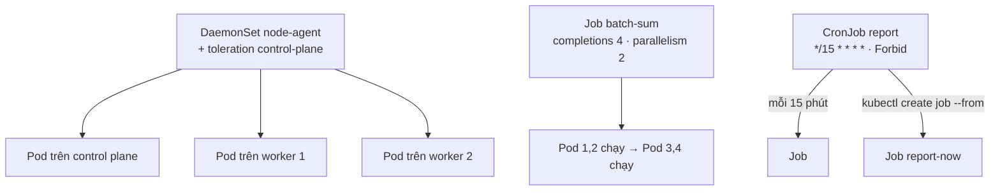
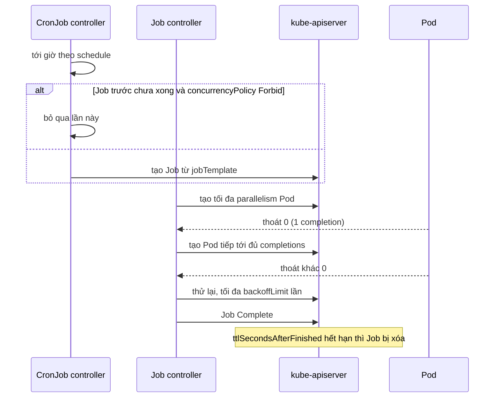

# Lab 09 · DaemonSet, Job và CronJob

**Cấp độ 2 · Workloads** · khoảng 30 phút · môi trường: kind hoặc kubeadm

Năng lực CKA: Workloads & Scheduling › Primitive cho ứng dụng tự phục hồi

Mức hỗ trợ: **Cầm tay chỉ việc**. Mỗi bước có lệnh, giải thích vì sao và kết quả bạn sẽ thấy. Lần đầu làm theo từng bước; lần hai đóng phần hướng dẫn lại và tự làm đề bài.

## Mục tiêu

Chọn đúng loại workload: một Pod trên mỗi node (DaemonSet), tác vụ chạy tới khi xong (Job), tác vụ theo lịch (CronJob).

## Cần làm trước

- [Lab 05 · Deployment: scale, rolling update, rollback](../05-deployment-rollout/README.md)

## Kiến thức cần nắm

- Không có `kubectl create daemonset`: sinh YAML Deployment rồi đổi `kind: DaemonSet`, bỏ `replicas` và `strategy`. Muốn chạy cả trên control plane phải tolerate taint `node-role.kubernetes.io/control-plane:NoSchedule`.
- Job: `completions` (cần bao nhiêu lần thành công), `parallelism` (chạy song song bao nhiêu), `backoffLimit` (số lần thử lại), `ttlSecondsAfterFinished` (tự xóa). `restartPolicy` chỉ được `Never` hoặc `OnFailure`.
- CronJob: `schedule` theo cú pháp cron, `concurrencyPolicy` (`Allow`, `Forbid`, `Replace`), giới hạn lịch sử job. `kubectl create job x --from=cronjob/y` chạy ngay một lần.

## Sơ đồ

### Lab dựng gì



### Luồng hoạt động



## Chuẩn bị

```bash
./lab start 9
```

## Đề bài

1. Trong `lab09`, tạo DaemonSet `node-agent` (image `busybox:1.36`, lệnh `sleep 3600`) chạy trên **mọi** node, kể cả control plane.

2. Tạo Job `batch-sum` (image `busybox:1.36`, lệnh `sh -c 'echo done'`) cần **4** lần thành công, chạy song song tối đa **2**, thử lại tối đa **2** lần, tự xóa sau **300** giây khi xong. Job phải hoàn thành.

3. Tạo CronJob `report` chạy mỗi 15 phút (image `busybox:1.36`, lệnh `date`), không cho chạy chồng (`Forbid`), giữ lại 2 job thành công.

4. Chạy ngay một lần CronJob `report` bằng Job tên `report-now`. Job phải hoàn thành.

## Hướng dẫn từng bước

### Bước 1 · DaemonSet: mỗi node một Pod

`kubectl create` không có lệnh cho DaemonSet. Mẹo: sinh YAML Deployment rồi đổi `kind`, xóa `replicas` và `strategy`.

```bash
./lab start 9
kubectl create deploy node-agent -n lab09 --image=busybox:1.36 $do -- sleep 3600 > ds.yaml
sed -i 's/kind: Deployment/kind: DaemonSet/; /replicas:/d; /strategy: {}/d' ds.yaml
kubectl apply -f ds.yaml
kubectl get ds,pods -n lab09 -o wide
```

> **Kết quả:** DESIRED 2: chỉ 2 worker. Control plane có taint `node-role.kubernetes.io/control-plane:NoSchedule` nên Pod không được đặt lên đó.

### Bước 2 · Toleration để chạy cả trên control plane

```bash
kubectl describe node "$CP" | grep Taints
vi ds.yaml
```
Thêm vào `spec.template.spec`:
```yaml
      tolerations:
      - key: node-role.kubernetes.io/control-plane
        operator: Exists
        effect: NoSchedule
```
```bash
kubectl apply -f ds.yaml
kubectl get ds node-agent -n lab09
```

> **Kết quả:** DESIRED 3, READY 3.

### Bước 3 · Job chạy nhiều lần

- `completions`: số lần cần thành công.
- `parallelism`: số Pod chạy cùng lúc.
- `backoffLimit`: số lần thử lại khi lỗi.
- `ttlSecondsAfterFinished`: tự xóa Job sau khi xong.

Pod của Job phải có `restartPolicy` là `Never` hoặc `OnFailure`.

```bash
kubectl create job batch-sum -n lab09 --image=busybox:1.36 $do -- sh -c 'echo done' > job.yaml
vi job.yaml        # thêm 4 trường trên vào spec (ngang hàng template)
```
```yaml
spec:
  completions: 4
  parallelism: 2
  backoffLimit: 2
  ttlSecondsAfterFinished: 300
  template:
```
```bash
kubectl apply -f job.yaml
kubectl get pods -n lab09 -l job-name=batch-sum -w
```

> **Kết quả:** Pod chạy theo từng cặp, Job đạt `COMPLETIONS 4/4`.

### Bước 4 · CronJob

Lịch theo cú pháp cron: `phút giờ ngày tháng thứ`. `*/15 * * * *` là mỗi 15 phút. `concurrencyPolicy: Forbid` bỏ qua lần chạy mới nếu lần trước chưa xong.

```bash
kubectl create cronjob report -n lab09 --image=busybox:1.36 --schedule='*/15 * * * *' $do -- date > cj.yaml
vi cj.yaml         # thêm vào spec:
```
```yaml
spec:
  concurrencyPolicy: Forbid
  successfulJobsHistoryLimit: 2
```
```bash
kubectl apply -f cj.yaml
```

### Bước 5 · Chạy CronJob ngay

Không cần chờ 15 phút: tạo Job từ template của CronJob. Đây là cách kiểm tra CronJob hay dùng nhất.

```bash
kubectl create job report-now -n lab09 --from=cronjob/report
kubectl logs -n lab09 job/report-now
./lab check 9
```

> **Kết quả:** log in ngày giờ hiện tại.

## Gợi ý

<details><summary>Sinh YAML Job và CronJob</summary>

`kubectl create job batch-sum --image=busybox:1.36 $do -- sh -c 'echo done'` và `kubectl create cronjob report --image=busybox:1.36 --schedule='*/15 * * * *' $do -- date`

</details>

## Chấm bài

```bash
./lab check 9
```

Lời giải: [SOLUTION.md](SOLUTION.md) (chỉ mở sau khi đã tự làm).

## Dọn dẹp

```bash
./lab reset 9
```

## Tài liệu

- [DaemonSet](https://kubernetes.io/docs/concepts/workloads/controllers/daemonset/)
- [Jobs](https://kubernetes.io/docs/concepts/workloads/controllers/job/)
- [CronJob](https://kubernetes.io/docs/concepts/workloads/controllers/cron-jobs/)

---

← [Lab 08 · Init container và sidecar container](../08-init-sidecar/README.md) · [Lab 10 · Requests, limits, LimitRange và ResourceQuota](../10-resources-quota/README.md) →
