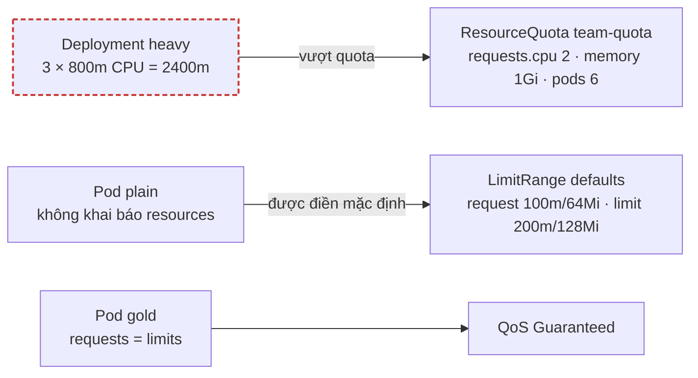
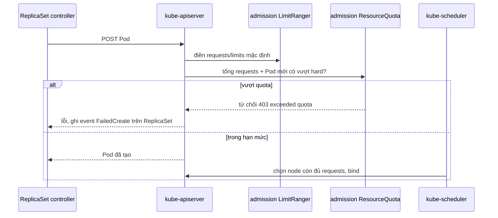

# Lab 10 · Requests, limits, LimitRange và ResourceQuota

**Cấp độ 2 · Workloads** · khoảng 35 phút · môi trường: kind hoặc kubeadm

Năng lực CKA: Workloads & Scheduling › Admission và scheduling của Pod; Troubleshooting › Theo dõi tài nguyên cluster và ứng dụng

Mức hỗ trợ: **Cầm tay chỉ việc**. Mỗi bước có lệnh, giải thích vì sao và kết quả bạn sẽ thấy. Lần đầu làm theo từng bước; lần hai đóng phần hướng dẫn lại và tự làm đề bài.

## Mục tiêu

Hiểu requests/limits tác động thế nào tới scheduling và QoS, tìm vì sao Deployment không đủ Pod khi namespace có quota, và đặt giá trị mặc định bằng LimitRange.

## Cần làm trước

- [Lab 05 · Deployment: scale, rolling update, rollback](../05-deployment-rollout/README.md)

## Kiến thức cần nắm

- Scheduler chỉ nhìn **requests**. Vượt memory **limit** thì container bị OOMKilled; vượt CPU limit thì bị throttle.
- QoS: `Guaranteed` (mọi container có requests = limits cho CPU và memory), `Burstable`, `BestEffort` (không đặt gì, bị evict đầu tiên).
- ResourceQuota giới hạn tổng của namespace. Khi quota có `requests.cpu`, mọi Pod **bắt buộc** khai báo requests CPU, nếu không bị từ chối.
- Pod bị quota từ chối không tồn tại, nên lỗi nằm ở **event của ReplicaSet** (`FailedCreate`), không ở Deployment.
- LimitRange điền requests/limits mặc định cho container không khai báo, và có thể đặt min/max.
- Quota sát giới hạn có thể làm rolling update **kẹt**: Deployment cần tạo Pod mới (maxSurge) trước khi xóa Pod cũ, nhưng quota không cho tạo. Gỡ bằng cách tạm tăng `maxUnavailable`, giảm `replicas`, hoặc nới quota.

## Sơ đồ

### Lab dựng gì



### Luồng hoạt động


Lỗi quota không tạo ra Pod lỗi nào, nên phải xem event của **ReplicaSet**, không phải của Pod.

## Chuẩn bị

```bash
./lab start 10
```

## Đề bài

1. Deployment `heavy` trong `lab10` muốn 3 replica nhưng chỉ có 2 Pod. Tìm resource nào của quota bị vượt (ví dụ `limits.memory`) và ghi vào `~/cka-answers/10-quota.txt`.

2. Sửa `heavy` để đủ 3 replica: requests `cpu: 200m`, `memory: 128Mi`; limits `memory: 256Mi`.

3. Tạo LimitRange `defaults` trong `lab10`: container không khai báo sẽ nhận request `cpu: 100m`, `memory: 64Mi` và limit `cpu: 200m`, `memory: 128Mi`.

4. Tạo Pod `plain` (image `nginx:1.27`, không khai báo resources). Nó phải chạy được nhờ LimitRange.

5. Tạo Pod `gold` (image `nginx:1.27`) thuộc QoS class `Guaranteed` với CPU 100m và memory 64Mi.

## Hướng dẫn từng bước

### Bước 1 · Requests và limits khác nhau thế nào

- **requests**: lượng tài nguyên scheduler **giữ chỗ** trên node; Pod chỉ được đặt lên node còn đủ.
- **limits**: mức trần lúc chạy. Vượt limit CPU thì bị bóp (throttle). Vượt limit memory thì bị kill (`OOMKilled`).

ResourceQuota giới hạn **tổng** requests và limits của cả namespace.

### Bước 2 · Tìm vì sao thiếu Pod

Khi Deployment thiếu Pod mà không thấy Pod lỗi nào, lỗi nằm ở **ReplicaSet**: nó không tạo được Pod. Xem event của nó.

```bash
./lab start 10
kubectl get deploy heavy -n lab10                  # READY 2/3
kubectl describe rs -n lab10 -l app=heavy | grep -i -A2 FailedCreate
kubectl describe quota team-quota -n lab10
```

> **Kết quả:** `exceeded quota: team-quota, requested: requests.cpu=800m, used: requests.cpu=1600m, limited: requests.cpu=2`.

```bash
echo requests.cpu > ~/cka-answers/10-quota.txt
```

### Bước 3 · Giảm requests

```bash
kubectl set resources deploy heavy -n lab10 --requests=cpu=200m,memory=128Mi --limits=memory=256Mi
kubectl rollout status deploy heavy -n lab10
kubectl describe quota team-quota -n lab10
```

> **Kết quả:** 3/3 Pod, cột Used của `requests.cpu` là `600m`.

Rolling update cần chỗ cho Pod mới **trước khi** xóa Pod cũ. Nếu quota đã kín, Pod mới không được tạo và rollout đứng im. Khi gặp tình huống này, tạm scale về ít replica hơn hoặc nới quota.

### Bước 4 · LimitRange: giá trị mặc định cho container

Khi namespace có quota cho `requests.cpu`, Pod **không** khai báo requests sẽ bị từ chối. LimitRange điền sẵn giá trị mặc định:

- `defaultRequest`: request mặc định.
- `default`: limit mặc định.

```bash
cat <<'EOF' | kubectl apply -f -
apiVersion: v1
kind: LimitRange
metadata: {name: defaults, namespace: lab10}
spec:
  limits:
  - type: Container
    defaultRequest: {cpu: 100m, memory: 64Mi}
    default: {cpu: 200m, memory: 128Mi}
EOF
kubectl run plain -n lab10 --image=nginx:1.27
kubectl get pod plain -n lab10 -o jsonpath='{.spec.containers[0].resources}'; echo
```

> **Kết quả:** Pod `plain` có requests và limits do LimitRange điền vào.

### Bước 5 · QoS class

- **Guaranteed**: mọi container có requests **bằng** limits cho cả CPU lẫn memory.
- **Burstable**: có requests nhưng không đạt Guaranteed.
- **BestEffort**: không có gì.

Khi node thiếu memory, kubelet đuổi BestEffort trước, Guaranteed sau cùng.

```bash
kubectl run gold -n lab10 --image=nginx:1.27 $do > gold.yaml
vi gold.yaml       # trong container:
```
```yaml
    resources:
      requests: {cpu: 100m, memory: 64Mi}
      limits: {cpu: 100m, memory: 64Mi}
```
```bash
kubectl apply -f gold.yaml
kubectl get pod gold plain -n lab10 -o custom-columns=NAME:.metadata.name,QOS:.status.qosClass
./lab check 10
```

> **Kết quả:** `gold Guaranteed`, `plain Burstable`.

## Gợi ý

<details><summary>Tìm lý do</summary>

`kubectl describe rs -n lab10 -l app=heavy | grep -A3 FailedCreate` và `kubectl describe quota -n lab10`

</details>

<details><summary>Sửa resources nhanh</summary>

`kubectl set resources deploy heavy -n lab10 --requests=cpu=200m,memory=128Mi --limits=memory=256Mi`

</details>

## Chấm bài

```bash
./lab check 10
```

Lời giải: [SOLUTION.md](SOLUTION.md) (chỉ mở sau khi đã tự làm).

## Dọn dẹp

```bash
./lab reset 10
```

## Tài liệu

- [Resource management for Pods and containers](https://kubernetes.io/docs/concepts/configuration/manage-resources-containers/)
- [Resource quotas](https://kubernetes.io/docs/concepts/policy/resource-quotas/)
- [Limit ranges](https://kubernetes.io/docs/concepts/policy/limit-range/)
- [Pod QoS classes](https://kubernetes.io/docs/concepts/workloads/pods/pod-qos/)

---

← [Lab 09 · DaemonSet, Job và CronJob](../09-daemonset-job-cronjob/README.md) · [Lab 11 · metrics-server và HorizontalPodAutoscaler](../11-hpa-metrics/README.md) →
