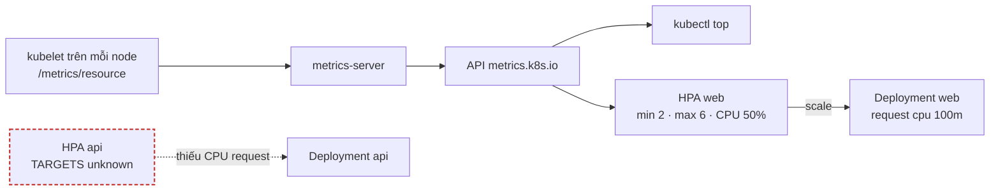
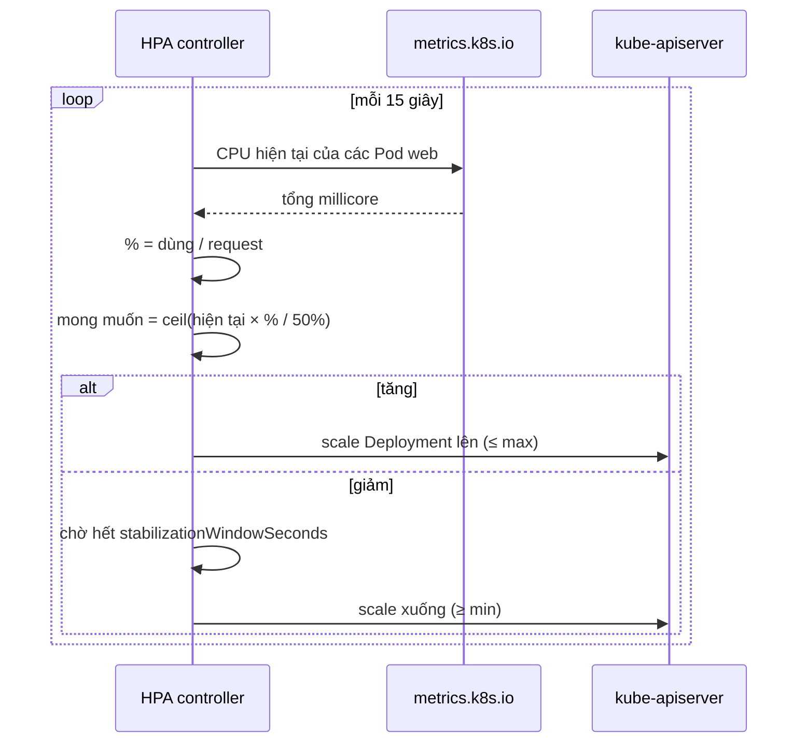

# Lab 11 · metrics-server và HorizontalPodAutoscaler

**Cấp độ 2 · Workloads** · khoảng 30 phút · môi trường: kind hoặc kubeadm

Năng lực CKA: Workloads & Scheduling › Autoscaling; Troubleshooting › Theo dõi tài nguyên cluster và ứng dụng

Mức hỗ trợ: **Cầm tay chỉ việc**. Mỗi bước có lệnh, giải thích vì sao và kết quả bạn sẽ thấy. Lần đầu làm theo từng bước; lần hai đóng phần hướng dẫn lại và tự làm đề bài.

## Mục tiêu

Theo dõi CPU/RAM bằng `kubectl top`, tạo HPA có behavior, và sửa HPA hiện `<unknown>` vì Pod không khai báo requests.

## Cần làm trước

- [Lab 10 · Requests, limits, LimitRange và ResourceQuota](../10-resources-quota/README.md)

## Kiến thức cần nắm

- metrics-server lấy số liệu từ kubelet và phục vụ Metrics API cho `kubectl top` và HPA. Lab 00 đã cài nó trên kind.
- HPA tính `desiredReplicas = ceil(replicas × giá trị hiện tại / mục tiêu)`. Utilization tính theo **requests**, nên Pod không có CPU request thì HPA không tính được (`<unknown>`).
- `behavior.scaleDown.stabilizationWindowSeconds` (mặc định 300) chống dao động: khi giảm, HPA lấy khuyến nghị cao nhất trong cửa sổ.

## Sơ đồ

### Lab dựng gì



### Luồng hoạt động



## Chuẩn bị

```bash
./lab start 11
```

## Đề bài

1. Ghi tên Pod trong namespace `kube-system` đang dùng **nhiều memory nhất** vào `~/cka-answers/11-top-pod.txt`.

2. Trong `lab11`, tạo HPA cho Deployment `web`: tối thiểu 2, tối đa 6 replica, mục tiêu CPU **50%**, và scale down chờ **60 giây**.

3. HPA `api` đã có sẵn nhưng hiển thị `<unknown>`. Sửa Deployment `api` để HPA đọc được metric (CPU request `100m`).

4. (Không chấm) Tạo tải để thấy HPA scale up: `kubectl run load -n lab11 --image=busybox:1.36 -- sh -c 'while true; do wget -qO- http://web >/dev/null; done'` rồi `kubectl get hpa -n lab11 -w`.

## Hướng dẫn từng bước

### Bước 1 · metrics-server là gì

metrics-server thu CPU và memory từ kubelet của mỗi node 15 giây một lần, rồi phục vụ qua API `metrics.k8s.io`. Cả `kubectl top` và HPA đọc từ API này. Nó **không** lưu lịch sử; muốn có lịch sử thì cần Prometheus.

```bash
./lab start 11
kubectl get apiservice v1beta1.metrics.k8s.io       # AVAILABLE True
kubectl top nodes
```

### Bước 2 · Tìm Pod tốn memory nhất

```bash
kubectl top pod -n kube-system --sort-by=memory
kubectl top pod -n kube-system --sort-by=memory --no-headers | head -1 | awk '{print $1}' > ~/cka-answers/11-top-pod.txt
cat ~/cka-answers/11-top-pod.txt
```

> **Kết quả:** thường là `kube-apiserver-…` hoặc `etcd-…`. Thêm `--containers` để xem theo từng container.

### Bước 3 · Tạo HPA

HPA tính `số replica mong muốn = ceil(replica hiện tại × mức dùng hiện tại / mục tiêu)`. Mức dùng tính theo **phần trăm của CPU request**, nên Pod không có request thì HPA không tính được.

```bash
kubectl autoscale deploy web -n lab11 --min=2 --max=6 --cpu=50% $do > hpa.yaml
cat hpa.yaml
```

Cờ cũ `--cpu-percent=50` vẫn chạy nhưng đã bị đánh dấu deprecated từ kubectl v1.34.

### Bước 4 · Thêm behavior

`kubectl autoscale` không có cờ cho `behavior`, phải sửa YAML. `stabilizationWindowSeconds` của scaleDown là số giây HPA chờ, sau khi tải giảm, trước khi giảm replica. Nó chống việc scale lên xuống liên tục.

```bash
vi hpa.yaml        # thêm vào spec:
```
```yaml
  behavior:
    scaleDown:
      stabilizationWindowSeconds: 60
```
```bash
kubectl apply -f hpa.yaml
kubectl get hpa -n lab11
```

> **Kết quả:** `web` có MINPODS 2, MAXPODS 6; Deployment `web` lên 2 replica.

### Bước 5 · Sửa HPA hiển thị unknown

```bash
kubectl get hpa api -n lab11                         # TARGETS cpu: <unknown>/70%
kubectl describe hpa api -n lab11 | grep -i -A3 warning
kubectl set resources deploy api -n lab11 --requests=cpu=100m
```

> **Kết quả:** event `missing request for cpu`. Sau khi thêm request và chờ khoảng 1 phút, TARGETS hiện dạng `0%/70%`.

### Bước 6 · Xem HPA scale (không chấm)

```bash
kubectl run load -n lab11 --image=busybox:1.36 -- sh -c 'while true; do wget -qO- http://web >/dev/null; done'
kubectl get hpa web -n lab11 -w          # chờ 1–2 phút
kubectl delete pod load -n lab11
./lab check 11
```

## Gợi ý

<details><summary>Sắp xếp theo memory</summary>

`kubectl top pod -n kube-system --sort-by=memory --no-headers | head -1`

</details>

<details><summary>HPA có behavior</summary>

`kubectl autoscale` không đặt được behavior. Sinh YAML (`$do`) rồi thêm `spec.behavior`.

</details>

## Chấm bài

```bash
./lab check 11
```

Lời giải: [SOLUTION.md](SOLUTION.md) (chỉ mở sau khi đã tự làm).

## Dọn dẹp

```bash
./lab reset 11
```

## Tài liệu

- [Horizontal Pod Autoscaling](https://kubernetes.io/docs/tasks/run-application/horizontal-pod-autoscale/)
- [HPA walkthrough](https://kubernetes.io/docs/tasks/run-application/horizontal-pod-autoscale-walkthrough/)
- [Resource metrics pipeline](https://kubernetes.io/docs/tasks/debug/debug-cluster/resource-metrics-pipeline/)

---

← [Lab 10 · Requests, limits, LimitRange và ResourceQuota](../10-resources-quota/README.md) · [Lab 12 · nodeSelector, node affinity, taint và toleration](../12-node-selection/README.md) →
