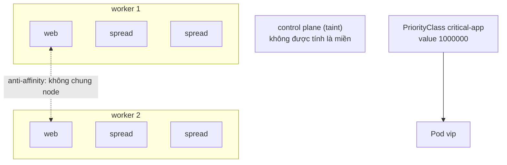
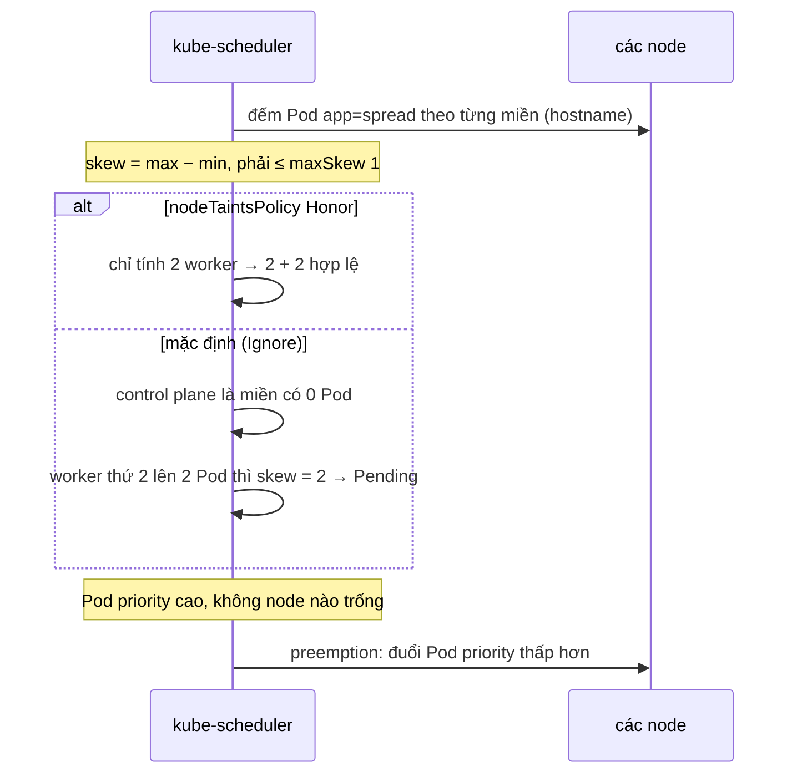

# Lab 13 · Anti-affinity, topology spread và PriorityClass

**Cấp độ 3 · Scheduling** · khoảng 30 phút · môi trường: kind hoặc kubeadm

Năng lực CKA: Workloads & Scheduling › Admission và scheduling của Pod

Mức hỗ trợ: **Dẫn hướng**. Mỗi câu chỉ ra chỗ tra tài liệu, khung lệnh và cách tự kiểm, nhưng không đưa đáp án. Hãy thử tự làm trước, kẹt mới mở.

## Mục tiêu

Tách replica ra các node khác nhau để chịu lỗi, chia đều Pod theo topology, và gán độ ưu tiên cho workload quan trọng.

## Cần làm trước

- [Lab 12 · nodeSelector, node affinity, taint và toleration](../12-node-selection/README.md)

## Kiến thức cần nắm

- `podAntiAffinity` với `topologyKey: kubernetes.io/hostname` cấm hai Pod cùng label nằm chung node. Nếu `required` mà không đủ node, Pod thừa đứng Pending.
- `topologySpreadConstraints`: `maxSkew` là chênh lệch tối đa giữa các miền, `whenUnsatisfiable: DoNotSchedule` (cứng) hoặc `ScheduleAnyway`. `nodeTaintsPolicy: Honor` loại khỏi phép tính các node có taint mà Pod không tolerate (mặc định là `Ignore`, tức vẫn tính).
- PriorityClass gán số ưu tiên; Pod ưu tiên cao có thể **preempt** (đuổi) Pod thấp hơn khi thiếu chỗ. Một PriorityClass có thể là `globalDefault`.

## Sơ đồ

### Lab dựng gì



### Luồng hoạt động



## Chuẩn bị

```bash
./lab start 13
```

## Đề bài

1. Trong `lab13`, tạo Deployment `web` (2 replica, `nginx:1.27`, label `app=web`) mà hai Pod **bắt buộc** nằm trên hai node khác nhau.

2. Tạo Deployment `spread` (4 replica, `nginx:1.27`, label `app=spread`) chia đều theo node (`kubernetes.io/hostname`), `maxSkew: 1`, không được vi phạm. Cả 4 Pod phải chạy.

3. Cluster có một PriorityClass là mặc định toàn cục. Ghi tên của nó vào `~/cka-answers/13-default-pc.txt`.

4. Tạo PriorityClass `critical-app` với value `1000000`, không phải mặc định, mô tả `payment`. Tạo Pod `vip` (`nginx:1.27`) dùng nó.

## Cách tiếp cận

### Câu 1 · Pod anti-affinity bắt buộc

**Tra:** trang *Assigning Pods to Nodes*, mục *Inter-pod affinity and anti-affinity*.

**Khung:** trong `template.spec.affinity.podAntiAffinity.requiredDuringSchedulingIgnoredDuringExecution[]` cần hai trường: `topologyKey` (miền: mỗi node là một miền) và `labelSelector` (tránh Pod nào: chính các Pod `app=web`).

**Tự kiểm:** `kubectl get pods -n lab13 -l app=web -o wide`. Hai Pod nằm ở hai NODE khác nhau. Thử `kubectl scale … --replicas=3`: Pod thứ 3 phải Pending, rồi scale lại về 2.

### Câu 2 · Topology spread

**Tra:** trang *Pod Topology Spread Constraints*. Các trường cần có: `maxSkew`, `topologyKey`, `whenUnsatisfiable`, `labelSelector`.

**Tự kiểm:** `kubectl get pods -n lab13 -l app=spread -o wide`. Phải có 4 Pod Running, 2 + 2.

**Bẫy:** nếu chỉ 2 Pod chạy và 2 Pending, đọc `kubectl describe pod` của Pod Pending, rồi xem lại trong trang tài liệu trường nào quyết định node **có taint** có được tính là một miền không.

### Câu 3 · PriorityClass mặc định

**Khung:** `kubectl get priorityclass`, rồi xem cột `GLOBAL-DEFAULT`.

### Câu 4 · Tạo và dùng PriorityClass

**Khung:** `kubectl create priorityclass --help` có đủ cờ: value, description, global-default. Pod dùng nó qua trường `spec.priorityClassName`.

**Tự kiểm:** `kubectl get pod vip -n lab13 -o jsonpath='{.spec.priority}'`. Admission controller đã điền số `1000000` vào Pod.

## Gợi ý

<details><summary>spread chỉ chạy được 2 Pod?</summary>

Control plane cũng được tính là một "miền" với 0 Pod, nên mỗi worker chỉ được 1 Pod. Đặt `nodeTaintsPolicy: Honor` để bỏ qua node có taint mà Pod không tolerate.

</details>

<details><summary>Tìm PriorityClass mặc định</summary>

`kubectl get priorityclass` rồi xem cột `GLOBAL-DEFAULT`.

</details>

## Chấm bài

```bash
./lab check 13
```

Lời giải: [SOLUTION.md](SOLUTION.md) (chỉ mở sau khi đã tự làm).

## Dọn dẹp

```bash
./lab reset 13
```

## Tài liệu

- [Inter-pod affinity and anti-affinity](https://kubernetes.io/docs/concepts/scheduling-eviction/assign-pod-node/#inter-pod-affinity-and-anti-affinity)
- [Pod topology spread constraints](https://kubernetes.io/docs/concepts/scheduling-eviction/topology-spread-constraints/)
- [Pod priority and preemption](https://kubernetes.io/docs/concepts/scheduling-eviction/pod-priority-preemption/)

---

← [Lab 12 · nodeSelector, node affinity, taint và toleration](../12-node-selection/README.md) · [Lab 14 · Static pod, lập lịch thủ công và bảo trì node](../14-static-pod-maintenance/README.md) →
