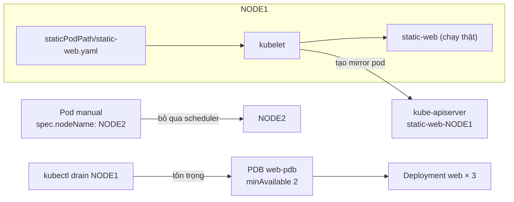
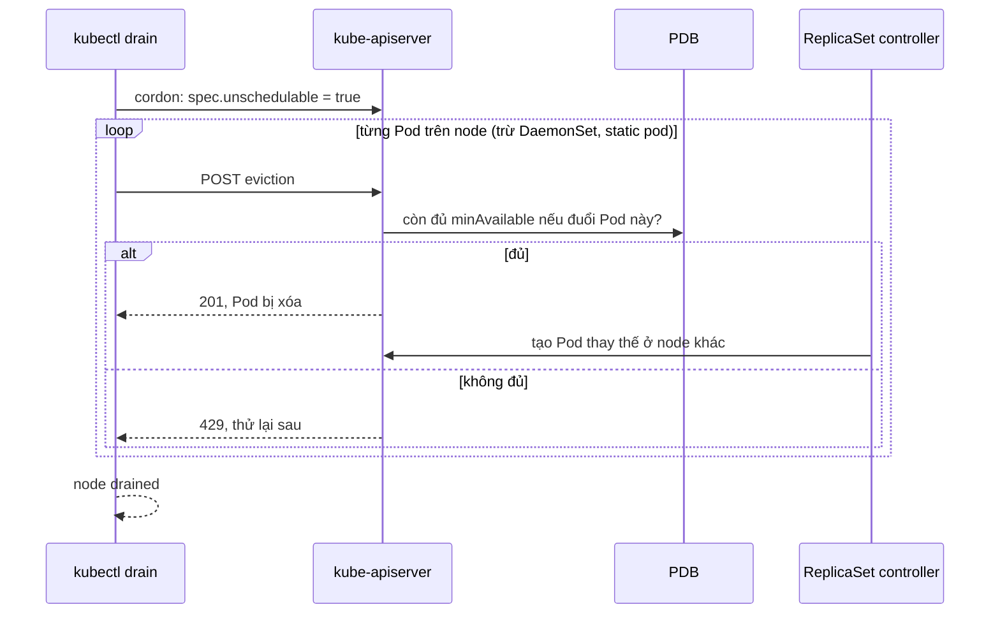

# Lab 14 · Static pod, lập lịch thủ công và bảo trì node

**Cấp độ 3 · Scheduling** · khoảng 35 phút · môi trường: kind hoặc kubeadm (cần vào node)

Năng lực CKA: Workloads & Scheduling › Admission và scheduling của Pod; Workloads & Scheduling › Primitive cho ứng dụng tự phục hồi; Troubleshooting › Troubleshoot cluster và node

Mức hỗ trợ: **Dẫn hướng**. Mỗi câu chỉ ra chỗ tra tài liệu, khung lệnh và cách tự kiểm, nhưng không đưa đáp án. Hãy thử tự làm trước, kẹt mới mở.

## Mục tiêu

Chạy Pod không qua scheduler (static pod, `nodeName`), và đưa một node vào bảo trì an toàn với PodDisruptionBudget, `cordon` và `drain`.

## Cần làm trước

- [Lab 12 · nodeSelector, node affinity, taint và toleration](../12-node-selection/README.md)

## Kiến thức cần nắm

- **Static pod**: kubelet đọc file YAML trong `staticPodPath` (kubeadm: `/etc/kubernetes/manifests`) và chạy Pod mà không cần API server. API chỉ thấy một "mirror pod" tên `<tên>-<node>`; xóa bằng kubectl không có tác dụng, phải xóa file.
- Đặt `spec.nodeName` thì bỏ qua scheduler: kubelet của node đó nhận Pod luôn. Hữu ích khi scheduler chết.
- `cordon` chặn Pod mới; `drain` = cordon + đuổi Pod qua Eviction API, tôn trọng **PodDisruptionBudget**. DaemonSet và mirror pod không bị đuổi; cần `--ignore-daemonsets`, `--delete-emptydir-data`.

## Sơ đồ

### Lab dựng gì



### Luồng hoạt động



## Chuẩn bị

```bash
./lab start 14
```

## Đề bài

1. Tạo static pod `static-web` (image `nginx:1.27`) trên `$NODE1`. Tìm đúng thư mục từ cấu hình kubelet của node.

2. Giả sử scheduler đang hỏng. Tạo Pod `manual` (image `nginx:1.27`) trong `lab14` chạy trên `$NODE2` **mà không qua scheduler**.

3. Deployment `web` trong `lab14` có 3 replica. Tạo PodDisruptionBudget `web-pdb` đảm bảo luôn còn ít nhất 2 Pod `app=web`.

4. Đưa `$NODE1` vào bảo trì: không nhận Pod mới và mọi Pod thường đã dời đi. Để nguyên trạng thái này khi chấm; `./lab reset 14` sẽ đưa node trở lại.

## Cách tiếp cận

### Câu 1 · Static pod

Static pod do **kubelet** đọc từ một thư mục trên node, không qua API server. API server chỉ thấy một "mirror pod" tên `<tên>-<node>`.

**Tra:** cấu hình kubelet ở `/var/lib/kubelet/config.yaml`, trường `staticPodPath`. Nếu không có file đó, xem cờ kubelet: `ps aux | grep kubelet`.

**Khung:** sinh YAML bằng `kubectl run … $do` ở máy bạn, `./lab ssh $NODE1`, rồi ghi file vào thư mục tìm được.

**Tự kiểm:** `kubectl get pods -A | grep static-web`.

**Bẫy:** xóa mirror pod bằng kubectl thì nó sống lại ngay. Muốn xóa static pod thì xóa file trên node.

### Câu 2 · Lập lịch thủ công

Scheduler chỉ làm một việc: điền trường `spec.nodeName`. Tự điền trường này thì Pod bỏ qua scheduler.

**Khung:** YAML Pod + `nodeName: <tên node>` trong `spec`.

**Bẫy:** `nodeName` phải có **khi tạo** Pod. Pod đã Pending thì không sửa được, phải xóa đi tạo lại.

### Câu 3 · PodDisruptionBudget

**Khung:** `kubectl create pdb --help` (`--selector`, `--min-available`).

**Tự kiểm:** `kubectl get pdb -n lab14`. Cột `ALLOWED DISRUPTIONS` là 1 (3 Pod − 2 tối thiểu).

### Câu 4 · Bảo trì node

`cordon` chỉ chặn Pod mới. `drain` = cordon + đuổi Pod đang chạy (có tôn trọng PDB).

**Khung:** `kubectl drain <node>` cùng các cờ cho DaemonSet và emptyDir. Đọc thông báo lỗi: nó nói đúng cờ còn thiếu.

**Tự kiểm:** `kubectl get nodes` thấy `SchedulingDisabled`; `kubectl get pods -A -o wide | grep $NODE1` chỉ còn Pod của DaemonSet và static pod.

**Bẫy:** Pod không có controller (Pod trần) chặn drain. Đọc kỹ thông báo trước khi thêm `--force`, vì Pod đó sẽ mất hẳn.

## Gợi ý

<details><summary>Tìm thư mục static pod</summary>

`./lab ssh $NODE1` rồi `grep staticPodPath /var/lib/kubelet/config.yaml`

</details>

<details><summary>Drain bị chặn?</summary>

Đọc thông báo: thường do DaemonSet (`--ignore-daemonsets`), Pod dùng emptyDir (`--delete-emptydir-data`), hoặc Pod không có controller (Pod trần, cần `--force`, và Pod đó sẽ mất hẳn). Pod trần còn sót từ lab khác: `./lab reset <id>` hoặc thêm `--force`.

</details>

## Chấm bài

```bash
./lab check 14
```

Lời giải: [SOLUTION.md](SOLUTION.md) (chỉ mở sau khi đã tự làm).

## Dọn dẹp

```bash
./lab reset 14
```

## Tài liệu

- [Create static Pods](https://kubernetes.io/docs/tasks/configure-pod-container/static-pod/)
- [Safely drain a node](https://kubernetes.io/docs/tasks/administer-cluster/safely-drain-node/)
- [Disruptions](https://kubernetes.io/docs/concepts/workloads/pods/disruptions/)

---

← [Lab 13 · Anti-affinity, topology spread và PriorityClass](../13-spread-priority/README.md) · [Lab 15 · Service, EndpointSlice và kết nối giữa các Pod](../15-services/README.md) →
