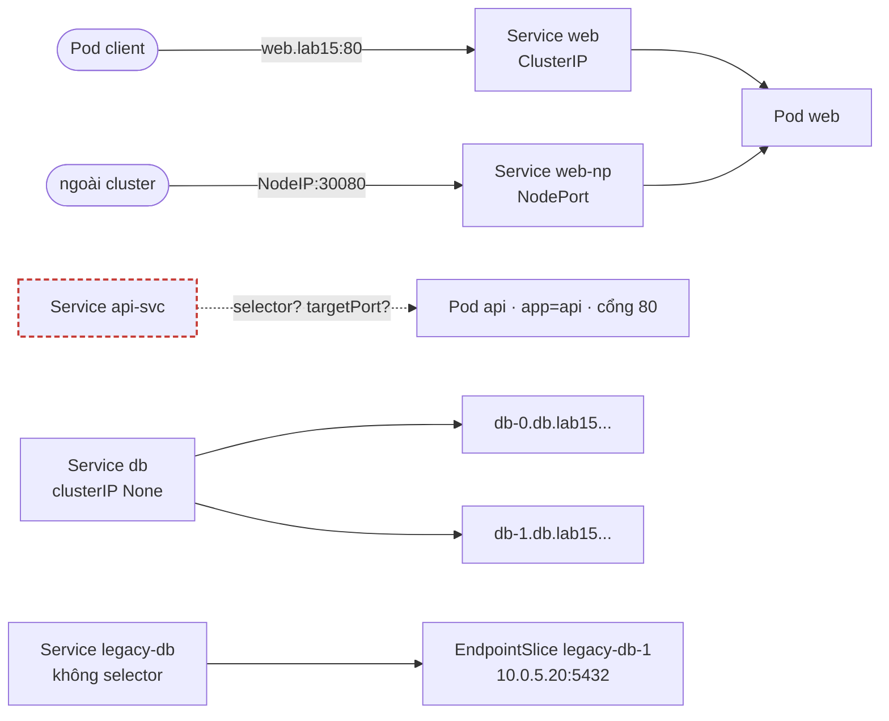
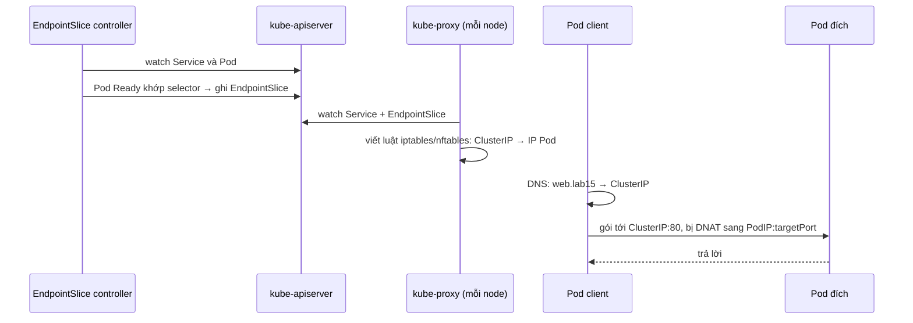

# Lab 15 · Service, EndpointSlice và kết nối giữa các Pod

**Cấp độ 4 · Services & Networking** · khoảng 35 phút · môi trường: kind hoặc kubeadm

Năng lực CKA: Services & Networking › Service ClusterIP, NodePort, LoadBalancer và endpoints; Services & Networking › Kết nối giữa các Pod; Troubleshooting › Troubleshoot Service và networking

Mức hỗ trợ: **Dẫn hướng**. Mỗi câu chỉ ra chỗ tra tài liệu, khung lệnh và cách tự kiểm, nhưng không đưa đáp án. Hãy thử tự làm trước, kẹt mới mở.

## Mục tiêu

Tạo đủ loại Service, hiểu Service tìm Pod bằng selector và EndpointSlice, sửa Service không có endpoint, và trỏ Service ra ngoài cluster.

## Cần làm trước

- [Lab 05 · Deployment: scale, rolling update, rollback](../05-deployment-rollout/README.md)

## Kiến thức cần nắm

- Service chọn Pod bằng **label selector**; EndpointSlice controller ghi IP:port của các Pod **Ready** khớp selector. Service không có endpoint gần như luôn do selector sai hoặc Pod chưa Ready.
- `port` là cổng của Service, `targetPort` là cổng của container (có thể dùng tên cổng), `nodePort` là cổng mở trên mọi node (30000–32767).
- **Headless** (`clusterIP: None`): DNS trả thẳng IP Pod; với StatefulSet mỗi Pod có tên riêng `db-0.db.<ns>.svc.cluster.local`.
- Service **không selector** cộng EndpointSlice tự tạo (label `kubernetes.io/service-name`) để trỏ tới máy ngoài cluster.

## Sơ đồ

### Lab dựng gì



### Luồng hoạt động


ClusterIP là IP ảo: không có tiến trình nào lắng nghe trên nó, chỉ có luật NAT trên mỗi node.

## Chuẩn bị

```bash
./lab start 15
```

## Đề bài

1. Trong `lab15`, expose Deployment `web` thành Service ClusterIP tên `web`, cổng 80. Ghi ClusterIP của nó vào `~/cka-answers/15-web-ip.txt`.

2. Tạo Service `web-np` kiểu NodePort cho `web`: cổng 80, nodePort `30080`.

3. Service `api-svc` không trả lời. Sửa nó (không sửa Deployment `api`) để gọi `http://api-svc.lab15` từ Pod khác nhận được trang nginx.

4. StatefulSet `db` đã có nhưng thiếu Service. Tạo headless Service `db` cổng 5432 để tên `db-0.db.lab15.svc.cluster.local` phân giải được.

5. Tạo Service `legacy-db` (cổng 5432, không selector) trỏ tới máy `10.0.5.20:5432` bằng một EndpointSlice tự viết tên `legacy-db-1`.

## Cách tiếp cận

### Câu 1 · Expose ClusterIP

**Khung:** `kubectl expose deploy <tên> --port=…`, rồi lấy `spec.clusterIP` bằng jsonpath và ghi vào file.

### Câu 2 · NodePort cố định

`kubectl expose` không có cờ để chọn nodePort.

**Khung:** `kubectl expose … --name=web-np --type=NodePort $do > np.yaml`, thêm `nodePort: 30080` vào `ports[0]`, rồi apply.

**Tự kiểm:** `kubectl get svc web-np -n lab15` hiện cột PORT(S) `80:30080/TCP`.

### Câu 3 · Service không trả lời

Service nối với Pod qua hai thứ, phải kiểm tra **cả hai**:

1. `selector` của Service phải khớp **label** của Pod.
2. `targetPort` phải là cổng container **thật sự lắng nghe**.

**Khung:** so `kubectl get svc api-svc -o yaml` với `kubectl get pods --show-labels` và `containerPort` của Pod.

**Tự kiểm:** `kubectl get endpointslices -n lab15 -l kubernetes.io/service-name=api-svc` có địa chỉ, rồi `kubectl run t --rm -it --image=busybox:1.36 -n lab15 --restart=Never -- wget -qO- -T3 api-svc`.

### Câu 4 · Headless Service cho StatefulSet

Headless (`clusterIP: None`) không có IP ảo. DNS trả thẳng IP của Pod, và mỗi Pod của StatefulSet có tên riêng `<pod>.<service>`.

**Khung:** `kubectl create svc clusterip --help`, tìm cờ cho clusterIP None.

**Bẫy:** tên Service phải trùng `spec.serviceName` của StatefulSet. Selector phải khớp label Pod: kiểm tra Service `create svc` sinh selector gì.

### Câu 5 · Service trỏ ra ngoài cluster

Service **không có selector** thì control plane không tạo EndpointSlice, bạn tự viết.

**Tra:** trang *Service*, mục *Services without selectors*, có YAML EndpointSlice mẫu.

**Bẫy:** label `kubernetes.io/service-name` nối EndpointSlice với Service. Thiếu label này thì Service không dùng nó.

## Gợi ý

<details><summary>Vì sao Service không có endpoint?</summary>

So `kubectl get svc api-svc -n lab15 -o jsonpath='{.spec.selector}'` với `kubectl get pods -n lab15 --show-labels`, và `targetPort` với cổng container.

</details>

<details><summary>Thử gọi Service</summary>

`kubectl run t -n lab15 --rm -it --image=busybox:1.36 --restart=Never -- wget -qO- -T3 api-svc`

</details>

## Chấm bài

```bash
./lab check 15
```

Lời giải: [SOLUTION.md](SOLUTION.md) (chỉ mở sau khi đã tự làm).

## Dọn dẹp

```bash
./lab reset 15
```

## Tài liệu

- [Service](https://kubernetes.io/docs/concepts/services-networking/service/)
- [EndpointSlices](https://kubernetes.io/docs/concepts/services-networking/endpoint-slices/)
- [Debug Services](https://kubernetes.io/docs/tasks/debug/debug-application/debug-service/)

---

← [Lab 14 · Static pod, lập lịch thủ công và bảo trì node](../14-static-pod-maintenance/README.md) · [Lab 16 · DNS trong cluster và CoreDNS](../16-dns-coredns/README.md) →
