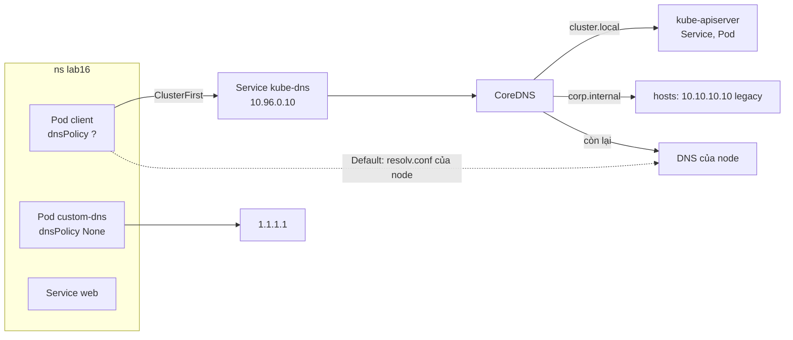
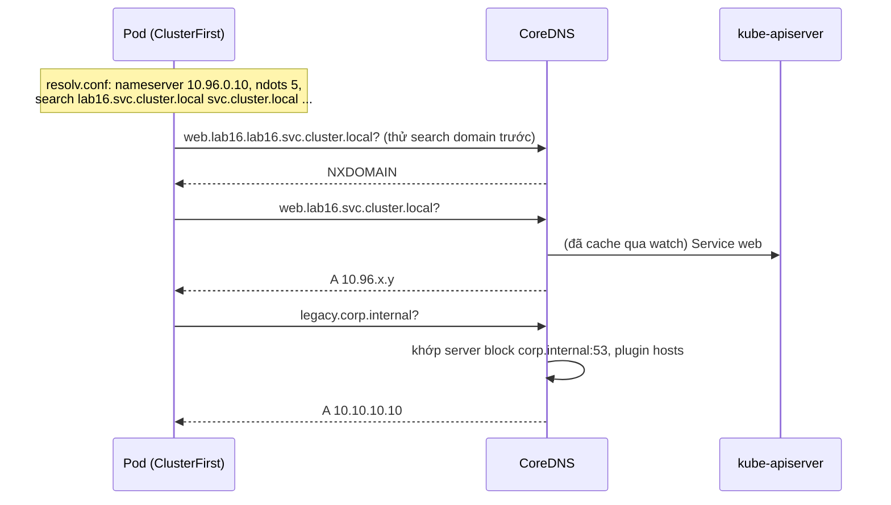

# Lab 16 · DNS trong cluster và CoreDNS

**Cấp độ 4 · Services & Networking** · khoảng 30 phút · môi trường: kind hoặc kubeadm

Năng lực CKA: Services & Networking › CoreDNS; Troubleshooting › Troubleshoot Service và networking

Mức hỗ trợ: **Dẫn hướng**. Mỗi câu chỉ ra chỗ tra tài liệu, khung lệnh và cách tự kiểm, nhưng không đưa đáp án. Hãy thử tự làm trước, kẹt mới mở.

## Mục tiêu

Hiểu tên DNS của Service và Pod, đọc cấu hình DNS của Pod, tùy chỉnh `dnsPolicy`, và sửa Corefile của CoreDNS để phân giải tên nội bộ của công ty.

## Cần làm trước

- [Lab 15 · Service, EndpointSlice và kết nối giữa các Pod](../15-services/README.md)

## Kiến thức cần nắm

- Service: `<svc>.<ns>.svc.<cluster-domain>` (mặc định `cluster.local`). Pod đọc `/etc/resolv.conf`: nameserver là ClusterIP của Service `kube-dns`, có `search <ns>.svc.cluster.local svc.cluster.local cluster.local` và `ndots:5`.
- `dnsPolicy`: `ClusterFirst` (mặc định, dùng CoreDNS), `Default` (dùng DNS của node, **không** phân giải được Service), `None` (tự khai báo trong `dnsConfig`).
- CoreDNS cấu hình bằng ConfigMap `coredns` trong `kube-system` (Corefile). Có thể thêm server block riêng cho một zone. Plugin `reload` tự nạp lại sau khoảng 30 giây; muốn nhanh thì `kubectl -n kube-system rollout restart deploy coredns`.

## Sơ đồ

### Lab dựng gì



### Luồng hoạt động



## Chuẩn bị

```bash
./lab start 16
```

## Đề bài

1. Ghi ClusterIP của Service DNS của cluster vào `~/cka-answers/16-dns-ip.txt`, và cluster domain vào `~/cka-answers/16-domain.txt`.

2. Pod `client` trong `lab16` không phân giải được tên Service nào. Tìm nguyên nhân và sửa để từ `client` chạy `nslookup web.lab16` thành công. Giữ nguyên tên Pod và image.

3. Tạo Pod `custom-dns` (image `busybox:1.36`, lệnh `sleep 3600`) **chỉ** dùng nameserver `1.1.1.1`, search domain `lab16.svc.cluster.local`, option `ndots: 2`.

4. Công ty có máy `legacy.corp.internal` ở `10.10.10.10` mà DNS công cộng không biết. Sửa CoreDNS để mọi Pod phân giải được tên này, không làm hỏng DNS của cluster.

## Cách tiếp cận

### Câu 1 · DNS Service và cluster domain

**Khung:** Service DNS nằm trong `kube-system`, tên lịch sử là `kube-dns`. Cluster domain nằm ở hai chỗ: Corefile (`kubernetes <domain> …`) và cấu hình kubelet (`clusterDomain`). Có thể xem nhanh trong `/etc/resolv.conf` của một Pod bất kỳ.

### Câu 2 · Pod không phân giải được tên Service

**Tra:** trang *DNS for Services and Pods*, mục *Pod's DNS Policy*. Đọc kỹ ý nghĩa của `Default`: nó **không** phải giá trị mặc định.

**Khung:** `kubectl exec client -n lab16 -- cat /etc/resolv.conf`, so với Pod khác. Trường này không sửa được trên Pod đang chạy: xuất YAML, sửa, `kubectl replace --force -f`.

**Tự kiểm:** `kubectl exec client -n lab16 -- nslookup web.lab16`.

### Câu 3 · dnsPolicy None + dnsConfig

**Tra:** cùng trang, mục *Pod's DNS Config*, có YAML mẫu.

**Tự kiểm:** `kubectl exec custom-dns -n lab16 -- cat /etc/resolv.conf` có đúng 3 dòng `nameserver`, `search`, `options`.

### Câu 4 · Thêm zone vào CoreDNS

**Tra:** trang *Customizing DNS Service*, có ví dụ server block cho một domain riêng. Plugin `hosts` của CoreDNS khai báo tên → IP tĩnh.

**Khung:** `kubectl -n kube-system edit cm coredns`, thêm một server block `corp.internal:53 { … }` **ở ngoài** block `.:53`, rồi `rollout restart` CoreDNS.

**Tự kiểm:** `kubectl -n kube-system logs deploy/coredns` không có lỗi; `nslookup legacy.corp.internal` từ một Pod mới.

**Bẫy:** sai một dấu ngoặc là CoreDNS CrashLoop và **cả cluster** mất DNS. Luôn sao lưu ConfigMap trước khi sửa: `kubectl get cm coredns -n kube-system -o yaml > coredns.bak.yaml`.

## Gợi ý

<details><summary>Tìm cluster domain</summary>

`kubectl -n kube-system get cm coredns -o yaml` (dòng `kubernetes cluster.local …`) hoặc `clusterDomain` trong `/var/lib/kubelet/config.yaml` của node.

</details>

<details><summary>Thêm zone vào Corefile</summary>

Thêm một server block mới ở cuối Corefile, dùng plugin `hosts`:
```
corp.internal:53 {
    errors
    hosts {
        10.10.10.10 legacy.corp.internal
    }
}
```

</details>

## Chấm bài

```bash
./lab check 16
```

Lời giải: [SOLUTION.md](SOLUTION.md) (chỉ mở sau khi đã tự làm).

## Dọn dẹp

```bash
./lab reset 16
```

## Tài liệu

- [DNS for Services and Pods](https://kubernetes.io/docs/concepts/services-networking/dns-pod-service/)
- [Customizing DNS Service](https://kubernetes.io/docs/tasks/administer-cluster/dns-custom-nameservers/)
- [Debugging DNS resolution](https://kubernetes.io/docs/tasks/administer-cluster/dns-debugging-resolution/)

---

← [Lab 15 · Service, EndpointSlice và kết nối giữa các Pod](../15-services/README.md) · [Lab 17 · NetworkPolicy theo mô hình mặc định chặn](../17-network-policy/README.md) →
