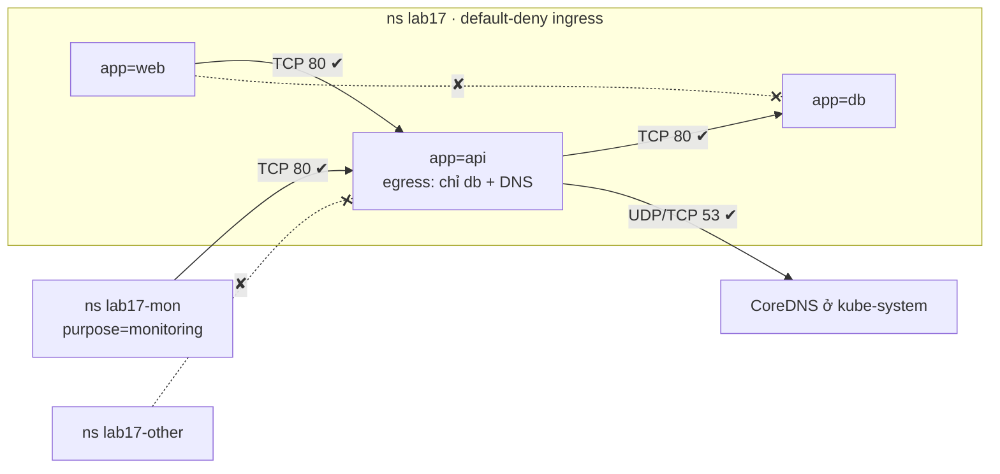
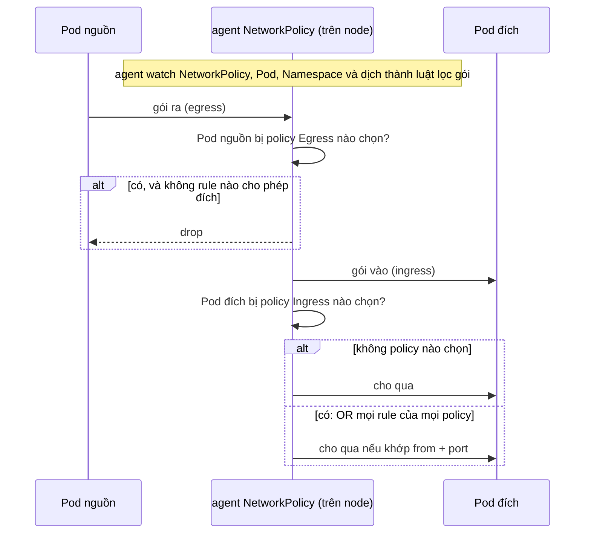

# Lab 17 · NetworkPolicy theo mô hình mặc định chặn

**Cấp độ 4 · Services & Networking** · khoảng 40 phút · môi trường: kind hoặc kubeadm

Năng lực CKA: Services & Networking › NetworkPolicy; Services & Networking › Kết nối giữa các Pod

Mức hỗ trợ: **Dẫn hướng**. Mỗi câu chỉ ra chỗ tra tài liệu, khung lệnh và cách tự kiểm, nhưng không đưa đáp án. Hãy thử tự làm trước, kẹt mới mở.

## Mục tiêu

Khóa một ứng dụng ba tầng web → api → db: chặn mặc định, chỉ mở đúng các đường cần thiết, kể cả theo namespace và chiều đi ra (egress).

## Cần làm trước

- [Lab 15 · Service, EndpointSlice và kết nối giữa các Pod](../15-services/README.md)
- [Lab 16 · DNS trong cluster và CoreDNS](../16-dns-coredns/README.md)

## Kiến thức cần nắm

- Pod không bị policy nào chọn thì nhận mọi traffic. Một khi bị chọn cho chiều `Ingress` (hoặc `Egress`), chỉ traffic được liệt kê mới qua.
- Trong một phần tử `from`, `podSelector` và `namespaceSelector` đặt **cùng một gạch đầu dòng** là AND; tách thành **hai gạch đầu dòng** là OR.
- Namespace luôn có label `kubernetes.io/metadata.name=<tên>`, tiện để chọn một namespace cụ thể.
- Chặn egress thì phải mở UDP/TCP 53 tới CoreDNS, nếu không mọi lần gọi bằng tên đều lỗi.
- Policy chỉ có hiệu lực khi CNI hỗ trợ (kindnet, Calico, Cilium… có; Flannel thuần thì không).

## Sơ đồ

### Lab dựng gì



### Luồng hoạt động



## Chuẩn bị

```bash
./lab start 17
```

## Đề bài

1. Trong `lab17`, tạo policy `default-deny` chặn **mọi ingress** tới mọi Pod.

2. Tạo policy `web-to-api`: Pod `app=api` chỉ nhận traffic TCP 80 từ Pod `app=web` cùng namespace.

3. Tạo policy `api-to-db`: Pod `app=db` chỉ nhận TCP 80 từ Pod `app=api`.

4. Tạo policy `monitoring-to-api`: Pod trong các namespace có label `purpose=monitoring` được gọi `app=api` cổng 80. Namespace `lab17-mon` đã có label đó; namespace `lab17-other` thì không và phải bị chặn.

5. Tạo policy `api-egress`: Pod `app=api` chỉ được gọi ra Pod `app=db` cổng 80 và DNS (cổng 53 UDP và TCP).

## Cách tiếp cận

### Cách nghĩ về NetworkPolicy

- Khi Pod chưa bị policy nào chọn, mọi traffic tới nó đều được phép.
- Khi một policy chọn Pod theo chiều Ingress, chỉ những gì policy cho phép mới được vào. Chiều Egress cũng vậy.
- Các policy **cộng dồn** (OR): không có rule "deny" riêng.

Vẽ ra giấy: Pod nào nhận từ ai, cổng nào, rồi mới viết YAML.

### Câu 1 · default-deny

**Tra:** trang *Network Policies*, mục *Default policies*, có YAML chép được.

### Câu 2–3 · Cho phép theo label Pod

**Khung:** `podSelector` (Pod được bảo vệ) + `ingress[].from[].podSelector` (ai được gọi) + `ingress[].ports`.

**Tự kiểm:** giả lập Pod nguồn bằng label:
`kubectl run t -n lab17 --rm -it --image=busybox:1.36 --labels=app=web --restart=Never -- wget -qO- -T3 api`.

### Câu 4 · Cho phép theo namespace

**Khung:** `from[].namespaceSelector.matchLabels`.

**Bẫy:** trong `from`, `namespaceSelector` và `podSelector` **cùng một phần tử** nghĩa là AND, còn **hai phần tử** nghĩa là OR. Một dấu `-` thừa làm đổi nghĩa cả policy.

### Câu 5 · Egress

Khi bật Egress, Pod mất luôn DNS: gọi bằng tên sẽ hỏng dù đã cho phép tới `db`.

**Khung:** một rule tới `app=db` cổng 80, một rule tới DNS cổng 53 cả UDP và TCP. Để chọn Pod CoreDNS ở namespace khác, xem label của nó: `kubectl get pods -n kube-system --show-labels | grep dns`.

**Tự kiểm:** từ Pod label `app=api`, `wget db` được và `wget web` bị chặn.

## Gợi ý

<details><summary>Kiểm tra bằng Pod có label giả lập</summary>

`kubectl run t -n lab17 --rm -it --image=busybox:1.36 --labels=app=web --restart=Never -- wget -qO- -T3 api`

</details>

<details><summary>DNS cho egress</summary>

`to: [{namespaceSelector: {}, podSelector: {matchLabels: {k8s-app: kube-dns}}}]` với `ports: [{port: 53, protocol: UDP}, {port: 53, protocol: TCP}]`

</details>

## Chấm bài

```bash
./lab check 17
```

Lời giải: [SOLUTION.md](SOLUTION.md) (chỉ mở sau khi đã tự làm).

## Dọn dẹp

```bash
./lab reset 17
```

## Tài liệu

- [Network Policies](https://kubernetes.io/docs/concepts/services-networking/network-policies/)
- [Declare Network Policy](https://kubernetes.io/docs/tasks/administer-cluster/declare-network-policy/)

---

← [Lab 16 · DNS trong cluster và CoreDNS](../16-dns-coredns/README.md) · [Lab 18 · Ingress, IngressClass và TLS](../18-ingress/README.md) →
