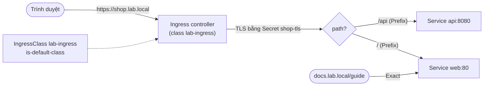
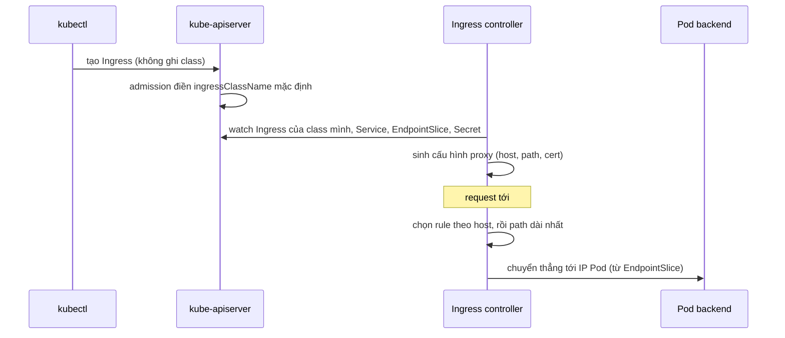

# Lab 18 · Ingress, IngressClass và TLS

**Cấp độ 4 · Services & Networking** · khoảng 30 phút · môi trường: kind hoặc kubeadm

Năng lực CKA: Services & Networking › Ingress controller và Ingress

Mức hỗ trợ: **Dẫn hướng**. Mỗi câu chỉ ra chỗ tra tài liệu, khung lệnh và cách tự kiểm, nhưng không đưa đáp án. Hãy thử tự làm trước, kẹt mới mở.

## Mục tiêu

Viết Ingress định tuyến theo host và path tới nhiều Service, gắn chứng chỉ TLS, và chọn IngressClass mặc định.

## Cần làm trước

- [Lab 15 · Service, EndpointSlice và kết nối giữa các Pod](../15-services/README.md)

## Kiến thức cần nắm

- Ingress chỉ là bản mô tả; cần một **Ingress controller** (Traefik, HAProxy, NGINX…) để thực thi. `ingressClassName` chọn controller nào xử lý.
- `pathType`: `Prefix` (khớp theo từng đoạn `/`), `Exact` (khớp đúng), `ImplementationSpecific`.
- TLS: Secret kiểu `kubernetes.io/tls` có `tls.crt` và `tls.key`, khai báo trong `spec.tls` cùng danh sách host.
- Annotation `ingressclass.kubernetes.io/is-default-class: "true"` trên IngressClass làm nó mặc định cho Ingress không ghi class.
- Dự án ingress-nginx đã ngừng phát triển; hướng mới là Gateway API (lab 19). Đề thi vẫn hỏi cả hai.

## Sơ đồ

### Lab dựng gì


Bài này chỉ có IngressClass, không cài controller thật, nên chấm trên các object. Với controller thật (ingress-nginx…), luồng hoạt động như sơ đồ dưới.

### Luồng hoạt động



## Chuẩn bị

```bash
./lab start 18
```

Lab chấm theo nội dung object, không cần controller. Muốn thấy traffic thật, cài một controller (ví dụ Traefik bằng Helm) và đổi `ingressClassName` cho khớp.

## Đề bài

1. Tạo chứng chỉ tự ký cho `shop.lab.local` và Secret TLS `shop-tls` trong `lab18`.

2. Tạo Ingress `shop` (class `lab-ingress`) cho host `shop.lab.local`: path `/api` (Prefix) tới Service `api` cổng 8080, path `/` (Prefix) tới Service `web` cổng 80, dùng TLS `shop-tls`.

3. Tạo Ingress `docs` không ghi `ingressClassName`, host `docs.lab.local`, path `/guide` kiểu **Exact** tới `web:80`.

4. Đặt IngressClass `lab-ingress` làm mặc định của cluster.

## Cách tiếp cận

### Câu 1 · Chứng chỉ và Secret TLS

**Khung:** `openssl req -x509 -nodes -days 365 -newkey rsa:2048 -keyout … -out … -subj "/CN=<host>"`, rồi `kubectl create secret tls --help`.

**Tự kiểm:** `kubectl get secret shop-tls -n lab18` có TYPE `kubernetes.io/tls`.

### Câu 2 · Ingress nhiều path + TLS

**Khung:** `kubectl create ingress --help` có ví dụ cú pháp `--rule="host/path=service:port,tls=secret"`. Path kết thúc bằng `*` là kiểu Prefix.

**Tự kiểm:** `kubectl describe ingress shop -n lab18` liệt kê 2 path, backend, và TLS. Backend `<error: endpoints not found>` nghĩa là Service hoặc cổng sai.

### Câu 3 · Path kiểu Exact, không ghi class

**Khung:** cùng lệnh, path không có `*` là Exact; bỏ cờ `--class`.

### Câu 4 · IngressClass mặc định

**Tra:** trang *Ingress*, mục *Default IngressClass*, nêu tên annotation.

**Tự kiểm:** `kubectl get ingressclass` hiện `(default)`. Ingress `docs` không có class sẽ được controller mặc định nhận.

## Gợi ý

<details><summary>Tạo cert và Secret</summary>

`openssl req -x509 -nodes -days 365 -newkey rsa:2048 -keyout tls.key -out tls.crt -subj "/CN=shop.lab.local"` rồi `kubectl create secret tls shop-tls --cert=tls.crt --key=tls.key -n lab18`

</details>

<details><summary>Sinh Ingress bằng lệnh</summary>

`kubectl create ingress shop -n lab18 --class=lab-ingress --rule="shop.lab.local/api*=api:8080,tls=shop-tls" --rule="shop.lab.local/*=web:80,tls=shop-tls"` (dấu `*` = Prefix)

</details>

## Chấm bài

```bash
./lab check 18
```

Lời giải: [SOLUTION.md](SOLUTION.md) (chỉ mở sau khi đã tự làm).

## Dọn dẹp

```bash
./lab reset 18
```

## Tài liệu

- [Ingress](https://kubernetes.io/docs/concepts/services-networking/ingress/)
- [Ingress controllers](https://kubernetes.io/docs/concepts/services-networking/ingress-controllers/)

---

← [Lab 17 · NetworkPolicy theo mô hình mặc định chặn](../17-network-policy/README.md) · [Lab 19 · Gateway API, HTTPRoute và ReferenceGrant](../19-gateway-api/README.md) →
