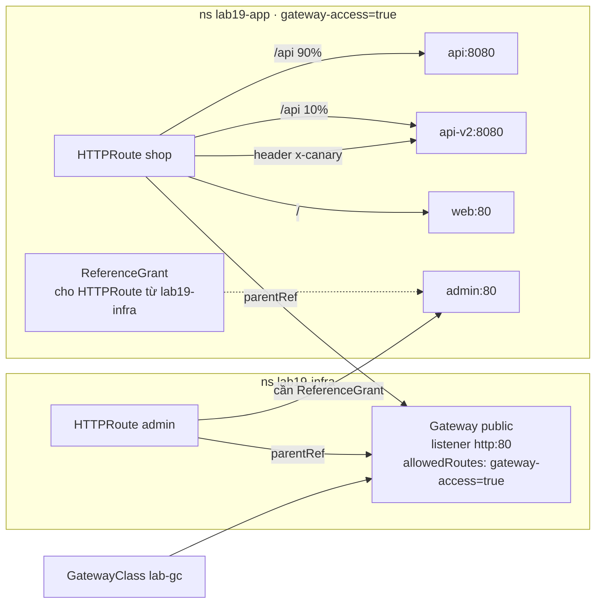
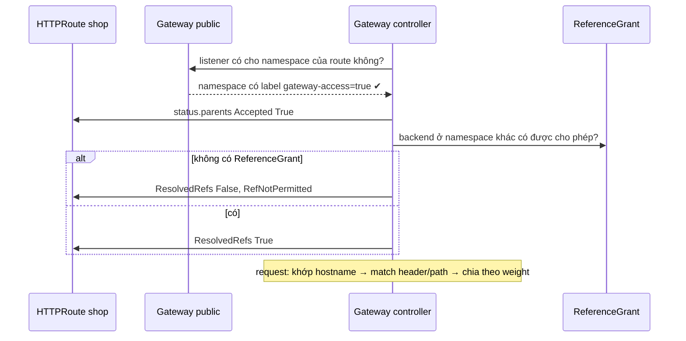

# Lab 19 · Gateway API, HTTPRoute và ReferenceGrant

**Cấp độ 4 · Services & Networking** · khoảng 40 phút · môi trường: kind hoặc kubeadm

Năng lực CKA: Services & Networking › Gateway API

Mức hỗ trợ: **Dẫn hướng**. Mỗi câu chỉ ra chỗ tra tài liệu, khung lệnh và cách tự kiểm, nhưng không đưa đáp án. Hãy thử tự làm trước, kẹt mới mở.

## Mục tiêu

Dựng định tuyến L7 bằng Gateway API: Gateway do đội hạ tầng quản lý, HTTPRoute của đội ứng dụng, chia traffic canary theo weight và theo header, và cho phép tham chiếu chéo namespace.

## Cần làm trước

- [Lab 18 · Ingress, IngressClass và TLS](../18-ingress/README.md)

## Kiến thức cần nắm

- **GatewayClass** (loại controller) → **Gateway** (listener: cổng, giao thức, TLS, namespace nào được gắn route) → **HTTPRoute** (match theo host, path, header; gửi tới `backendRefs` có `weight`).
- `allowedRoutes.namespaces.from`: `Same` (mặc định), `All`, hoặc `Selector` theo label namespace.
- Route tham chiếu Service ở **namespace khác** chỉ hợp lệ khi namespace đích có **ReferenceGrant** cho phép.
- Kiểm tra trạng thái: `kubectl describe httproute`, các condition `Accepted` và `ResolvedRefs` (cần controller thật).

## Sơ đồ

### Lab dựng gì



### Luồng hoạt động



## Chuẩn bị

```bash
./lab start 19
```

Setup cài CRD Gateway API v1.6.3 (bản standard) từ GitHub nếu cluster chưa có, và tạo GatewayClass `lab-gc`. Lab chấm theo nội dung object. Muốn thấy traffic thật, cài một implementation như Envoy Gateway hoặc NGINX Gateway Fabric và đổi `gatewayClassName`.

## Đề bài

1. Gắn label `gateway-access=true` cho namespace `lab19-app`.

2. Trong `lab19-infra`, tạo Gateway `public` (class `lab-gc`) có listener tên `http`, HTTP cổng 80, chỉ nhận route từ namespace có label `gateway-access=true`.

3. Trong `lab19-app`, tạo HTTPRoute `shop` gắn vào `public`, host `shop.lab.local`, gồm 3 rule:
   request có header `x-canary: "true"` đi **hết** vào `api-v2:8080`;
   path `/api` (PathPrefix) chia `api:8080` weight 90 và `api-v2:8080` weight 10;
   còn lại (`/`) vào `web:80`.

4. Đội hạ tầng tạo HTTPRoute `admin` trong `lab19-infra` (host `admin.lab.local`) gửi tới Service `admin` cổng 80 ở `lab19-app`. Tạo route đó và ReferenceGrant `allow-infra-routes` trong `lab19-app` cho phép HTTPRoute từ `lab19-infra` tham chiếu Service.

## Cách tiếp cận

### Mô hình Gateway API

Gateway API tách trách nhiệm theo vai trò:

- **GatewayClass** (nhà cung cấp) cho biết controller nào xử lý.
- **Gateway** (đội hạ tầng) mở listener và quyết định namespace nào được gắn route.
- **HTTPRoute** (đội ứng dụng) khai báo luật định tuyến.

Không có lệnh `kubectl create` cho các loại này. Mở trang *gateway-api.sigs.k8s.io* (được phép trong phòng thi) để chép YAML mẫu.

### Câu 1–2 · Gateway chỉ nhận route từ namespace có label

**Tra:** `kubectl explain gateway.spec.listeners.allowedRoutes.namespaces`. Có 3 giá trị `from`: `Same`, `All`, `Selector`.

**Tự kiểm:** `kubectl get gateway -n lab19-infra`, rồi `kubectl describe gateway public -n lab19-infra` để xem `Listeners`.

### Câu 3 · HTTPRoute 3 rule

**Tra:** trang *HTTP routing*, *HTTP header matching* và *Traffic splitting* của Gateway API.

**Khung:** `parentRefs` (Gateway ở namespace khác thì ghi `namespace`), `hostnames`, `rules[]` gồm `matches` + `backendRefs` (có `weight`).

**Tự kiểm:** `kubectl describe httproute shop -n lab19-app`. Phần `Status.Parents` phải có `Accepted: True` và `ResolvedRefs: True`.

### Câu 4 · Route tham chiếu Service ở namespace khác

Mặc định route chỉ được trỏ tới Service **cùng namespace**. Namespace chứa Service phải "đồng ý" bằng ReferenceGrant.

**Tra:** trang *ReferenceGrant*. `from` là ai tham chiếu (group, kind, namespace); `to` là bị tham chiếu (group `""` cho Service).

**Tự kiểm:** trước khi tạo ReferenceGrant, `describe httproute admin` báo `RefNotPermitted`. Sau đó lỗi biến mất.

## Gợi ý

<details><summary>Khung Gateway</summary>

`kubectl explain gateway.spec.listeners.allowedRoutes --recursive`

</details>

<details><summary>Match theo header</summary>

`matches: [{headers: [{name: x-canary, value: "true"}]}]`

</details>

## Chấm bài

```bash
./lab check 19
```

Lời giải: [SOLUTION.md](SOLUTION.md) (chỉ mở sau khi đã tự làm).

## Dọn dẹp

```bash
./lab reset 19
```

## Tài liệu

- [Gateway API (Kubernetes docs)](https://kubernetes.io/docs/concepts/services-networking/gateway/)
- [Gateway API guides](https://gateway-api.sigs.k8s.io/guides/)
- [HTTP traffic splitting](https://gateway-api.sigs.k8s.io/guides/traffic-splitting/)

---

← [Lab 18 · Ingress, IngressClass và TLS](../18-ingress/README.md) · [Lab 20 · Volume: emptyDir, hostPath, projected và Downward API](../20-volumes/README.md) →
