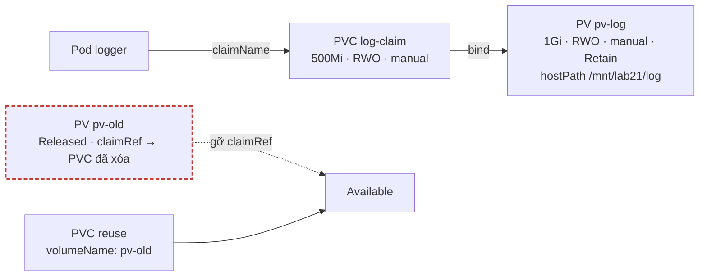
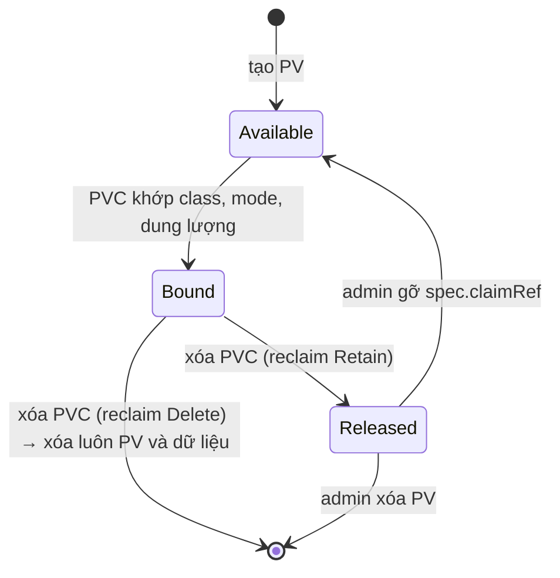

# Lab 21 · PersistentVolume, PVC và reclaim policy

**Cấp độ 5 · Storage** · khoảng 30 phút · môi trường: kind hoặc kubeadm

Năng lực CKA: Storage › PersistentVolume và PersistentVolumeClaim; Storage › Volume type, access mode, reclaim policy

Mức hỗ trợ: **Dẫn hướng**. Mỗi câu chỉ ra chỗ tra tài liệu, khung lệnh và cách tự kiểm, nhưng không đưa đáp án. Hãy thử tự làm trước, kẹt mới mở.

## Mục tiêu

Cấp phát lưu trữ thủ công: tạo PV, để PVC bind đúng PV, dùng trong Pod, và tái sử dụng một PV đã `Released` mà không mất dữ liệu.

## Cần làm trước

- [Lab 20 · Volume: emptyDir, hostPath, projected và Downward API](../20-volumes/README.md)

## Kiến thức cần nắm

- PVC bind với PV khi khớp **storageClassName**, **accessModes** (PV phải có mode PVC xin) và **dung lượng** (PV ≥ PVC). Một PV chỉ bind với một PVC.
- Access mode: `ReadWriteOnce` (một node), `ReadOnlyMany`, `ReadWriteMany`, `ReadWriteOncePod` (một Pod).
- Reclaim policy: `Retain` (xóa PVC thì PV thành `Released`, dữ liệu còn), `Delete` (xóa luôn disk). PV `Released` vẫn giữ `claimRef` cũ nên không bind lại được cho tới khi admin gỡ `claimRef`.
- `spec.volumeName` trong PVC chỉ định đích danh PV muốn bind.

## Sơ đồ

### Lab dựng gì



### Luồng hoạt động


`Retain` giữ dữ liệu nhưng PV không tự dùng lại được, vì nó vẫn "nhớ" PVC cũ.

## Chuẩn bị

```bash
./lab start 21
```

## Đề bài

1. Tạo PV `pv-log`: 1Gi, `ReadWriteOnce`, reclaim `Retain`, storageClassName `manual`, hostPath `/mnt/lab21/log` (tự tạo).

2. Trong `lab21`, tạo PVC `log-claim` xin 500Mi `ReadWriteOnce` class `manual`. Nó phải bind với `pv-log`.

3. Tạo Pod `logger` (`busybox:1.36`) dùng `log-claim` tại `/log`, ghi `ok` vào `/log/app.log` rồi `sleep 3600`.

4. PV `pv-old` đang ở trạng thái `Released` sau khi PVC cũ bị xóa. Đưa nó về `Available` **mà không xóa và tạo lại PV**, rồi tạo PVC `reuse` trong `lab21` bind **đích danh** vào `pv-old`.

## Cách tiếp cận

### Cách PVC tìm PV

Một PVC bind với một PV khi tất cả điều kiện sau thỏa:

- `storageClassName` **trùng nhau**.
- `accessModes` của PV chứa mode PVC xin.
- `capacity` của PV ≥ dung lượng PVC xin.
- PV đang `Available`.

PVC đứng Pending thì kiểm tra lần lượt từng điều kiện.

### Câu 1 · PV hostPath

**Tra:** trang *Configure a Pod to Use a PersistentVolume for Storage*, có YAML PV, PVC và Pod. Không có lệnh `kubectl create pv`.

**Tự kiểm:** `kubectl get pv pv-log` hiện `Available`, RECLAIM POLICY `Retain`.

### Câu 2 · PVC

**Tự kiểm:** `kubectl get pvc -n lab21` hiện `Bound` và `VOLUME pv-log`. PVC xin 500Mi nhưng CAPACITY là `1Gi`, vì được cả PV.

### Câu 3 · Pod dùng PVC

**Khung:** `volumes[].persistentVolumeClaim.claimName`.

**Tự kiểm:** `kubectl exec logger -n lab21 -- cat /log/app.log`.

### Câu 4 · Tái sử dụng PV Released

`Retain` giữ lại dữ liệu khi PVC bị xóa, nhưng PV vẫn nhớ PVC cũ qua `spec.claimRef` và đứng ở trạng thái `Released`.

**Khung:** xem `kubectl get pv pv-old -o yaml`, tìm trường giữ tham chiếu tới PVC cũ rồi gỡ nó (`kubectl edit` hoặc `patch` kiểu JSON `remove`).

**Khung PVC:** `spec.volumeName` để bind đích danh. Các điều kiện ở trên vẫn phải thỏa, nên xem `storageClassName` và dung lượng của `pv-old`.

## Gợi ý

<details><summary>PVC đứng Pending?</summary>

`kubectl describe pvc log-claim -n lab21` và so storageClassName, accessModes, dung lượng với PV.

</details>

<details><summary>Gỡ claimRef</summary>

`kubectl patch pv pv-old --type=json -p '[{"op":"remove","path":"/spec/claimRef"}]'`

</details>

## Chấm bài

```bash
./lab check 21
```

Lời giải: [SOLUTION.md](SOLUTION.md) (chỉ mở sau khi đã tự làm).

## Dọn dẹp

```bash
./lab reset 21
```

## Tài liệu

- [Persistent Volumes](https://kubernetes.io/docs/concepts/storage/persistent-volumes/)
- [Configure a Pod to use a PersistentVolume](https://kubernetes.io/docs/tasks/configure-pod-container/configure-persistent-volume-storage/)

---

← [Lab 20 · Volume: emptyDir, hostPath, projected và Downward API](../20-volumes/README.md) · [Lab 22 · StorageClass, dynamic provisioning và StatefulSet](../22-storageclass-statefulset/README.md) →
