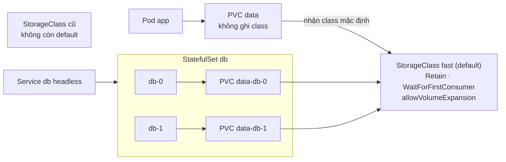
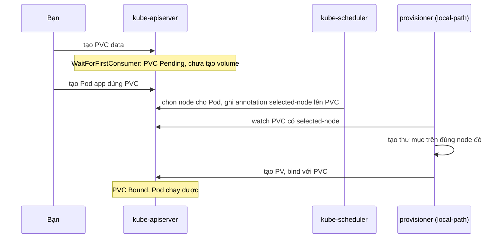

# Lab 22 · StorageClass, dynamic provisioning và StatefulSet

**Cấp độ 5 · Storage** · khoảng 35 phút · môi trường: kind hoặc kubeadm

Năng lực CKA: Storage › StorageClass và dynamic provisioning; Storage › PersistentVolume và PersistentVolumeClaim

Mức hỗ trợ: **Dẫn hướng**. Mỗi câu chỉ ra chỗ tra tài liệu, khung lệnh và cách tự kiểm, nhưng không đưa đáp án. Hãy thử tự làm trước, kẹt mới mở.

## Mục tiêu

Để cluster tự cấp phát volume: tạo StorageClass, đặt nó làm mặc định, hiểu `WaitForFirstConsumer`, và cho mỗi replica của StatefulSet một volume riêng.

## Cần làm trước

- [Lab 21 · PersistentVolume, PVC và reclaim policy](../21-pv-pvc/README.md)

## Kiến thức cần nắm

- StorageClass gồm `provisioner`, `parameters`, `reclaimPolicy` (mặc định `Delete`), `volumeBindingMode` (`Immediate` hoặc `WaitForFirstConsumer`), `allowVolumeExpansion`.
- `WaitForFirstConsumer`: PVC đứng `Pending` cho tới khi có Pod dùng nó, để disk được tạo đúng zone/node của Pod.
- Annotation `storageclass.kubernetes.io/is-default-class: "true"` chọn lớp mặc định cho PVC không ghi `storageClassName`. Chỉ nên có **một** lớp mặc định.
- StatefulSet với `volumeClaimTemplates` tạo PVC tên `<template>-<sts>-<số>`; PVC **không** bị xóa khi scale xuống (trừ khi đặt `persistentVolumeClaimRetentionPolicy`).

## Sơ đồ

### Lab dựng gì



### Luồng hoạt động



## Chuẩn bị

```bash
./lab start 22
```

Setup in ra provisioner của StorageClass mặc định hiện tại (với kind là `rancher.io/local-path`). Dùng đúng provisioner đó cho StorageClass mới.

## Đề bài

1. Tạo StorageClass `fast` dùng cùng provisioner với StorageClass mặc định hiện tại, reclaim `Retain`, `WaitForFirstConsumer`, cho phép mở rộng volume.

2. Đặt `fast` làm StorageClass mặc định, và lớp mặc định cũ **không** còn là mặc định.

3. Trong `lab22`, tạo PVC `data` 1Gi `ReadWriteOnce` **không ghi** `storageClassName`. Ghi trạng thái của nó ngay sau khi tạo (`Pending` hay `Bound`) vào `~/cka-answers/22-phase.txt`. Sau đó tạo Pod `app` (`busybox:1.36`, `sleep 3600`) dùng PVC này tại `/data` để PVC chuyển `Bound`.

4. Tạo headless Service `db` và StatefulSet `db` (2 replica, `busybox:1.36`, `sleep 3600`) có `volumeClaimTemplates` tên `data`, 1Gi, class `fast`, gắn tại `/var/lib/db`.

## Cách tiếp cận

### Câu 1 · StorageClass mới

**Khung:** `kubectl get sc` để biết provisioner của lớp mặc định, rồi `kubectl get sc <tên> -o yaml > fast.yaml` làm khung và sửa tên cùng các trường.

**Tra:** `kubectl explain storageclass` có các trường `reclaimPolicy`, `volumeBindingMode`, `allowVolumeExpansion`.

### Câu 2 · Đổi lớp mặc định

**Tra:** trang *Change the default StorageClass* nêu tên annotation.

**Tự kiểm:** `kubectl get sc` chỉ có **một** dòng `(default)`.

**Bẫy:** quên bỏ mặc định ở lớp cũ thì cluster có 2 lớp mặc định. PVC không ghi class sẽ nhận lớp mặc định mới tạo gần nhất, và đề thi chấm sai.

### Câu 3 · WaitForFirstConsumer

`WaitForFirstConsumer` hoãn việc tạo volume tới khi có Pod dùng PVC, để volume được tạo đúng node Pod chạy.

**Tự kiểm:** ngay sau khi tạo PVC, `kubectl get pvc data -n lab22`, và `describe` có event `waiting for first consumer`. Sau khi tạo Pod thì PVC thành Bound.

### Câu 4 · StatefulSet với volumeClaimTemplates

**Tra:** trang *StatefulSets*, phần *Components*, có ví dụ đầy đủ gồm Service headless và `volumeClaimTemplates`. Không có lệnh `create` cho StatefulSet: sinh YAML Deployment rồi sửa `kind`, thêm `serviceName`, xóa `strategy`.

**Tự kiểm:** `kubectl get pvc -n lab22` có `data-db-0`, `data-db-1`. Tên PVC là `<template>-<pod>`.

**Bẫy:** xóa StatefulSet **không** xóa PVC của nó.

## Gợi ý

<details><summary>Xem provisioner và lớp mặc định</summary>

`kubectl get sc` (cột PROVISIONER, dòng có `(default)`)

</details>

<details><summary>Bỏ mặc định của lớp cũ</summary>

`kubectl patch sc <tên> -p '{"metadata":{"annotations":{"storageclass.kubernetes.io/is-default-class":"false"}}}'`

</details>

## Chấm bài

```bash
./lab check 22
```

Lời giải: [SOLUTION.md](SOLUTION.md) (chỉ mở sau khi đã tự làm).

## Dọn dẹp

```bash
./lab reset 22
```

## Tài liệu

- [Storage classes](https://kubernetes.io/docs/concepts/storage/storage-classes/)
- [Dynamic provisioning](https://kubernetes.io/docs/concepts/storage/dynamic-provisioning/)
- [StatefulSets](https://kubernetes.io/docs/concepts/workloads/controllers/statefulset/)

---

← [Lab 21 · PersistentVolume, PVC và reclaim policy](../21-pv-pvc/README.md) · [Lab 23 · RBAC với Role, ClusterRole và ServiceAccount](../23-rbac/README.md) →
