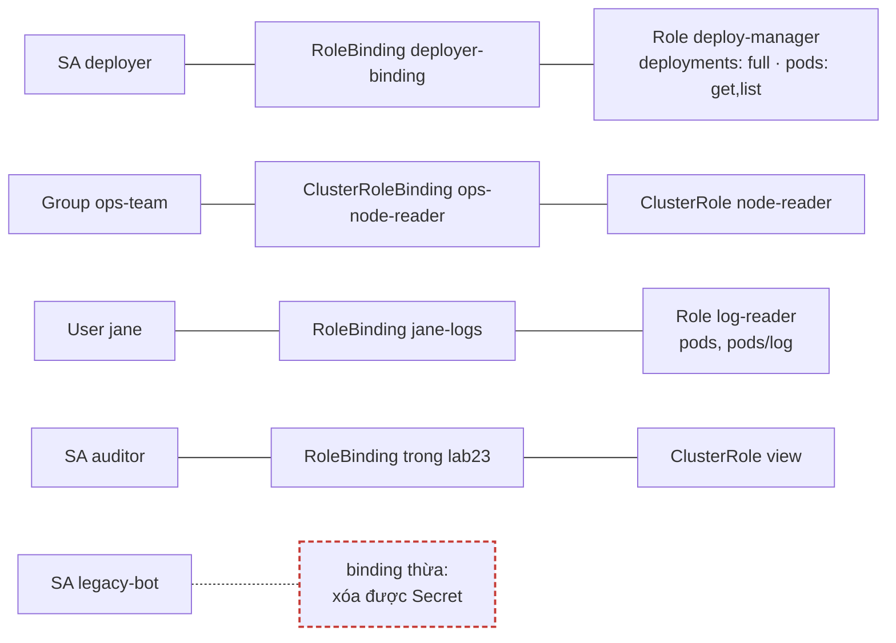
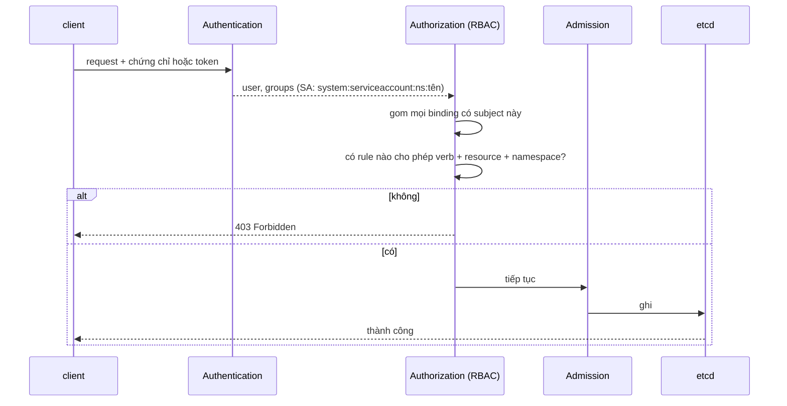

# Lab 23 · RBAC với Role, ClusterRole và ServiceAccount

**Cấp độ 6 · Bảo mật** · khoảng 35 phút · môi trường: kind hoặc kubeadm

Năng lực CKA: Cluster Architecture › Quản lý RBAC

Mức hỗ trợ: **Dẫn hướng**. Mỗi câu chỉ ra chỗ tra tài liệu, khung lệnh và cách tự kiểm, nhưng không đưa đáp án. Hãy thử tự làm trước, kẹt mới mở.

## Mục tiêu

Cấp đúng và đủ quyền theo nguyên tắc tối thiểu cho ServiceAccount, user và group; kiểm tra bằng `kubectl auth can-i`; tìm và gỡ một quyền thừa.

## Cần làm trước

- [Lab 02 · kubectl, namespace, context và Kubernetes API](../02-kubectl-api/README.md)

## Kiến thức cần nắm

- **Role** (trong namespace) và **ClusterRole** (toàn cluster) chứa `rules`: `apiGroups`, `resources` (kể cả subresource như `pods/log`, `pods/exec`), `verbs`, tùy chọn `resourceNames`.
- **RoleBinding** gắn Role *hoặc ClusterRole* cho chủ thể **trong một namespace**. **ClusterRoleBinding** gắn ClusterRole cho toàn cluster.
- Chủ thể: `User`, `Group`, `ServiceAccount` (`system:serviceaccount:<ns>:<tên>`). RBAC chỉ **cho phép**, không có luật từ chối.
- ClusterRole có sẵn: `view`, `edit`, `admin`, `cluster-admin`.

## Sơ đồ

### Lab dựng gì



### Luồng hoạt động


RBAC chỉ có "cho phép". Không có rule nào cho phép thì bị từ chối.

## Chuẩn bị

```bash
./lab start 23
```

## Đề bài

1. Trong `lab23`, tạo ServiceAccount `deployer` và Role `deploy-manager` cho phép `get, list, watch, create, update, patch, delete` trên `deployments` và chỉ `get, list` trên `pods`. Gắn Role cho `deployer` bằng RoleBinding `deployer-binding`.

2. Tạo ClusterRole `node-reader` (`get, list, watch` trên `nodes`) và ClusterRoleBinding `ops-node-reader` gắn cho group `ops-team`.

3. User `jane` chỉ được đọc Pod và log của Pod trong `lab23`. Tạo Role `log-reader` và RoleBinding `jane-logs`.

4. ServiceAccount `auditor` (tạo mới trong `lab23`) được quyền của ClusterRole có sẵn `view`, nhưng **chỉ trong** namespace `lab23`.

5. ServiceAccount `legacy-bot` trong `lab23` đang xóa được Secret, việc này không được phép. Tìm binding cấp quyền đó, ghi tên binding vào `~/cka-answers/23-binding.txt`, rồi xóa binding.

## Cách tiếp cận

### Cách đọc RBAC

Mọi quyền đều trả lời câu hỏi: **ai** (subject: User, Group, ServiceAccount) được làm **gì** (verb) trên **cái gì** (resource, apiGroup), **ở đâu** (namespace hay toàn cluster).

- **Role/ClusterRole** định nghĩa "gì trên cái gì".
- **RoleBinding/ClusterRoleBinding** gắn nó cho "ai" và quyết định "ở đâu".

Một RoleBinding có thể trỏ tới một ClusterRole: khi đó quyền chỉ có hiệu lực trong namespace của binding.

### Câu 1 · Role nhiều rule

**Khung:** `kubectl create role --help`. Một lệnh chỉ tạo một bộ verb cho mọi resource, nên rule thứ hai thêm bằng `edit` hoặc tạo YAML.

**Tra:** `kubectl api-resources | grep -E 'deployments|pods'` để biết apiGroup: `apps` cho Deployment, `""` cho Pod.

**Tự kiểm:** `kubectl auth can-i delete deployments -n lab23 --as=system:serviceaccount:lab23:deployer` trả về yes; với `delete pods` trả về no.

### Câu 2 · ClusterRole cho group

**Tự kiểm:** `kubectl auth can-i list nodes --as=someone --as-group=ops-team`.

### Câu 3 · Log của Pod là subresource

**Khung:** quyền đọc log là resource `pods/log`.

**Tự kiểm:** `kubectl auth can-i get pods/log -n lab23 --as=jane`.

### Câu 4 · ClusterRole dùng trong một namespace

**Khung:** RoleBinding (không phải ClusterRoleBinding) + `--clusterrole=view`.

**Tự kiểm:** `can-i list pods -n lab23` trả về yes; `-n default` trả về no.

### Câu 5 · Tìm binding thừa

**Khung:** liệt kê `rolebinding,clusterrolebinding -A -o wide` rồi `grep` tên ServiceAccount. Cột SERVICEACCOUNTS cho biết binding gắn cho ai.

**Tự kiểm:** `kubectl auth can-i delete secrets -n lab23 --as=system:serviceaccount:lab23:legacy-bot` trả về no.

## Gợi ý

<details><summary>Kiểm tra quyền</summary>

`kubectl auth can-i delete deployments -n lab23 --as=system:serviceaccount:lab23:deployer` hoặc `--as=jane`, `--as=x --as-group=ops-team`

</details>

<details><summary>Tìm binding của một ServiceAccount</summary>

`kubectl get rolebinding,clusterrolebinding -A -o wide | grep legacy-bot`

</details>

## Chấm bài

```bash
./lab check 23
```

Lời giải: [SOLUTION.md](SOLUTION.md) (chỉ mở sau khi đã tự làm).

## Dọn dẹp

```bash
./lab reset 23
```

## Tài liệu

- [Using RBAC Authorization](https://kubernetes.io/docs/reference/access-authn-authz/rbac/)
- [Service accounts](https://kubernetes.io/docs/concepts/security/service-accounts/)

---

← [Lab 22 · StorageClass, dynamic provisioning và StatefulSet](../22-storageclass-statefulset/README.md) · [Lab 24 · User mới bằng chứng chỉ, CSR và kubeconfig](../24-users-csr-kubeconfig/README.md) →
