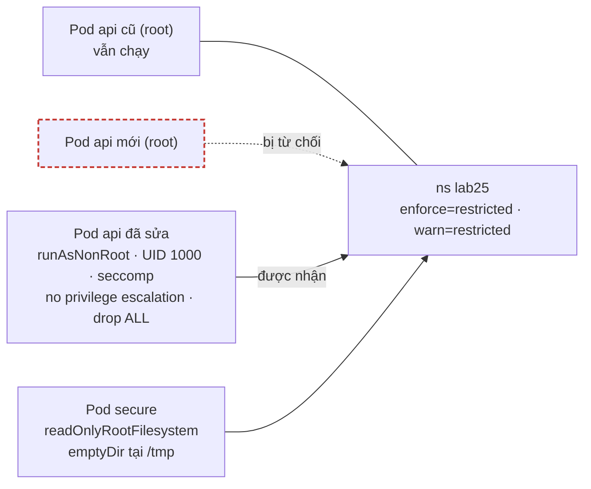
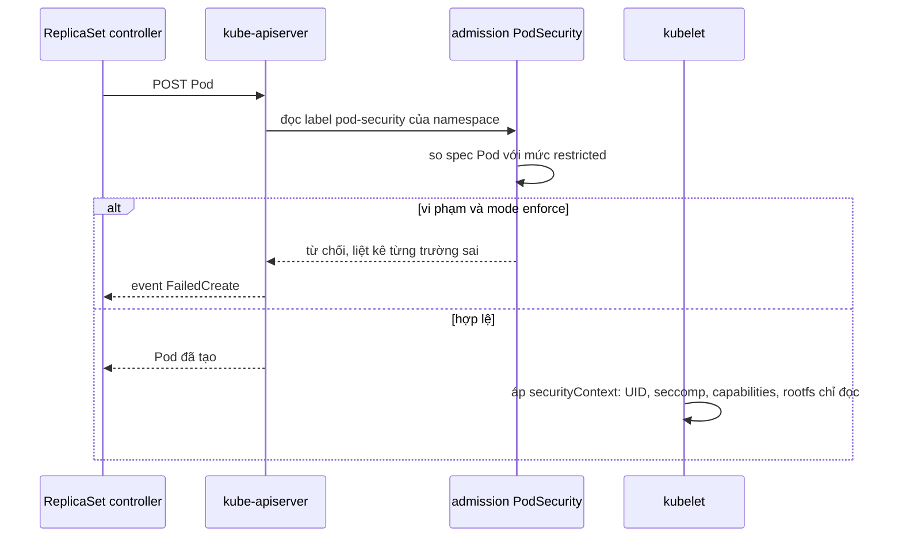

# Lab 25 · securityContext và Pod Security Admission

**Cấp độ 6 · Bảo mật** · khoảng 30 phút · môi trường: kind hoặc kubeadm

Năng lực CKA: Workloads & Scheduling › Admission và scheduling của Pod; Cluster Architecture › Quản lý RBAC

Mức hỗ trợ: **Dẫn hướng**. Mỗi câu chỉ ra chỗ tra tài liệu, khung lệnh và cách tự kiểm, nhưng không đưa đáp án. Hãy thử tự làm trước, kẹt mới mở.

## Mục tiêu

Bắt một namespace tuân thủ chuẩn bảo mật `restricted`, sửa workload cũ cho đạt chuẩn, và chạy container với filesystem chỉ đọc.

## Cần làm trước

- [Lab 07 · Liveness, readiness và startup probe](../07-probes/README.md)
- [Lab 23 · RBAC với Role, ClusterRole và ServiceAccount](../23-rbac/README.md)

## Kiến thức cần nắm

- Pod Security Admission bật bằng **label namespace**: `pod-security.kubernetes.io/<enforce|audit|warn>=<privileged|baseline|restricted>`. `enforce` từ chối Pod mới; Pod đang chạy **không** bị đuổi.
- Chuẩn `restricted` đòi: `runAsNonRoot: true`, `allowPrivilegeEscalation: false`, `capabilities.drop: [ALL]`, `seccompProfile.type: RuntimeDefault` (hoặc `Localhost`), không hostPath/hostNetwork/privileged.
- Với Deployment, Pod bị từ chối không xuất hiện: lỗi nằm ở event `FailedCreate` của ReplicaSet.
- `readOnlyRootFilesystem: true` chặn ghi vào filesystem của image; chỗ cần ghi thì gắn `emptyDir`.

## Sơ đồ

### Lab dựng gì



### Luồng hoạt động



## Chuẩn bị

```bash
./lab start 25
```

## Đề bài

1. Bật cho namespace `lab25` chế độ `enforce` và `warn` ở mức `restricted`.

2. Deployment `api` trong `lab25` đang chạy với root. Sau khi bật enforce, nó không tạo được Pod mới. Sửa `api` đạt chuẩn `restricted`, chạy với UID `1000`, rồi rollout lại để Pod mới được tạo.

3. Tạo Pod `secure` (`busybox:1.36`, `sleep 3600`) đạt chuẩn `restricted`, root filesystem **chỉ đọc**, và ghi được vào `/tmp` nhờ một emptyDir.

## Cách tiếp cận

### Câu 1 · Bật Pod Security Admission

PSA đọc label của namespace: `pod-security.kubernetes.io/<mode>=<level>`. Có ba mode:

- `enforce`: từ chối Pod vi phạm.
- `warn`: in cảnh báo.
- `audit`: ghi vào audit log.

**Tra:** trang *Enforce Pod Security Standards with Namespace Labels*.

**Tự kiểm:** `kubectl get ns lab25 --show-labels`.

### Câu 2 · Đưa Deployment đạt chuẩn restricted

Enforce chỉ chặn Pod **mới**. Pod đang chạy không bị đuổi, nên Deployment trông vẫn ổn cho tới lần rollout kế tiếp.

**Khung:** `kubectl rollout restart deploy api -n lab25`, rồi xem lý do bị từ chối ở `kubectl describe rs -n lab25` hoặc `kubectl get events -n lab25`. Thông báo liệt kê **từng** trường còn thiếu.

**Tra:** trang *Pod Security Standards*, bảng mức *Restricted*. Bốn trường gần như luôn cần là `runAsNonRoot`, `seccompProfile`, `allowPrivilegeEscalation: false`, `capabilities.drop: [ALL]`.

**Tự kiểm:** thử nhanh mà không tạo gì: `kubectl apply -f api.yaml --dry-run=server`. Server áp dụng PSA và in cảnh báo nếu còn thiếu.

### Câu 3 · Root filesystem chỉ đọc

**Khung:** `securityContext.readOnlyRootFilesystem: true` ở cấp container, và một emptyDir gắn vào `/tmp`.

**Tự kiểm:** `kubectl exec secure -n lab25 -- touch /x` phải lỗi; `touch /tmp/x` phải được.

**Bẫy:** có trường chỉ đặt được ở cấp **Pod** (`fsGroup`), có trường chỉ đặt được ở cấp **container** (`capabilities`, `readOnlyRootFilesystem`). Xem bằng `kubectl explain pod.spec.securityContext` và `kubectl explain pod.spec.containers.securityContext`.

## Gợi ý

<details><summary>Xem vì sao Pod bị từ chối</summary>

`kubectl rollout restart deploy api -n lab25` rồi `kubectl describe rs -n lab25 -l app=api | grep -A2 FailedCreate`

</details>

<details><summary>Thử nhanh với dry-run phía server</summary>

`kubectl apply -f pod.yaml --dry-run=server` báo ngay vi phạm PSA mà không tạo gì.

</details>

## Chấm bài

```bash
./lab check 25
```

Lời giải: [SOLUTION.md](SOLUTION.md) (chỉ mở sau khi đã tự làm).

## Dọn dẹp

```bash
./lab reset 25
```

## Tài liệu

- [Pod Security Standards](https://kubernetes.io/docs/concepts/security/pod-security-standards/)
- [Pod Security Admission](https://kubernetes.io/docs/concepts/security/pod-security-admission/)
- [Configure a Security Context](https://kubernetes.io/docs/tasks/configure-pod-container/security-context/)

---

← [Lab 24 · User mới bằng chứng chỉ, CSR và kubeconfig](../24-users-csr-kubeconfig/README.md) · [Lab 26 · Helm từ chart đến rollback](../26-helm/README.md) →
