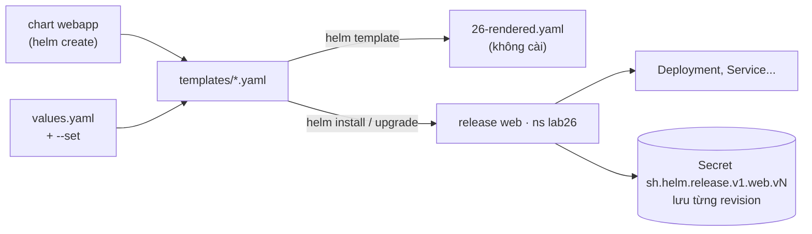
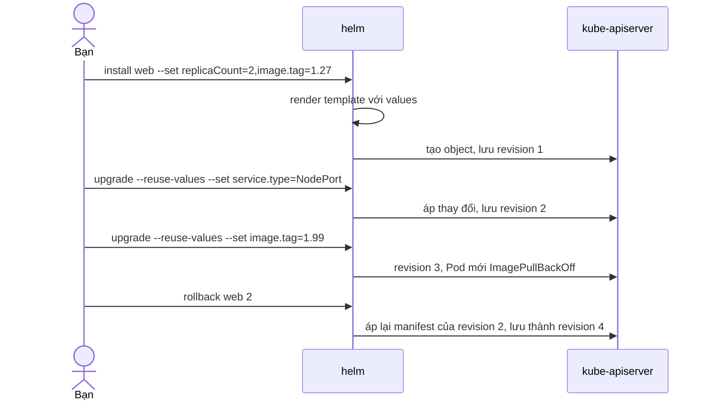

# Lab 26 · Helm từ chart đến rollback

**Cấp độ 7 · Vận hành cluster** · khoảng 35 phút · môi trường: kind hoặc kubeadm

Năng lực CKA: Cluster Architecture › Cài thành phần bằng Helm và Kustomize

Mức hỗ trợ: **Tự lực**. Đề bài kiểu phòng thi. Phần này chỉ đưa quy trình làm việc và cách kiểm chứng; chi tiết bạn tự tra như trong phòng thi.

## Mục tiêu

Dùng Helm như trong công việc thật: tạo chart, cài release với values, nâng cấp giữ values cũ, quay lại revision tốt, render YAML để kiểm tra trước, và gỡ release.

## Cần làm trước

- [Lab 05 · Deployment: scale, rolling update, rollback](../05-deployment-rollout/README.md)

## Kiến thức cần nắm

- **Chart** là gói template + `values.yaml`; **release** là một lần cài chart vào cluster; mỗi lần `upgrade` hoặc `rollback` tạo một **revision** mới (lưu dạng Secret trong namespace của release).
- `--set` và `-f values.yaml` ghi đè giá trị. `helm upgrade` **không** giữ `--set` cũ trừ khi thêm `--reuse-values`.
- `helm template` render YAML ở máy, không cần cluster. `helm get values`, `helm history`, `helm rollback <release> <revision>`.
- Chart từ repo: `helm repo add`, `helm search repo`, `helm install … --version`. Chart từ OCI registry: `helm install x oci://…`.

## Sơ đồ

### Lab dựng gì



### Luồng hoạt động



## Chuẩn bị

```bash
./lab start 26
```

Cần Helm v3 trên máy chạy lab (`helm version`). Lab dùng chart tạo tại chỗ bằng `helm create`, không cần internet.

## Đề bài

1. Tạo chart `webapp` trong `~/cka-answers/lab26/` bằng `helm create`.

2. Cài release `web` từ chart đó vào namespace `lab26` với 2 replica và image `nginx:1.27` (chart mặc định dùng repository `nginx`, chỉ cần đặt tag).

3. Nâng cấp `web` để Service thành `NodePort`, **giữ** các giá trị đã đặt trước đó.

4. Nâng cấp tiếp với image tag `1.99` (không tồn tại), thấy Pod lỗi, rồi rollback về revision có NodePort và `nginx:1.27`.

5. Không cài, chỉ render chart với release tên `preview` và 3 replica, lưu vào `~/cka-answers/26-rendered.yaml`.

6. Cài thử release `tmp` vào `lab26` rồi gỡ nó.

## Quy trình tư duy

### Quy trình

1. Đọc `values.yaml` của chart trước khi đặt giá trị: `helm show values <chart>` cho biết tên khóa chính xác (`replicaCount`, `image.tag`, `service.type`).
2. Mọi lệnh thay đổi đều có `-n <ns>`. Quên namespace là lỗi phổ biến nhất với Helm.
3. Sau mỗi lần `install`/`upgrade`, kiểm tra bằng `helm list -n …`, `helm get values …` và `kubectl get` các object thật.

### Tự tra cứu

`helm <lệnh> --help` có ví dụ cho mọi tình huống của bài. Hãy chú ý các cờ:

- giữ giá trị cũ khi nâng cấp;
- chọn revision để quay lại;
- render mà không cài.

### Kiểm chứng

- `helm history web -n lab26` thể hiện đúng câu chuyện: install → NodePort → 1.99 → rollback.
- `helm get values web -n lab26` của revision cuối có đủ replica, tag và loại Service.

## Gợi ý

<details><summary>Đặt nhiều giá trị</summary>

`--set replicaCount=2,image.tag=1.27`

</details>

<details><summary>Xem revision</summary>

`helm history web -n lab26`

</details>

## Chấm bài

```bash
./lab check 26
```

Lời giải: [SOLUTION.md](SOLUTION.md) (chỉ mở sau khi đã tự làm).

## Dọn dẹp

```bash
./lab reset 26
```

## Tài liệu

- [Helm quickstart](https://helm.sh/docs/intro/quickstart/)
- [helm upgrade](https://helm.sh/docs/helm/helm_upgrade/)

---

← [Lab 25 · securityContext và Pod Security Admission](../25-security-context-psa/README.md) · [Lab 27 · Kustomize với base và overlay](../27-kustomize/README.md) →
