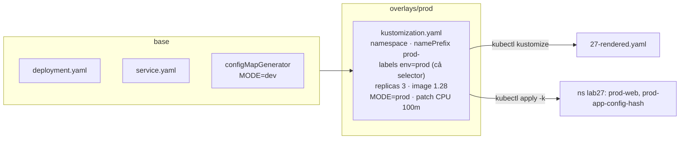
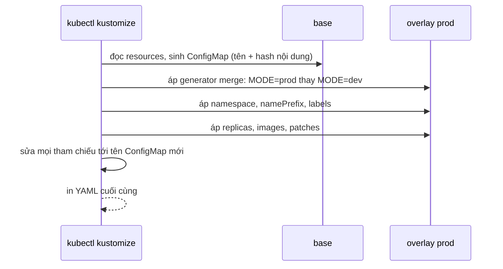

# Lab 27 · Kustomize với base và overlay

**Cấp độ 7 · Vận hành cluster** · khoảng 30 phút · môi trường: kind hoặc kubeadm

Năng lực CKA: Cluster Architecture › Cài thành phần bằng Helm và Kustomize

Mức hỗ trợ: **Tự lực**. Đề bài kiểu phòng thi. Phần này chỉ đưa quy trình làm việc và cách kiểm chứng; chi tiết bạn tự tra như trong phòng thi.

## Mục tiêu

Tùy biến bộ manifest cho từng môi trường mà không sửa file gốc: overlay đổi namespace, tiền tố tên, label, số replica, image, cấu hình sinh tự động và patch.

## Cần làm trước

- [Lab 06 · ConfigMap và Secret](../06-configmap-secret/README.md)
- [Lab 26 · Helm từ chart đến rollback](../26-helm/README.md)

## Kiến thức cần nắm

- `kustomization.yaml` liệt kê `resources` rồi biến đổi: `namespace`, `namePrefix`, `labels`, `images`, `replicas`, `patches`.
- `configMapGenerator` sinh ConfigMap có **hậu tố hash** theo nội dung, và tự sửa mọi chỗ tham chiếu. Đổi cấu hình là đổi tên ConfigMap, nên Deployment tự rollout. Trong overlay dùng `behavior: merge` để ghi đè key của base.
- `kubectl kustomize <dir>` xem kết quả; `kubectl apply -k <dir>` áp dụng. kubectl có sẵn Kustomize, không cần cài thêm.

## Sơ đồ

### Lab dựng gì



### Luồng hoạt động


ConfigMap đổi nội dung thì hash đổi, Deployment tham chiếu tên mới và tự rollout.

## Chuẩn bị

```bash
./lab start 27
```

## Đề bài

1. Base có sẵn ở `~/cka-answers/lab27/base` (Deployment `web`, Service `web`, ConfigMap `app-config` sinh bằng generator). Đọc nó.

2. Tạo overlay `~/cka-answers/lab27/overlays/prod` dùng base đó, với: namespace `lab27`; tiền tố tên `prod-`; label `env=prod` gắn cả vào selector; 3 replica; image `nginx:1.28`; `MODE=prod` thay cho `MODE=dev`; container `web` có request `cpu: 100m`.

3. Lưu kết quả render của overlay vào `~/cka-answers/27-rendered.yaml`, rồi áp dụng overlay vào cluster.

## Quy trình tư duy

### Quy trình

1. Đọc base: `kustomization.yaml` liệt kê resource và generator gì. Render thử `kubectl kustomize <base>` để biết tên object thực tế.
2. Mỗi yêu cầu của đề ứng với một trường trong `kustomization.yaml` của overlay. Lập bảng trước: namespace, tiền tố tên, label (có gắn vào selector không), số replica, image, ConfigMap, patch.
3. Render overlay sau **mỗi** thay đổi và đọc kết quả, chưa apply vội.

### Tự tra cứu

- Trang *Declarative Management of Kubernetes Objects Using Kustomize* liệt kê các trường và ví dụ.
- `kubectl explain` không áp dụng cho kustomization. Khi cần, dùng tài liệu tham chiếu của kustomize trên kubectl.docs.kubernetes.io.

### Kiểm chứng

- Trong file render: tên có tiền tố, selector có `env=prod`, ConfigMap có hậu tố hash và Deployment tham chiếu đúng tên mới đó.
- `kubectl apply -k <overlay>`, rồi `kubectl get all,cm -n lab27`.

## Gợi ý

<details><summary>Ghi đè ConfigMap của base</summary>

```yaml
configMapGenerator:
- name: app-config
  behavior: merge
  literals: [MODE=prod]
```

</details>

<details><summary>Patch resources</summary>

File `resources.yaml` dạng strategic merge (Deployment tên `web`, container `web`) rồi `patches: [{path: resources.yaml}]`.

</details>

## Chấm bài

```bash
./lab check 27
```

Lời giải: [SOLUTION.md](SOLUTION.md) (chỉ mở sau khi đã tự làm).

## Dọn dẹp

```bash
./lab reset 27
```

## Tài liệu

- [Declarative management with Kustomize](https://kubernetes.io/docs/tasks/manage-kubernetes-objects/kustomization/)
- [Kustomize reference](https://kubectl.docs.kubernetes.io/references/kustomize/kustomization/)

---

← [Lab 26 · Helm từ chart đến rollback](../26-helm/README.md) · [Lab 28 · CustomResourceDefinition và Operator](../28-crd-operator/README.md) →
