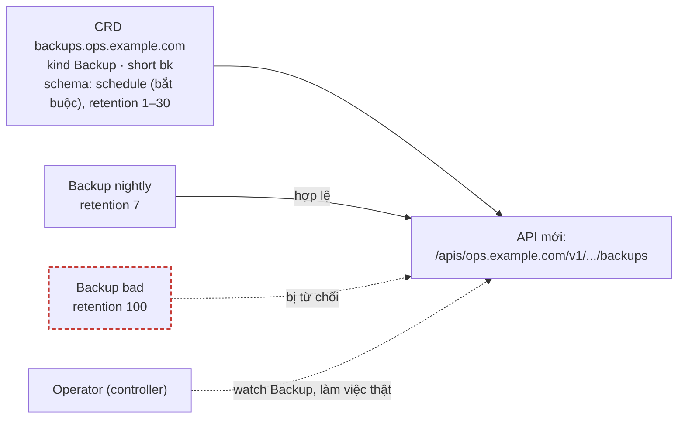
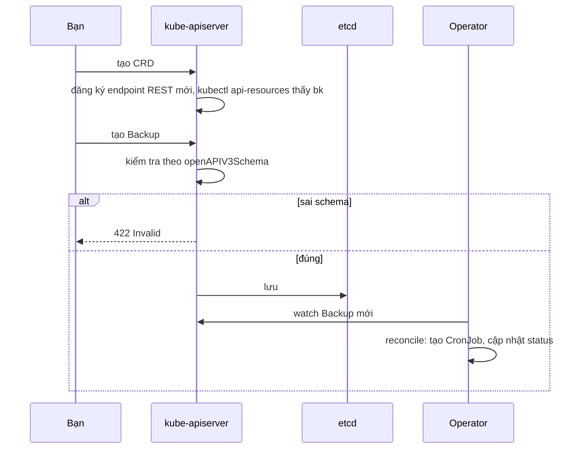

# Lab 28 · CustomResourceDefinition và Operator

**Cấp độ 7 · Vận hành cluster** · khoảng 30 phút · môi trường: kind hoặc kubeadm

Năng lực CKA: Cluster Architecture › CRD, cài và cấu hình Operator; Cluster Architecture › Interface mở rộng: CNI, CSI, CRI

Mức hỗ trợ: **Tự lực**. Đề bài kiểu phòng thi. Phần này chỉ đưa quy trình làm việc và cách kiểm chứng; chi tiết bạn tự tra như trong phòng thi.

## Mục tiêu

Mở rộng Kubernetes API bằng loại object của riêng bạn, có kiểm tra dữ liệu, tên viết tắt và cột hiển thị; hiểu Operator dùng CRD thế nào.

## Cần làm trước

- [Lab 04 · Sinh YAML nhanh và trích xuất bằng jsonpath](../04-yaml-jsonpath/README.md)

## Kiến thức cần nắm

- CRD khai báo `group`, `names` (`kind`, `plural`, `singular`, `shortNames`), `scope` (`Namespaced` hoặc `Cluster`), và các `versions` (một version là `storage: true`).
- `openAPIV3Schema` kiểm tra dữ liệu ngay khi tạo: kiểu, `required`, `minimum`/`maximum`, `enum`. Object sai bị API từ chối.
- `additionalPrinterColumns` thêm cột cho `kubectl get`.
- **Operator** = CRD + controller theo dõi các object đó và vận hành phần mềm thay con người (cert-manager, Prometheus Operator, CloudNativePG…). Cài thường bằng Helm hoặc manifest.

## Sơ đồ

### Lab dựng gì



### Luồng hoạt động



## Chuẩn bị

```bash
./lab start 28
```

## Đề bài

1. Tạo CRD `backups.ops.example.com`: kind `Backup`, namespaced, tên ngắn `bk`, version `v1`. Schema: `spec.schedule` (string, **bắt buộc**), `spec.retention` (integer từ 1 tới 30). Thêm hai cột `Schedule` và `Retention` cho `kubectl get`.

2. Trong `lab28`, tạo Backup `nightly` với schedule `0 2 * * *`, retention `7`.

3. Thử tạo Backup `bad` với retention `100`. API phải từ chối; không được có object `bad`.

4. Ghi các tên ngắn của resource thuộc group `ops.example.com` (theo `kubectl api-resources`) vào `~/cka-answers/28-short.txt`.

## Quy trình tư duy

### Quy trình

1. Chép CRD mẫu từ trang *Extend the Kubernetes API with CustomResourceDefinitions*, rồi sửa từng phần: `group`, `names` (plural, singular, kind, shortNames), `scope`, `versions[]`.
2. Schema OpenAPI nằm ở `versions[].schema.openAPIV3Schema`. Ràng buộc bắt buộc (`required`) và khoảng giá trị (`minimum`/`maximum`) viết ở đây.
3. Cột hiển thị là `versions[].additionalPrinterColumns` với `jsonPath`.

### Kiểm chứng

- `kubectl get crd backups.ops.example.com`, rồi `kubectl api-resources --api-group=ops.example.com`.
- Tạo một object hợp lệ và một object sai: API phải trả lỗi validation **ngay lúc tạo**.
- `kubectl get bk -n lab28` có cột Schedule và Retention.

### Liên hệ thực tế

Operator = CRD + controller theo dõi object đó. Khi cài operator (cert-manager, Prometheus Operator…), bạn sẽ thấy CRD của nó trong `kubectl get crd`.

## Gợi ý

<details><summary>Khung CRD</summary>

Xem ví dụ trong tài liệu "Extend the Kubernetes API with CustomResourceDefinitions" rồi sửa tên. `kubectl explain backup.spec` chạy được khi schema đúng.

</details>

## Chấm bài

```bash
./lab check 28
```

Lời giải: [SOLUTION.md](SOLUTION.md) (chỉ mở sau khi đã tự làm).

## Dọn dẹp

```bash
./lab reset 28
```

## Tài liệu

- [Custom resources](https://kubernetes.io/docs/concepts/extend-kubernetes/api-extension/custom-resources/)
- [Extend the API with CRDs](https://kubernetes.io/docs/tasks/extend-kubernetes/custom-resources/custom-resource-definitions/)
- [Operator pattern](https://kubernetes.io/docs/concepts/extend-kubernetes/operator/)

---

← [Lab 27 · Kustomize với base và overlay](../27-kustomize/README.md) · [Lab 29 · Sao lưu và khôi phục etcd](../29-etcd-backup-restore/README.md) →
