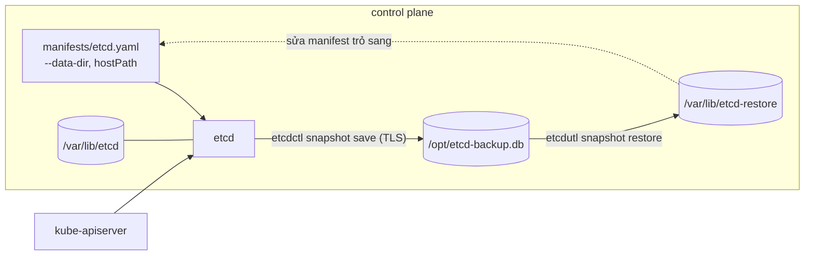
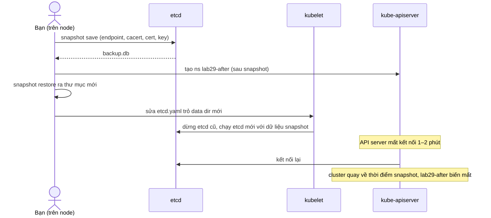

# Lab 29 · Sao lưu và khôi phục etcd

**Cấp độ 7 · Vận hành cluster** · khoảng 40 phút · môi trường: kind hoặc kubeadm (cần vào node)

Năng lực CKA: Cluster Architecture › Quản lý vòng đời cluster (nâng cấp); Cluster Architecture › Tạo và quản lý cluster bằng kubeadm

Mức hỗ trợ: **Tự lực**. Đề bài kiểu phòng thi. Phần này chỉ đưa quy trình làm việc và cách kiểm chứng; chi tiết bạn tự tra như trong phòng thi.

## Mục tiêu

Chụp snapshot etcd đúng cách, và khôi phục cluster về thời điểm chụp khi dữ liệu bị thay đổi sau đó.

## Cần làm trước

- [Lab 14 · Static pod, lập lịch thủ công và bảo trì node](../14-static-pod-maintenance/README.md)

## Kiến thức cần nắm

- etcd bật TLS hai chiều: `etcdctl` cần `--endpoints`, `--cacert`, `--cert`, `--key`. Lấy đường dẫn từ `/etc/kubernetes/manifests/etcd.yaml`.
- `etcdctl snapshot save` chụp; `etcdutl snapshot status` kiểm tra; `etcdutl snapshot restore --data-dir <thư mục mới>` khôi phục ra thư mục **mới**.
- Sau khi restore, sửa `hostPath` của volume `etcd-data` trong `etcd.yaml` trỏ sang thư mục mới. kubelet tự tạo lại Pod etcd; API server có thể mất 1–2 phút để trở lại.
- Restore đưa **toàn bộ** cluster về thời điểm chụp: object tạo sau đó biến mất.

## Sơ đồ

### Lab dựng gì



### Luồng hoạt động



## Chuẩn bị

```bash
./lab start 29
```

Setup cài `etcdctl` và `etcdutl` v3.6.16 vào node control plane nếu chưa có (tải từ GitHub), và tạo namespace `lab29-before`.

## Đề bài

1. Vào node control plane (`./lab ssh $CP`). Ghi giá trị `--data-dir` của etcd vào `/root/29-datadir.txt` trên node.

2. Chụp snapshot etcd vào `/opt/etcd-backup.db` trên node control plane và kiểm tra nó bằng `etcdutl snapshot status`.

3. **Sau** khi chụp, tạo namespace `lab29-after` (giả lập thay đổi xảy ra sau lần sao lưu).

4. Khôi phục snapshot ra `/var/lib/etcd-restore` và cho etcd chạy trên dữ liệu đó. Kết quả: `lab29-before` còn, `lab29-after` không còn.

## Quy trình tư duy

### Quy trình

1. **Thu thập trước khi gõ lệnh.** Mọi tham số kết nối etcd (endpoint, cacert, cert, key, data-dir) đều có trong `/etc/kubernetes/manifests/etcd.yaml`. Đọc file đó, đặt biến shell, đừng gõ đường dẫn từ trí nhớ.
2. **Snapshot** bằng `etcdctl snapshot save` (cần TLS), **kiểm tra** bằng `etcdutl snapshot status`.
3. **Restore** bằng `etcdutl snapshot restore` ra thư mục **mới**. Không ghi đè thư mục đang chạy.
4. **Trỏ etcd sang dữ liệu mới**: sửa static pod manifest ở **mọi** chỗ nhắc tới data dir cũ.
5. **Chờ**: kubelet tạo lại etcd và API server. Trong 1–2 phút kubectl sẽ báo lỗi kết nối, đó là bình thường.

### Kiểm chứng

- `crictl ps | grep -E 'etcd|apiserver'` trên node thấy container mới.
- `kubectl get ns` có `lab29-before`, không có `lab29-after`.

### Bẫy

Một manifest có hai chỗ dùng data dir: cờ `--data-dir` và `hostPath` của volume. Sửa thiếu một chỗ là etcd không lên, hoặc lên nhưng dùng dữ liệu cũ.

## Gợi ý

<details><summary>Biến cho đỡ gõ</summary>

`export ETCDCTL_API=3; E="--endpoints=https://127.0.0.1:2379 --cacert=/etc/kubernetes/pki/etcd/ca.crt --cert=/etc/kubernetes/pki/etcd/server.crt --key=/etc/kubernetes/pki/etcd/server.key"`

</details>

<details><summary>API server không trả lời sau khi sửa etcd.yaml?</summary>

Chờ 1–2 phút; xem `crictl ps -a | grep -E 'etcd|apiserver'` và `crictl logs <id>` trên node.

</details>

## Chấm bài

```bash
./lab check 29
```

Lời giải: [SOLUTION.md](SOLUTION.md) (chỉ mở sau khi đã tự làm).

## Dọn dẹp

```bash
./lab reset 29
```

## Tài liệu

- [Operating etcd clusters for Kubernetes](https://kubernetes.io/docs/tasks/administer-cluster/configure-upgrade-etcd/)
- [etcd disaster recovery](https://etcd.io/docs/v3.6/op-guide/recovery/)

---

← [Lab 28 · CustomResourceDefinition và Operator](../28-crd-operator/README.md) · [Lab 30 · Nâng cấp cluster kubeadm 1.34 → 1.35](../30-kubeadm-upgrade/README.md) →
