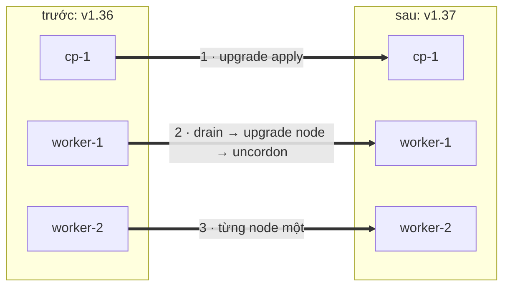
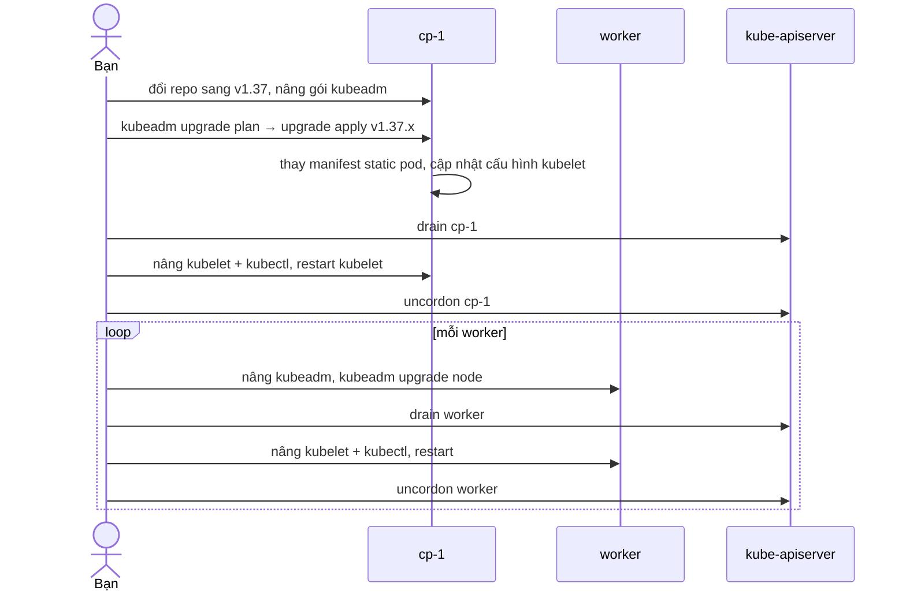

# Lab 30 · Nâng cấp cluster kubeadm 1.36 → 1.37

**Cấp độ 7 · Vận hành cluster** · khoảng 60 phút · môi trường: kubeadm trên máy ảo

Năng lực CKA: Cluster Architecture › Quản lý vòng đời cluster (nâng cấp); Cluster Architecture › Tạo và quản lý cluster bằng kubeadm

Mức hỗ trợ: **Tự lực**. Đề bài kiểu phòng thi. Phần này chỉ đưa quy trình làm việc và cách kiểm chứng; chi tiết bạn tự tra như trong phòng thi.

## Mục tiêu

Nâng một cluster đang chạy lên minor mới mà không làm gián đoạn ứng dụng: control plane trước, từng worker sau, đúng thứ tự drain và uncordon.

## Cần làm trước

- [Lab 01 · Cài cluster bằng kubeadm trên máy ảo](../01-kubeadm-install/README.md)
- [Lab 14 · Static pod, lập lịch thủ công và bảo trì node](../14-static-pod-maintenance/README.md)

## Kiến thức cần nắm

- Mỗi lần chỉ nâng **một** minor. Thứ tự: `kubeadm` trên control plane → `kubeadm upgrade plan` → `kubeadm upgrade apply` → drain → nâng `kubelet` và `kubectl` → restart kubelet → uncordon. Control plane thứ hai trở đi và worker dùng `kubeadm upgrade node`.
- Version skew: kubelet được cũ hơn API server tối đa 3 minor, không bao giờ mới hơn. kubectl lệch ±1 minor.
- Gói bị `apt-mark hold` để không vô tình nâng; phải `unhold` trước khi cài phiên bản mới. Repo `pkgs.k8s.io` chia theo minor: đổi `/v1.36/` thành `/v1.37/`.
- `kubeadm upgrade apply` tự gia hạn chứng chỉ control plane.

## Sơ đồ

### Lab dựng gì


Control plane luôn nâng trước. kubelet không được mới hơn kube-apiserver.

### Luồng hoạt động



## Chuẩn bị

```bash
./lab start 30
```

Cần cluster từ lab 01 (Kubernetes v1.36). Chạy lab từ `cp-1`.

## Đề bài

1. Ghi phiên bản đích mà `kubeadm upgrade plan` đề xuất (sau khi nâng kubeadm) vào `~/cka-answers/30-target.txt`.

2. Nâng control plane `cp-1` lên v1.37 (kubeadm, control plane, kubelet, kubectl).

3. Nâng lần lượt `worker-1` rồi `worker-2`, mỗi node phải được drain trước và uncordon sau.

4. Mọi node `Ready`, kubelet v1.37.x, không node nào còn `SchedulingDisabled`.

## Quy trình tư duy

### Quy trình

Mở trang *Upgrading kubeadm clusters* và làm theo đúng thứ tự của nó. Đề thi chấm kết quả, nhưng sai thứ tự là cluster hỏng.

1. **Repo gói** trỏ sang minor mới (`/etc/apt/sources.list.d/kubernetes.list`), `apt update`, xem các phiên bản có sẵn.
2. **Control plane**: nâng `kubeadm`, chạy `kubeadm upgrade plan`, rồi `kubeadm upgrade apply`; sau đó drain, nâng `kubelet`/`kubectl`, `daemon-reload`, restart kubelet, uncordon.
3. **Từng worker**: nâng `kubeadm`, `kubeadm upgrade node`, drain (chạy từ cp-1), nâng `kubelet`/`kubectl`, restart, uncordon.

### Kiểm chứng sau mỗi node

- `kubectl get nodes` cho thấy node vừa làm có VERSION mới và không còn `SchedulingDisabled`.
- Mọi Pod hệ thống `Running`.

### Bẫy

Gói bị `apt-mark hold`. Phải `unhold` rồi `hold` lại (hoặc dùng `--allow-change-held-packages`).

## Gợi ý

<details><summary>Xem phiên bản có trong repo</summary>

`apt-cache madison kubeadm | head`

</details>

## Chấm bài

```bash
./lab check 30
```

Lời giải: [SOLUTION.md](SOLUTION.md) (chỉ mở sau khi đã tự làm).

## Dọn dẹp

```bash
./lab reset 30
```

## Tài liệu

- [Upgrading kubeadm clusters](https://kubernetes.io/docs/tasks/administer-cluster/kubeadm/kubeadm-upgrade/)
- [Version skew policy](https://kubernetes.io/releases/version-skew-policy/)

---

← [Lab 29 · Sao lưu và khôi phục etcd](../29-etcd-backup-restore/README.md) · [Lab 31 · Chứng chỉ, cấu hình control plane và kubelet](../31-control-plane-config/README.md) →
