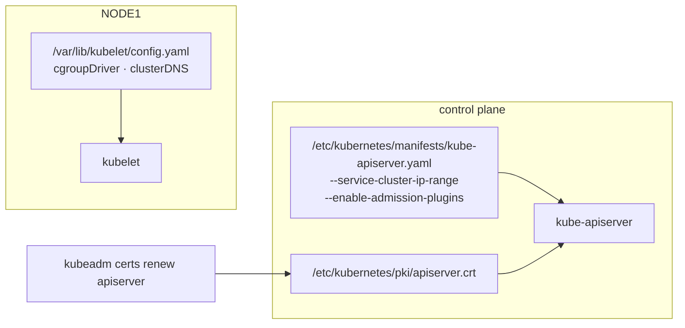
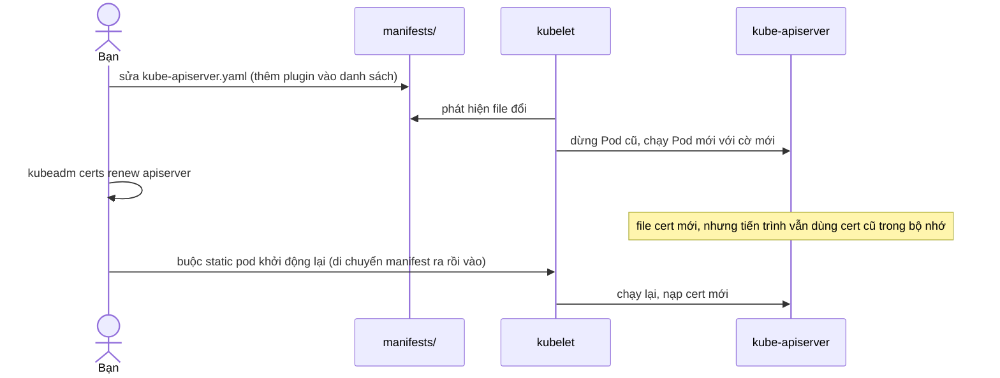

# Lab 31 · Chứng chỉ, cấu hình control plane và kubelet

**Cấp độ 7 · Vận hành cluster** · khoảng 35 phút · môi trường: kind hoặc kubeadm (cần vào node)

Năng lực CKA: Cluster Architecture › Tạo và quản lý cluster bằng kubeadm; Troubleshooting › Troubleshoot thành phần control plane; Cluster Architecture › Interface mở rộng: CNI, CSI, CRI

Mức hỗ trợ: **Tự lực**. Đề bài kiểu phòng thi. Phần này chỉ đưa quy trình làm việc và cách kiểm chứng; chi tiết bạn tự tra như trong phòng thi.

## Mục tiêu

Biết cấu hình của từng thành phần nằm ở đâu, đọc và sửa cờ của static pod an toàn, gia hạn chứng chỉ, và đọc cấu hình kubelet.

## Cần làm trước

- [Lab 29 · Sao lưu và khôi phục etcd](../29-etcd-backup-restore/README.md)

## Kiến thức cần nắm

- Control plane kubeadm: manifest ở `/etc/kubernetes/manifests`, chứng chỉ ở `/etc/kubernetes/pki`, kubeconfig ở `/etc/kubernetes/*.conf`. Sửa manifest là kubelet tự tạo lại Pod.
- `kubeadm certs check-expiration` xem hạn; `kubeadm certs renew <tên>|all` gia hạn, sau đó phải restart thành phần dùng cert đó (di chuyển manifest ra rồi vào lại, hoặc `crictl stop` container).
- kubelet: cấu hình ở `/var/lib/kubelet/config.yaml` (`cgroupDriver`, `clusterDNS`, `staticPodPath`…), cờ thêm ở `/var/lib/kubelet/kubeadm-flags.env`.
- Trước khi sửa manifest, luôn sao lưu ra **ngoài** thư mục manifests (kubelet đọc mọi file trong đó).

## Sơ đồ

### Lab dựng gì



### Luồng hoạt động



## Chuẩn bị

```bash
./lab start 31
```

## Đề bài

1. Ghi dải IP của Service (`--service-cluster-ip-range`) vào `~/cka-answers/31-svc-range.txt`.

2. Ghi `cgroupDriver` và `clusterDNS` trong cấu hình kubelet của `$NODE1` vào `~/cka-answers/31-kubelet.txt` theo dạng `systemd 10.96.0.10`.

3. Gia hạn chứng chỉ `apiserver` bằng kubeadm và cho kube-apiserver dùng chứng chỉ mới.

4. Bật thêm admission plugin `AlwaysPullImages` cho kube-apiserver, giữ nguyên các plugin đang bật.

## Quy trình tư duy

### Quy trình

1. **Biết cấu hình nằm ở đâu.** Control plane nằm trong `/etc/kubernetes/manifests/*.yaml` (cờ dòng lệnh). Kubelet nằm trong `/var/lib/kubelet/config.yaml` và `/var/lib/kubelet/kubeadm-flags.env`. Chứng chỉ nằm trong `/etc/kubernetes/pki`.
2. **Đọc trước khi sửa.** `grep -- '--<cờ>' <manifest>` để biết giá trị hiện tại; với danh sách như admission plugin thì **thêm vào**, đừng thay thế.
3. **Sao lưu ra ngoài thư mục manifests** trước khi sửa: `cp kube-apiserver.yaml /root/`. Kubelet đọc **mọi** file trong thư mục manifests, kể cả bản sao lưu.
4. **Áp dụng thay đổi.** Sửa static pod manifest thì kubelet tự tạo lại Pod. Chứng chỉ mới không làm manifest đổi, nên phải tự buộc kube-apiserver khởi động lại.

### Kiểm chứng

- `kubeadm certs check-expiration` thấy ngày hết hạn mới.
- So sánh chứng chỉ API server **đang phục vụ** với file trên đĩa (`openssl s_client` lấy chứng chỉ từ cổng 6443).
- `kubectl -n kube-system get pod kube-apiserver-<node> -o yaml | grep admission` thấy plugin mới.

## Gợi ý

<details><summary>Restart kube-apiserver</summary>

`mv /etc/kubernetes/manifests/kube-apiserver.yaml /root/ && sleep 20 && mv /root/kube-apiserver.yaml /etc/kubernetes/manifests/`

</details>

<details><summary>Chứng chỉ apiserver đang dùng</summary>

`openssl x509 -in /etc/kubernetes/pki/apiserver.crt -noout -dates`

</details>

## Chấm bài

```bash
./lab check 31
```

Lời giải: [SOLUTION.md](SOLUTION.md) (chỉ mở sau khi đã tự làm).

## Dọn dẹp

```bash
./lab reset 31
```

## Tài liệu

- [Certificate management with kubeadm](https://kubernetes.io/docs/tasks/administer-cluster/kubeadm/kubeadm-certs/)
- [Admission controllers](https://kubernetes.io/docs/reference/access-authn-authz/admission-controllers/)
- [Set kubelet parameters via a config file](https://kubernetes.io/docs/tasks/administer-cluster/kubelet-config-file/)

---

← [Lab 30 · Nâng cấp cluster kubeadm 1.36 → 1.37](../30-kubeadm-upgrade/README.md) · [Lab 32 · Thêm control plane cho cluster HA](../32-control-plane-ha/README.md) →
