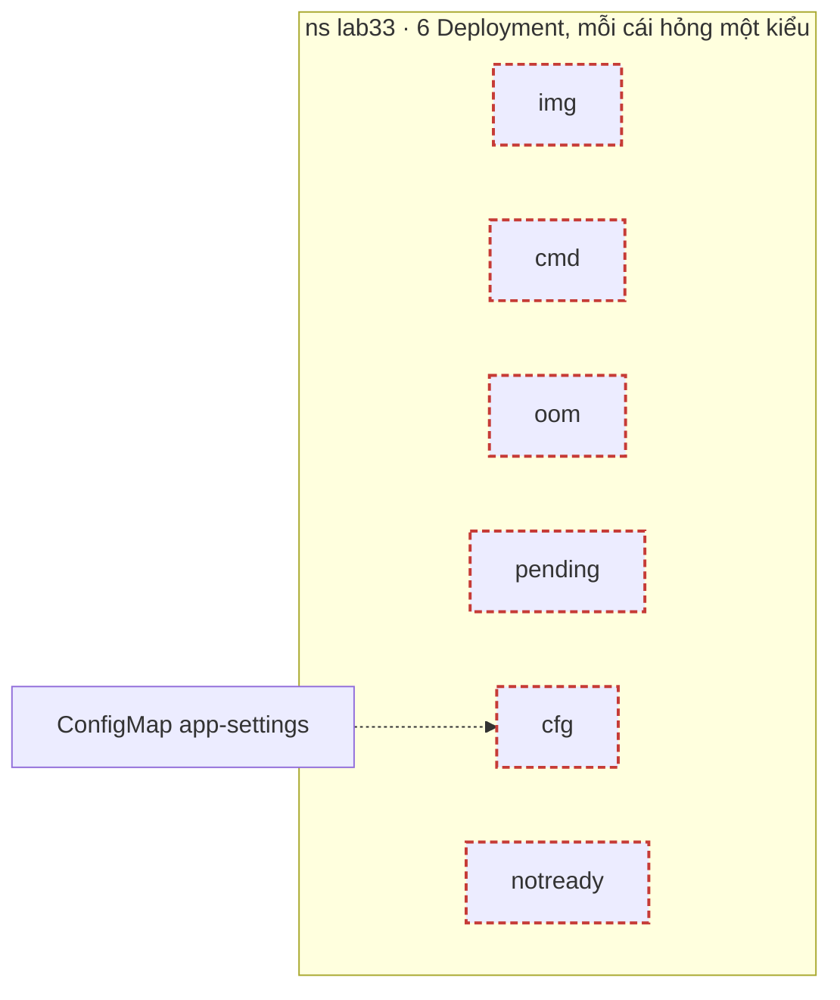
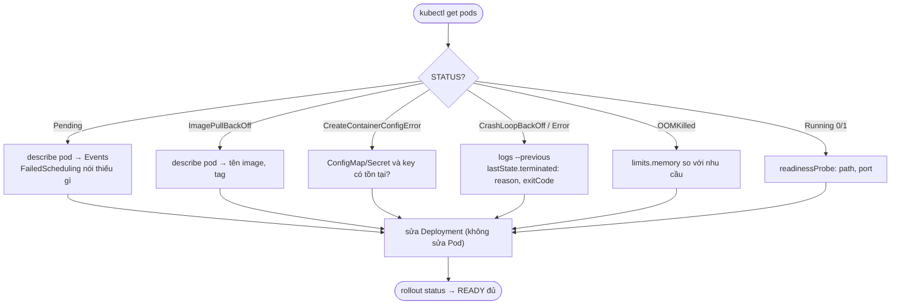

# Lab 33 · Troubleshooting ứng dụng: sáu Deployment hỏng

**Cấp độ 8 · Troubleshooting** · khoảng 40 phút · môi trường: kind hoặc kubeadm

Năng lực CKA: Troubleshooting › Quản lý và đánh giá output, log của container; Troubleshooting › Theo dõi tài nguyên cluster và ứng dụng; Workloads & Scheduling › Primitive cho ứng dụng tự phục hồi

Mức hỗ trợ: **Tự lực**. Đề bài kiểu phòng thi. Phần này chỉ đưa quy trình làm việc và cách kiểm chứng; chi tiết bạn tự tra như trong phòng thi.

## Mục tiêu

Chẩn đoán nhanh và sửa đúng sáu lỗi ứng dụng hay gặp nhất trong đề: image sai, lệnh sai, OOM, không xếp được node, thiếu cấu hình, probe sai.

## Cần làm trước

- [Lab 07 · Liveness, readiness và startup probe](../07-probes/README.md)
- [Lab 10 · Requests, limits, LimitRange và ResourceQuota](../10-resources-quota/README.md)

## Kiến thức cần nắm

- Quy trình: `kubectl get pods` (STATUS, RESTARTS) → `kubectl describe pod` (Events, Last State, Conditions) → `kubectl logs` và `logs --previous` → sửa Deployment, không sửa Pod.
- Bảng tra STATUS: `ImagePullBackOff`/`ErrImagePull` (image), `CrashLoopBackOff` (container chết lặp lại: xem exit code và log), `RunContainerError`/`StartError` (lệnh không chạy được), `CreateContainerConfigError` (thiếu ConfigMap/Secret), `Pending` (không xếp được node: đọc event `FailedScheduling`), `Running` nhưng `0/1` (readiness trượt).
- Exit code: `1` lỗi app, `126/127` lệnh không chạy được hoặc không tồn tại, `137` bị SIGKILL (thường `OOMKilled`), `143` SIGTERM.

## Sơ đồ

### Lab dựng gì



### Luồng hoạt động


Cây quyết định này dùng được cho mọi ứng dụng hỏng, trong thi lẫn ngoài thực tế.

## Chuẩn bị

```bash
./lab start 33
```

## Đề bài

1. Namespace `lab33` có sáu Deployment: `img`, `cmd`, `oom`, `pending`, `cfg`, `notready`. Mỗi cái hỏng một kiểu. Sửa để **cả sáu** đều sẵn sàng đủ replica.

2. Ràng buộc khi sửa: `img` dùng `nginx:1.27`; `cmd` vẫn chạy `sleep 3600`; `oom` giữ nguyên lệnh và chỉ đổi memory limit thành `256Mi`; `cfg` phải đọc biến từ ConfigMap `app-settings` với `MODE=prod`; `notready` giữ readinessProbe nhưng kiểm tra đúng đường dẫn.

3. Ghi lý do container của `oom` bị dừng (giá trị `reason` trong `lastState`) vào `~/cka-answers/33-oom.txt`.

## Quy trình tư duy

### Quy trình chẩn đoán ứng dụng

Làm cùng một vòng cho mọi Deployment, từ ngoài vào trong:

**Bước 1 · Toàn cảnh.** `kubectl get deploy,rs,pods -n lab33`. Ghi lại STATUS của từng Pod.

**Bước 2 · STATUS nói lên loại lỗi.**

| STATUS | Nhìn vào đâu |
|---|---|
| `ImagePullBackOff`, `ErrImagePull` | Events: tên image, tag, registry |
| `CrashLoopBackOff`, `Error` | `logs --previous`, `lastState.terminated` (reason, exitCode) |
| `OOMKilled` | limits memory so với nhu cầu thật |
| `Pending` | Events của Pod: scheduler nói thiếu gì |
| `CreateContainerConfigError` | ConfigMap/Secret được tham chiếu có tồn tại không, đúng key không |
| `Running` nhưng `0/1` | readinessProbe: path, port, lệnh |

**Bước 3 · Sửa ở Deployment, không sửa ở Pod.** Pod sẽ bị thay ngay, nên sửa template của Deployment.

**Bước 4 · Xác nhận từng cái** trước khi sang cái tiếp: `kubectl rollout status`.

### Kiểm chứng

`kubectl get deploy -n lab33`: cả 6 dòng có READY bằng DESIRED.

## Gợi ý

<details><summary>Nhìn toàn cảnh</summary>

`kubectl get pods -n lab33` rồi `kubectl get events -n lab33 --sort-by=.lastTimestamp | tail -20`

</details>

<details><summary>Lý do lần chết trước</summary>

`kubectl get pod <pod> -n lab33 -o jsonpath='{.status.containerStatuses[0].lastState.terminated.reason}'`

</details>

<details><summary>Pod Pending</summary>

`kubectl describe pod` → `0/3 nodes are available: … didn't match Pod's node affinity/selector`

</details>

## Chấm bài

```bash
./lab check 33
```

Lời giải: [SOLUTION.md](SOLUTION.md) (chỉ mở sau khi đã tự làm).

## Dọn dẹp

```bash
./lab reset 33
```

## Tài liệu

- [Debug Pods](https://kubernetes.io/docs/tasks/debug/debug-application/debug-pods/)
- [Determine the reason for Pod failure](https://kubernetes.io/docs/tasks/debug/debug-application/determine-reason-pod-failure/)

---

← [Lab 42 · Cài và dùng một Operator thật - cert-manager](../42-operator-cert-manager/README.md) · [Lab 34 · Troubleshooting mạng: Service, NetworkPolicy và DNS](../34-troubleshoot-network/README.md) →
