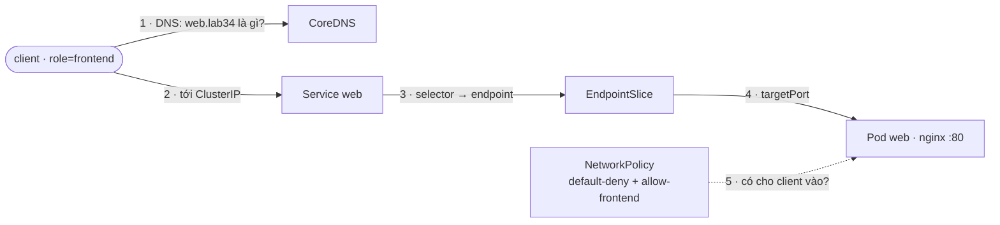
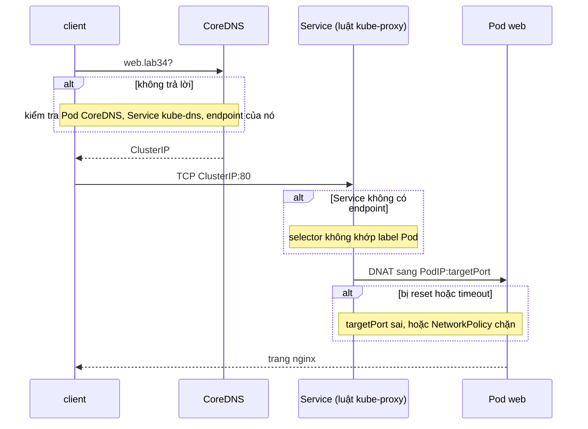

# Lab 34 · Troubleshooting mạng: Service, NetworkPolicy và DNS

**Cấp độ 8 · Troubleshooting** · khoảng 40 phút · môi trường: kind hoặc kubeadm

Năng lực CKA: Troubleshooting › Troubleshoot Service và networking; Services & Networking › NetworkPolicy; Services & Networking › CoreDNS

Mức hỗ trợ: **Tự lực**. Đề bài kiểu phòng thi. Phần này chỉ đưa quy trình làm việc và cách kiểm chứng; chi tiết bạn tự tra như trong phòng thi.

## Mục tiêu

Lần theo đường đi của một request bị hỏng ở nhiều chỗ cùng lúc: DNS, Service, endpoint, NetworkPolicy. Sửa từng lớp mà không phá bỏ chính sách bảo mật.

## Cần làm trước

- [Lab 16 · DNS trong cluster và CoreDNS](../16-dns-coredns/README.md)
- [Lab 17 · NetworkPolicy theo mô hình mặc định chặn](../17-network-policy/README.md)

## Kiến thức cần nắm

- Thứ tự kiểm tra: **DNS** (`nslookup web.lab34`) → **Service** có tồn tại, đúng cổng → **EndpointSlice** có IP không (selector, readiness, targetPort) → gọi thẳng **IP Pod** → **NetworkPolicy** → kube-proxy/CNI trên node.
- Gọi bằng IP Pod được mà bằng tên Service không được: lỗi ở DNS hoặc Service. Gọi IP Pod cũng không được: app, NetworkPolicy hoặc CNI.
- CoreDNS là Deployment `coredns` trong `kube-system`, Service tên `kube-dns`.

## Sơ đồ

### Lab dựng gì


Mỗi mũi tên là một chỗ có thể hỏng. Kiểm tra theo đúng thứ tự 1 → 5.

### Luồng hoạt động



## Chuẩn bị

```bash
./lab start 34
```

## Đề bài

1. Pod `client` trong `lab34` (label `role=frontend`) không gọi được `http://web.lab34`. Sửa mọi lỗi trên đường đi để `client` nhận được trang nginx.

2. Ràng buộc: **không** xóa hay sửa NetworkPolicy `default-deny`; **không** đổi label của `client` hay của Pod `web`; **không** tạo Service mới.

3. Ghi số lỗi bạn đã sửa vào `~/cka-answers/34-faults.txt`.

## Quy trình tư duy

### Quy trình chẩn đoán mạng

Đi theo đúng đường của một request, từ `client` tới container. Mỗi bước loại trừ một lớp:

1. **DNS:** `kubectl exec client -- nslookup web.lab34`. Thất bại thì xem Pod CoreDNS, Service `kube-dns` và endpoint của nó.
2. **Service → Pod:** `kubectl get endpointslices -l kubernetes.io/service-name=web`. Không có địa chỉ nghĩa là selector không khớp label.
3. **Cổng:** `port` của Service → `targetPort` → cổng container thực sự lắng nghe.
4. **Gọi thẳng IP Pod** (bỏ qua Service và DNS). Lệnh này thất bại thì vấn đề nằm ở NetworkPolicy hoặc ứng dụng.
5. **NetworkPolicy:** `kubectl get netpol -n lab34 -o yaml`. Với mỗi policy chọn Pod đích, tự hỏi: label của `client` có khớp `from` không, cổng có khớp không?

Mỗi lần sửa một lỗi, chạy lại từ bước 1. Lỗi sau thường bị lỗi trước che mất.

### Kiểm chứng

`kubectl exec client -n lab34 -- wget -qO- -T3 http://web.lab34` in trang nginx.

## Gợi ý

<details><summary>Bắt đầu từ DNS</summary>

`kubectl exec client -n lab34 -- nslookup web.lab34` báo lỗi? Xem `kubectl -n kube-system get deploy coredns`.

</details>

<details><summary>Gọi thẳng IP Pod để tách lỗi</summary>

`kubectl get pod -n lab34 -l app=web -o wide` rồi `kubectl exec client -n lab34 -- wget -qO- -T3 <pod-ip>`

</details>

## Chấm bài

```bash
./lab check 34
```

Lời giải: [SOLUTION.md](SOLUTION.md) (chỉ mở sau khi đã tự làm).

## Dọn dẹp

```bash
./lab reset 34
```

## Tài liệu

- [Debug Services](https://kubernetes.io/docs/tasks/debug/debug-application/debug-service/)
- [Debugging DNS resolution](https://kubernetes.io/docs/tasks/administer-cluster/dns-debugging-resolution/)

---

← [Lab 33 · Troubleshooting ứng dụng: sáu Deployment hỏng](../33-troubleshoot-apps/README.md) · [Lab 35 · Troubleshooting control plane: scheduler và controller-manager](../35-troubleshoot-control-plane/README.md) →
