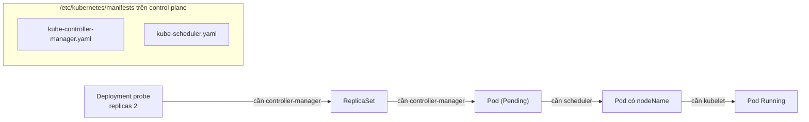
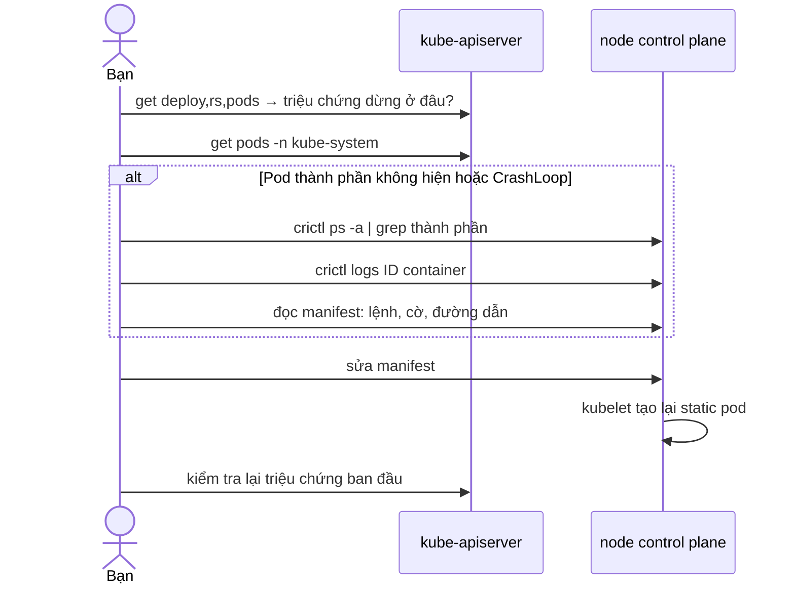

# Lab 35 · Troubleshooting control plane: scheduler và controller-manager

**Cấp độ 8 · Troubleshooting** · khoảng 40 phút · môi trường: kind hoặc kubeadm (cần vào node)

Năng lực CKA: Troubleshooting › Troubleshoot thành phần control plane

Mức hỗ trợ: **Tự lực**. Đề bài kiểu phòng thi. Phần này chỉ đưa quy trình làm việc và cách kiểm chứng; chi tiết bạn tự tra như trong phòng thi.

## Mục tiêu

Nhận ra thành phần control plane nào hỏng chỉ từ triệu chứng, đọc log khi kubectl không giúp được, và sửa static pod manifest.

## Cần làm trước

- [Lab 31 · Chứng chỉ, cấu hình control plane và kubelet](../31-control-plane-config/README.md)

## Kiến thức cần nắm

- Triệu chứng chỉ điểm: Deployment không có ReplicaSet → **kube-controller-manager**. Pod đứng `Pending` mà không có event → **kube-scheduler**. `kubectl` báo connection refused → **kube-apiserver** hoặc **etcd**.
- Control plane là static pod: log đọc bằng `kubectl -n kube-system logs <pod>`, hoặc trên node bằng `crictl ps -a` + `crictl logs <id>`, hoặc file trong `/var/log/pods/`. Pod không được tạo luôn thì xem `journalctl -u kubelet`.
- Sửa file trong `/etc/kubernetes/manifests` là đủ; kubelet tự tạo lại Pod (có thể mất 20–60 giây).

## Sơ đồ

### Lab dựng gì


Dừng ở bước nào thì thành phần ứng với mũi tên đó đang hỏng.

### Luồng hoạt động



## Chuẩn bị

```bash
./lab start 35
```

## Đề bài

1. Deployment `probe` trong `lab35` (2 replica) đã được tạo nhưng không có Pod nào. Tìm thành phần control plane hỏng và sửa.

2. Sau đó Pod của `probe` vẫn không chạy. Tìm và sửa thành phần thứ hai.

3. Ghi tên hai thành phần đã sửa (ví dụ `kube-apiserver`), mỗi tên một dòng, vào `~/cka-answers/35-components.txt`.

## Quy trình tư duy

### Quy trình chẩn đoán control plane

Biết thành phần nào làm việc gì thì triệu chứng chỉ thẳng vào nó:

| Triệu chứng | Thành phần |
|---|---|
| kubectl không kết nối được | kube-apiserver (hoặc etcd phía sau) |
| Deployment có nhưng không có ReplicaSet/Pod | kube-controller-manager |
| Pod có nhưng `Pending` mãi, không có event scheduler | kube-scheduler |
| Pod đã có node nhưng không chạy | kubelet trên node đó |

1. `kubectl get pods -n kube-system`: thành phần nào không `Running`?
2. `kubectl -n kube-system logs <pod>` hoặc `describe`. Nếu Pod không hiện, vào node: `crictl ps -a | grep <thành phần>`, rồi `crictl logs <id>`.
3. Lỗi thường ở manifest `/etc/kubernetes/manifests/<thành phần>.yaml`: cờ sai tên, đường dẫn file sai, image sai.
4. Sửa manifest, chờ kubelet tạo lại, xác nhận bằng triệu chứng ban đầu.

### Kiểm chứng

Deployment `probe` có 2/2 Pod Running.

## Gợi ý

<details><summary>Không có ReplicaSet</summary>

`kubectl get rs -n lab35` trống → ai tạo ReplicaSet? `kubectl -n kube-system get pods | grep controller`

</details>

<details><summary>Container control plane chết ngay khi khởi động</summary>

`./lab ssh $CP` rồi `crictl ps -a | grep -E 'scheduler|controller'` và `crictl logs <container-id>`

</details>

## Chấm bài

```bash
./lab check 35
```

Lời giải: [SOLUTION.md](SOLUTION.md) (chỉ mở sau khi đã tự làm).

## Dọn dẹp

```bash
./lab reset 35
```

## Tài liệu

- [Troubleshooting clusters](https://kubernetes.io/docs/tasks/debug/debug-cluster/)
- [Debugging Kubernetes nodes with crictl](https://kubernetes.io/docs/tasks/debug/debug-cluster/crictl/)

---

← [Lab 34 · Troubleshooting mạng: Service, NetworkPolicy và DNS](../34-troubleshoot-network/README.md) · [Lab 36 · Troubleshooting node: worker NotReady](../36-troubleshoot-node/README.md) →
