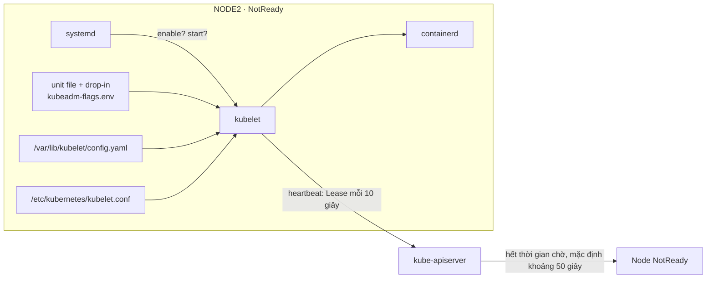
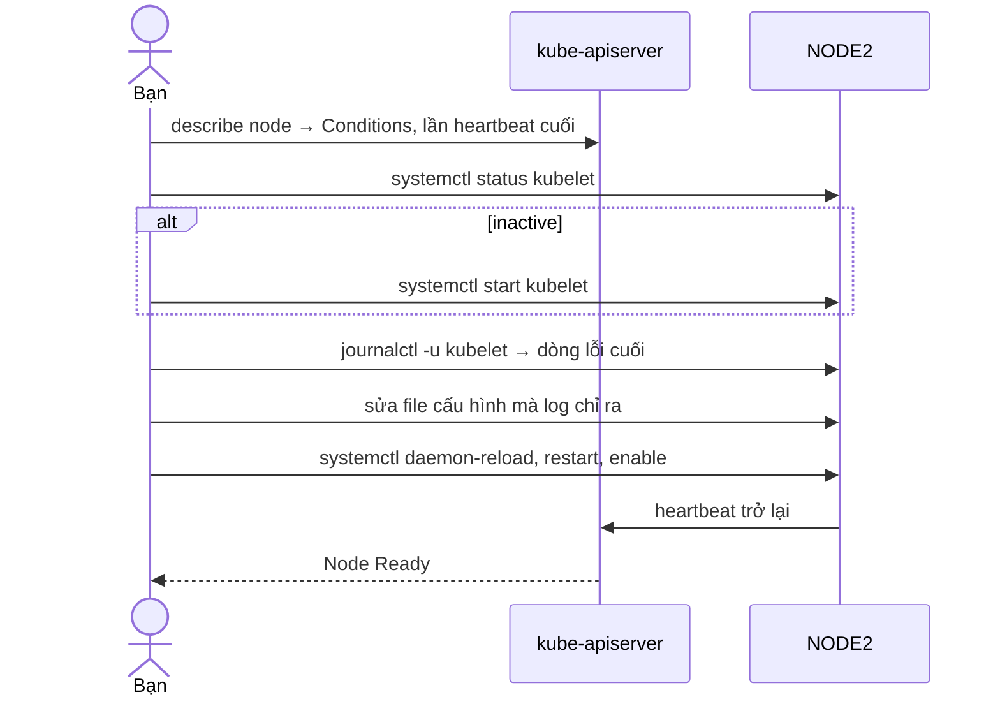

# Lab 36 · Troubleshooting node: worker NotReady

**Cấp độ 8 · Troubleshooting** · khoảng 35 phút · môi trường: kind hoặc kubeadm (cần vào node)

Năng lực CKA: Troubleshooting › Troubleshoot cluster và node

Mức hỗ trợ: **Tự lực**. Đề bài kiểu phòng thi. Phần này chỉ đưa quy trình làm việc và cách kiểm chứng; chi tiết bạn tự tra như trong phòng thi.

## Mục tiêu

Đưa một worker `NotReady` trở lại: xác định kubelet có chạy không, đọc journal để tìm cấu hình sai, sửa và bảo đảm kubelet tự chạy sau khi khởi động lại máy.

## Cần làm trước

- [Lab 14 · Static pod, lập lịch thủ công và bảo trì node](../14-static-pod-maintenance/README.md)

## Kiến thức cần nắm

- Node `NotReady` (hoặc `Unknown`) phần lớn do kubelet: không chạy, chạy rồi chết vì cấu hình sai, không nói chuyện được với container runtime, hoặc chứng chỉ hết hạn.
- Trên node: `systemctl status kubelet`, `journalctl -u kubelet -n 50`, cấu hình ở `/var/lib/kubelet/config.yaml`, cờ ở `/var/lib/kubelet/kubeadm-flags.env`, unit drop-in ở `/usr/lib/systemd/system/kubelet.service.d/10-kubeadm.conf`.
- `systemctl enable --now kubelet` vừa chạy ngay vừa tự chạy khi boot. Chỉ `start` thì sau reboot lại hỏng.

## Sơ đồ

### Lab dựng gì



### Luồng hoạt động



## Chuẩn bị

```bash
./lab start 36
```

## Đề bài

1. `$NODE2` đang `NotReady`. Đưa nó về `Ready`.

2. Bảo đảm kubelet trên `$NODE2` tự khởi động cùng máy.

3. Ghi đường dẫn file cấu hình mà bạn đã sửa vào `~/cka-answers/36-file.txt`.

## Quy trình tư duy

### Quy trình chẩn đoán node

1. **Từ ngoài:** `kubectl describe node <node>`, phần `Conditions` và thời điểm heartbeat cuối.
2. **Vào node:** `systemctl status kubelet`. Có ba khả năng: không chạy, chạy rồi chết liên tục, hoặc chạy nhưng không nói chuyện được với API server.
3. **Đọc log:** `journalctl -u kubelet --no-pager | tail -50`. Dòng `failed`, `error` cuối cùng thường nói thẳng file nào, cờ nào sai.
4. **Nơi kubelet lấy cấu hình:** unit file và drop-in (`systemctl cat kubelet`), `/var/lib/kubelet/config.yaml`, `/etc/kubernetes/kubelet.conf`.
5. **Sau khi sửa:** `systemctl daemon-reload` nếu đã đổi unit file, `systemctl restart kubelet`, và đảm bảo nó được `enable`.

### Kiểm chứng

- `kubectl get nodes`: node `Ready` sau khoảng 30 giây.
- `systemctl is-enabled kubelet` trả về `enabled`.

## Gợi ý

<details><summary>kubelet có chạy không?</summary>

`./lab ssh $NODE2` rồi `systemctl status kubelet`

</details>

<details><summary>kubelet chạy rồi chết</summary>

`journalctl -u kubelet -n 30 --no-pager` và tìm dòng `failed to load` / `no such file`.

</details>

## Chấm bài

```bash
./lab check 36
```

Lời giải: [SOLUTION.md](SOLUTION.md) (chỉ mở sau khi đã tự làm).

## Dọn dẹp

```bash
./lab reset 36
```

## Tài liệu

- [Troubleshooting clusters](https://kubernetes.io/docs/tasks/debug/debug-cluster/)
- [kubelet configuration file](https://kubernetes.io/docs/tasks/administer-cluster/kubelet-config-file/)

---

← [Lab 35 · Troubleshooting control plane: scheduler và controller-manager](../35-troubleshoot-control-plane/README.md) · [Lab 37 · Theo dõi tài nguyên, event và log](../37-monitoring-logs/README.md) →
