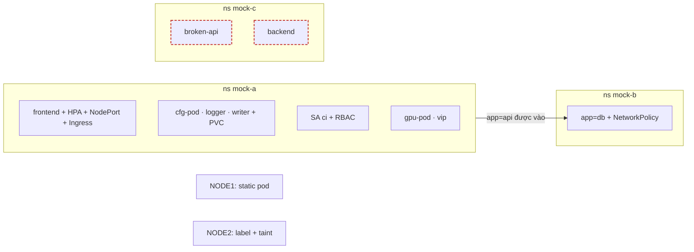
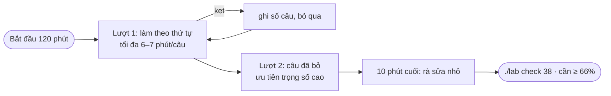

# Lab 38 · Đề thi thử CKA (2 giờ, 16 câu)

**Cấp độ 9 · Thi thử** · khoảng 120 phút · môi trường: kind hoặc kubeadm (cần vào node)

Năng lực CKA: Troubleshooting › Troubleshoot cluster và node; Troubleshooting › Quản lý và đánh giá output, log của container; Troubleshooting › Troubleshoot Service và networking; Cluster Architecture › Quản lý RBAC; Services & Networking › NetworkPolicy; Services & Networking › Service ClusterIP, NodePort, LoadBalancer và endpoints; Services & Networking › Ingress controller và Ingress; Workloads & Scheduling › Deployment, rolling update, rollback; Workloads & Scheduling › ConfigMap và Secret; Workloads & Scheduling › Autoscaling; Workloads & Scheduling › Primitive cho ứng dụng tự phục hồi; Workloads & Scheduling › Admission và scheduling của Pod; Storage › StorageClass và dynamic provisioning; Storage › PersistentVolume và PersistentVolumeClaim

Mức hỗ trợ: **Tự lực**. Đề bài kiểu phòng thi. Phần này chỉ đưa quy trình làm việc và cách kiểm chứng; chi tiết bạn tự tra như trong phòng thi.

## Mục tiêu

Làm một đề tổng hợp trong 120 phút như phòng thi thật. Mỗi câu có trọng số; câu chỉ được điểm khi đúng **toàn bộ**. Cần **66%** để đậu.

## Cần làm trước

Mọi lab từ 02 tới 37.

## Kiến thức cần nắm

- Đọc lướt cả 16 câu trước, làm câu dễ và nặng điểm trước. Câu nào kẹt quá 8 phút thì bỏ qua, quay lại sau.
- Sinh YAML bằng `$do`, tra field bằng `kubectl explain`, chỉ mở tài liệu khi cần ví dụ dài (NetworkPolicy, PV, Ingress).
- Sau mỗi câu, kiểm tra nhanh bằng `kubectl get`: đề thi chấm trạng thái trong cluster, không chấm file YAML.
- Chỉ chạy `./lab check 38` khi đã hết giờ hoặc làm xong, để luyện cảm giác tự kiểm tra.
- **Chế độ phòng thi:** mỗi câu ghi host. Vào host bằng `./lab ssh <host>` (phòng thi thật: `ssh <host>` rồi `sudo -i`), làm trên đó, xong `exit` về máy của bạn. Setup đã cài kubectl, kubeconfig và `alias k` lên mọi node. Đừng làm hết từ máy của bạn: tập thói quen đổi host ngay từ bây giờ.

## Sơ đồ

### Lab dựng gì



### Luồng hoạt động



## Chuẩn bị

```bash
./lab start 38
```

Setup tạo sẵn các namespace `mock-a`, `mock-b`, `mock-c` cùng vài workload, gắn label và taint lên `$NODE2`, rồi in giờ bắt đầu. Bấm đồng hồ 120 phút. Trên trang hướng dẫn HTML có đồng hồ đếm ngược.

## Đề bài

1. **Host `$CP`** · **(4%)** Tạo namespace `mock-x` có label `env=exam`.

2. **Host `$NODE1`** · **(8%)** Trong `mock-a`, tạo Deployment `frontend`: 3 replica, `nginx:1.27`, request CPU `100m`, rolling update `maxSurge: 1`, `maxUnavailable: 0`. Sau đó nâng lên `nginx:1.28` với change-cause `exam upgrade`.

3. **Host `$NODE2`** · **(5%)** Trong `mock-a`, tạo ConfigMap `exam-cfg` (`LEVEL=hard`) và Secret `exam-sec` (`token=abc123`). Tạo Pod `cfg-pod` (`busybox:1.36`, `sleep 3600`) có biến `LEVEL` từ ConfigMap và `TOKEN` từ key `token` của Secret.

4. **Host `$CP`** · **(6%)** Tạo HPA cho `frontend`: 3 tới 6 replica, CPU mục tiêu 60%.

5. **Host `$NODE2`** · **(6%)** `$NODE2` có label `exam-role=gpu` và taint `exam=true:NoSchedule`. Tạo Pod `gpu-pod` (`nginx:1.27`) trong `mock-a` chạy trên đúng node đó.

6. **Host `$NODE1`** · **(5%)** Tạo Pod `logger` trong `mock-a`: container `app` (`busybox:1.36`) ghi `tick` vào `/var/log/app.log` mỗi 2 giây; sidecar kiểu native tên `tail` (`busybox:1.36`) chạy `tail -F /var/log/app.log`. Hai container dùng chung emptyDir.

7. **Host `$CP`** · **(6%)** Tạo Service `frontend-np` kiểu NodePort cho `frontend`, cổng 80, nodePort `30090`.

8. **Host `$NODE2`** · **(8%)** Trong `mock-b`, tạo NetworkPolicy `db-access`: Pod `app=db` chỉ nhận TCP 80 từ Pod `app=api` **trong namespace `mock-a`**.

9. **Host `$NODE1`** · **(5%)** Tạo Ingress `frontend` trong `mock-a`: host `exam.local`, path `/` (Prefix) tới `frontend-np:80`.

10. **Host `$CP`** · **(6%)** Tạo PVC `exam-data` (1Gi, RWO, StorageClass mặc định) trong `mock-a` và Pod `writer` (`busybox:1.36`) gắn nó tại `/data`, ghi file `/data/ok` rồi `sleep 3600`.

11. **Host `$NODE2`** · **(6%)** Tạo ServiceAccount `ci` trong `mock-a`, chỉ được `create` Deployment và `get, list` Pod trong `mock-a`.

12. **Host `$NODE1`** · **(6%)** Tạo static pod `exam-static` (`nginx:1.27`) trên `$NODE1`.

13. **Host `$CP`** · **(10%)** Deployment `broken-api` trong `mock-c` không có Pod nào sẵn sàng. Sửa để 2/2 sẵn sàng, giữ readinessProbe.

14. **Host `$NODE1`** · **(8%)** Service `backend` trong `mock-c` không có endpoint. Sửa để gọi `http://backend.mock-c` được (không sửa Deployment `backend`).

15. **Máy của bạn** · **(6%)** Ghi vào `~/cka-answers/38-nodes.txt` mỗi node một dòng dạng `<tên> <phiên bản kubelet>`, sắp theo tên.

16. **Host `$NODE2`** · **(5%)** Tạo PriorityClass `exam-high` (value `100000`) và Pod `vip` (`nginx:1.27`) trong `mock-a` dùng nó.

## Quy trình tư duy

### Chiến lược 120 phút

1. **Lượt 1 (khoảng 70 phút):** làm theo thứ tự, mỗi câu tối đa 6–7 phút. Câu nào kẹt thì ghi số câu ra giấy rồi bỏ qua.
2. **Lượt 2 (khoảng 35 phút):** quay lại các câu đã bỏ, ưu tiên câu trọng số cao.
3. **10 phút cuối:** rà lại các câu chỉ cần sửa nhỏ. Không bắt đầu câu lớn mới.

### Thói quen mỗi câu

- Chạy lệnh `use-context` của đề bài (trong lab này cùng một cluster, nhưng hãy giữ thói quen).
- Đọc **hết** đề, gạch chân namespace, tên object, cổng và phiên bản.
- Sinh YAML bằng `$do`, đừng gõ tay; tra trang tài liệu khi cần YAML mẫu.
- Tự kiểm ngay: `get`, `describe`, `exec … wget`, `auth can-i`.

### Phân bổ theo domain

Troubleshooting chiếm 30% của đề thật. Nếu điểm thi thử thấp ở câu 13–14, quay lại lab 33–37 trước khi thi thử lần nữa.

### Chấm và ôn

```bash
./lab check 38      # bảng điểm theo câu, cần ≥ 66%
./lab reset 38 && ./lab start 38    # làm lại từ đầu
```

## Gợi ý

<details><summary>Câu 8: AND giữa namespace và Pod</summary>

`namespaceSelector` và `podSelector` nằm **cùng một** phần tử của `from`.

</details>

<details><summary>Câu 13 có hai lỗi</summary>

Một lỗi làm Pod không chạy, một lỗi làm Pod chạy mà không Ready.

</details>

## Chấm bài

```bash
./lab check 38
```

Lời giải: [SOLUTION.md](SOLUTION.md) (chỉ mở sau khi đã tự làm).

## Dọn dẹp

```bash
./lab reset 38
```

## Tài liệu

- [CKA curriculum](https://github.com/cncf/curriculum)
- [Linux Foundation CKA](https://training.linuxfoundation.org/certification/certified-kubernetes-administrator-cka/)
- [kubectl quick reference](https://kubernetes.io/docs/reference/kubectl/quick-reference/)

---

← [Lab 37 · Theo dõi tài nguyên, event và log](../37-monitoring-logs/README.md) · [Lab 45 · Đề thi thử 2 - chế độ phòng thi (2 giờ, 16 câu)](../45-mock-exam-2/README.md) →
