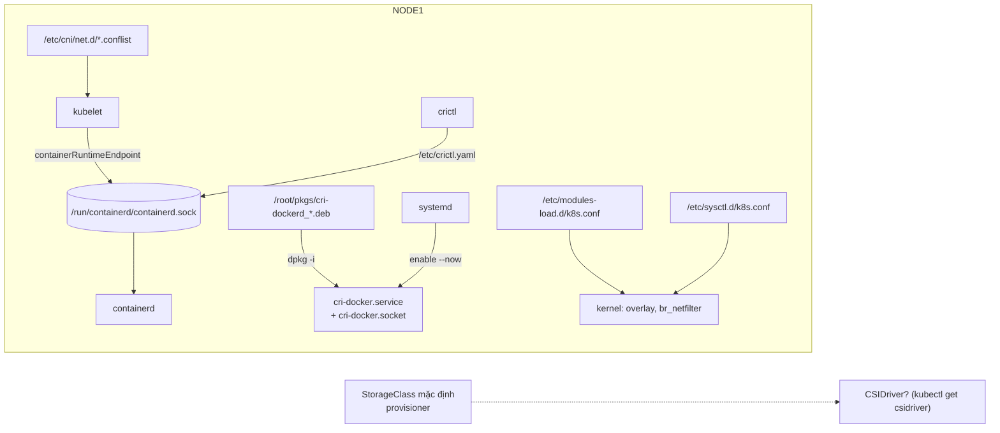
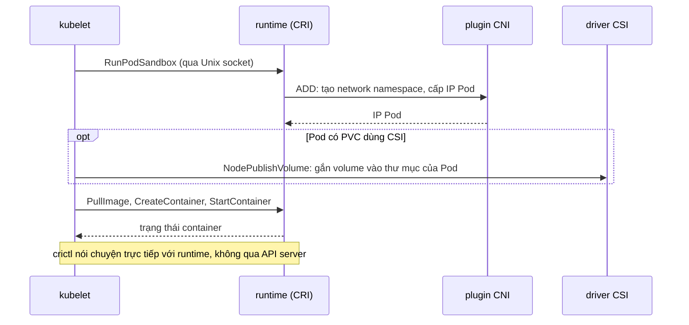

# Lab 39 · Chuẩn bị node - container runtime, kernel và CRI

**Cấp độ 7 · Vận hành cluster** · khoảng 35 phút · môi trường: kind hoặc kubeadm (cần vào node)

Năng lực CKA: Cluster Architecture › Chuẩn bị hạ tầng để cài cluster; Cluster Architecture › Interface mở rộng: CNI, CSI, CRI; Troubleshooting › Troubleshoot cluster và node

Mức hỗ trợ: **Tự lực**. Đề bài kiểu phòng thi. Phần này chỉ đưa quy trình làm việc và cách kiểm chứng; chi tiết bạn tự tra như trong phòng thi.

## Mục tiêu

Tự tay làm phần "chuẩn bị hạ tầng" mà đề thi hay hỏi: cài gói container runtime bằng `dpkg`, bật service bằng systemd, nạp module và sysctl cho Kubernetes, sửa `crictl`, và đọc ra node đang dùng CRI, CNI, CSI nào.

## Cần làm trước

- [Lab 14 · Static pod, lập lịch thủ công và bảo trì node](../14-static-pod-maintenance/README.md)

## Kiến thức cần nắm

- **CRI** (Container Runtime Interface): kubelet nói chuyện với runtime (containerd, CRI-O, cri-dockerd) qua một Unix socket. Đường dẫn socket nằm ở `containerRuntimeEndpoint` trong `/var/lib/kubelet/config.yaml` hoặc cờ `--container-runtime-endpoint` trong `/var/lib/kubelet/kubeadm-flags.env`.
- **cri-dockerd** là lớp CRI cho Docker Engine. Gói `.deb` cài bằng `dpkg -i`, rồi `systemctl enable --now cri-docker.service` (bật ngay và tự chạy khi khởi động máy).
- Kubernetes cần module `overlay` và `br_netfilter`, và sysctl `net.ipv4.ip_forward = 1`, `net.bridge.bridge-nf-call-iptables = 1` (IPv6: `net.ipv6.conf.all.forwarding = 1`). Ghi vào file trong `/etc/modules-load.d/` và `/etc/sysctl.d/` để còn sau khi khởi động lại, rồi `sysctl --system` để áp dụng ngay.
- **CNI**: cấu hình ở `/etc/cni/net.d/`, binary ở `/opt/cni/bin/`. **CSI**: driver đăng ký object `CSIDriver`; provisioner của StorageClass cho biết ai tạo volume.
- `crictl` đọc `/etc/crictl.yaml` để biết socket. Sai socket thì mọi lệnh `crictl` báo lỗi kết nối.

## Sơ đồ

### Lab dựng gì


CRI, CNI, CSI là ba giao diện mở rộng của kubelet: runtime container, mạng Pod, lưu trữ.

### Luồng hoạt động



## Chuẩn bị

```bash
./lab start 39
```

Bài làm trên `$NODE1` (`./lab ssh $NODE1`). Setup đặt sẵn file `/root/pkgs/cri-dockerd_0.4.9-lab_<arch>.deb` trên node.

Gói này là **gói mô phỏng** do setup tự đóng: nó có đúng tên, unit systemd `cri-docker.service` và `cri-docker.socket` như gói thật, nhưng chỉ giữ một tiến trình chạy, vì node kind không có Docker Engine. Thao tác `dpkg` và `systemctl` giống hệt khi cài gói thật trong phòng thi.

## Đề bài

1. Trên `$NODE1`, cài gói `cri-dockerd` từ file `.deb` trong `/root/pkgs/`. Bật `cri-docker.service` ngay bây giờ và tự chạy khi khởi động máy.

2. Đảm bảo module `overlay` và `br_netfilter` được nạp mỗi lần khởi động, bằng file `/etc/modules-load.d/k8s.conf`.

3. Tạo `/etc/sysctl.d/k8s.conf` đặt `net.bridge.bridge-nf-call-iptables = 1`, `net.ipv6.conf.all.forwarding = 1`, `net.ipv4.ip_forward = 1`, và áp dụng ngay không cần khởi động lại.

4. `crictl ps` trên `$NODE1` đang báo lỗi. Sửa cấu hình của `crictl` để nó dùng containerd.

5. Trên máy của bạn, ghi vào `~/cka-answers/`: socket CRI mà kubelet của `$NODE1` đang dùng (dạng `unix:///…`) vào `39-endpoint.txt`; tên file cấu hình CNI trong `/etc/cni/net.d/` của `$NODE1` vào `39-cni.txt`; provisioner của StorageClass mặc định vào `39-provisioner.txt`.

## Quy trình tư duy

### Quy trình

1. **Đọc trước, làm sau.** Trên node: `cat /etc/os-release`, `systemctl status <service>`, `ls /etc/sysctl.d /etc/modules-load.d`. Biết hiện trạng rồi mới sửa.
2. **Cài gói:** `dpkg -i <file>.deb`. Gói có unit systemd thì luôn `systemctl daemon-reload`, rồi `enable --now`. Một lệnh vừa bật khi khởi động vừa chạy ngay.
3. **Kernel:** ghi file trong `/etc/modules-load.d/` và `/etc/sysctl.d/` (còn sau khi khởi động lại), rồi áp dụng ngay bằng `modprobe` và `sysctl --system`.
4. **CRI:** socket mà kubelet dùng nằm trong cấu hình kubelet. `crictl` có cấu hình riêng ở `/etc/crictl.yaml`; hai chỗ này phải trỏ cùng một runtime.

### Kiểm chứng

- `dpkg -l | grep <gói>` thấy trạng thái `ii`.
- `systemctl is-enabled` và `systemctl is-active` trả về `enabled` và `active`.
- `sysctl <key>` từng khóa trả về `1`.
- `crictl ps` liệt kê container, không báo lỗi kết nối.

### Bẫy

- Quên `--now` thì service được bật cho lần khởi động sau nhưng chưa chạy. Quên `enable` thì chạy bây giờ nhưng mất sau khi khởi động lại. Đề thường chấm cả hai.
- Ghi sysctl vào `/etc/sysctl.conf` vẫn được, nhưng file riêng trong `/etc/sysctl.d/` dễ kiểm tra và đúng với tài liệu Kubernetes.

## Gợi ý

<details><summary>Cài và bật service</summary>

`dpkg -i <file>.deb`, rồi `systemctl daemon-reload` và `systemctl enable --now cri-docker.service`. Kiểm tra: `systemctl is-enabled` và `systemctl is-active`.

</details>

<details><summary>crictl dùng socket nào?</summary>

`cat /etc/crictl.yaml`. Socket của containerd thường là `unix:///run/containerd/containerd.sock`; xem nó có tồn tại không bằng `ls -l /run/containerd/`.

</details>

<details><summary>Tìm socket CRI của kubelet</summary>

`grep -i endpoint /var/lib/kubelet/config.yaml /var/lib/kubelet/kubeadm-flags.env`

</details>

## Chấm bài

```bash
./lab check 39
```

Lời giải: [SOLUTION.md](SOLUTION.md) (chỉ mở sau khi đã tự làm).

## Dọn dẹp

```bash
./lab reset 39
```

## Tài liệu

- [Container Runtimes (cài đặt và sysctl)](https://kubernetes.io/docs/setup/production-environment/container-runtimes/)
- [Debugging Kubernetes nodes with crictl](https://kubernetes.io/docs/tasks/debug/debug-cluster/crictl/)
- [Network Plugins](https://kubernetes.io/docs/concepts/extend-kubernetes/compute-storage-net/network-plugins/)
- [CSI Volumes](https://kubernetes.io/docs/concepts/storage/volumes/#csi)

---

← [Lab 32 · Thêm control plane cho cluster HA](../32-control-plane-ha/README.md) · [Lab 40 · Cài CNI Calico bằng Tigera Operator](../40-cni-tigera-operator/README.md) →
