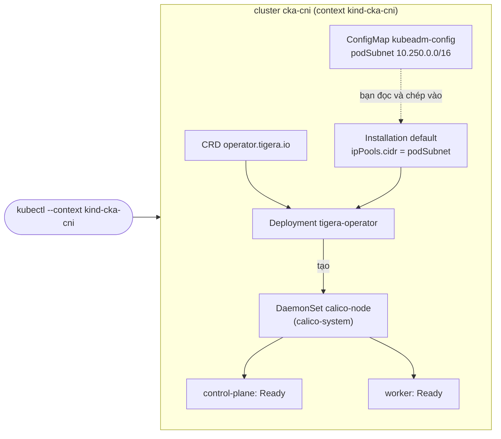
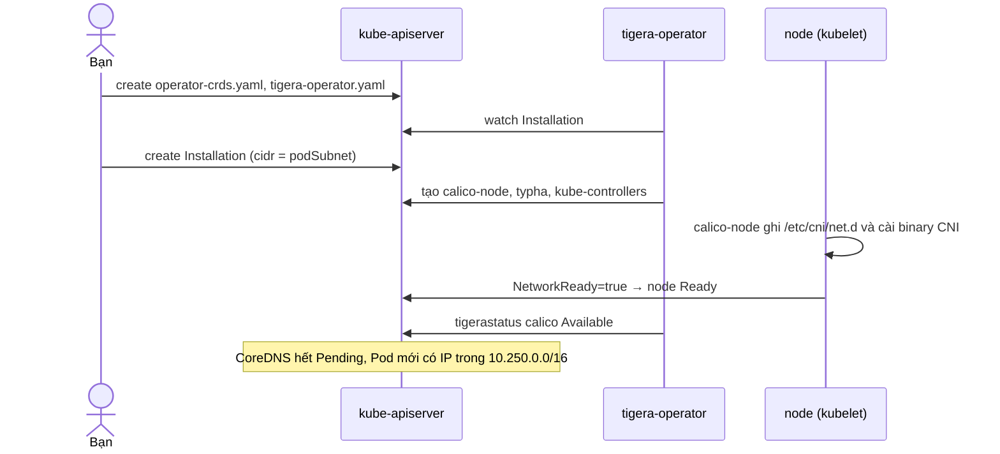

# Lab 40 · Cài CNI Calico bằng Tigera Operator

**Cấp độ 7 · Vận hành cluster** · khoảng 40 phút · môi trường: kind hoặc kubeadm

Năng lực CKA: Cluster Architecture › Interface mở rộng: CNI, CSI, CRI; Cluster Architecture › Chuẩn bị hạ tầng để cài cluster; Services & Networking › Kết nối giữa các Pod; Services & Networking › NetworkPolicy

Mức hỗ trợ: **Tự lực**. Đề bài kiểu phòng thi. Phần này chỉ đưa quy trình làm việc và cách kiểm chứng; chi tiết bạn tự tra như trong phòng thi.

## Mục tiêu

Cài một CNI cho cluster mới hoàn toàn chưa có mạng Pod, theo đúng cách đề thi gần đây hỏi: cài Tigera Operator rồi khai báo resource `Installation` khớp Pod CIDR của cluster. Làm quen việc làm trên một cluster khác bằng `--context`.

## Cần làm trước

- [Lab 01 · Cài cluster bằng kubeadm trên máy ảo](../01-kubeadm-install/README.md)
- [Lab 17 · NetworkPolicy theo mô hình mặc định chặn](../17-network-policy/README.md)

## Kiến thức cần nắm

- Cluster vừa `kubeadm init` không có CNI: node `NotReady`, CoreDNS `Pending`. Kubelet báo `container runtime network not ready: cni plugin not initialized`.
- **Tigera Operator** là cách cài Calico được khuyên dùng: (1) `kubectl create -f operator-crds.yaml`, (2) `kubectl create -f tigera-operator.yaml`, (3) tạo resource `Installation` (và `APIServer`) mô tả cấu hình. Operator đọc `Installation` rồi tự tạo DaemonSet `calico-node` trong namespace `calico-system`.
- `Installation.spec.calicoNetwork.ipPools[].cidr` phải nằm trong Pod CIDR của cluster (`networking.podSubnet` trong ConfigMap `kubeadm-config` của `kube-system`).
- Dùng `kubectl create` cho manifest CRD lớn của Calico: `kubectl apply` lưu cả object vào annotation và có thể vượt giới hạn kích thước.
- Kiểm tra: `kubectl get tigerastatus` (cột AVAILABLE), node `Ready`, Pod ở hai node gọi được nhau.

## Sơ đồ

### Lab dựng gì



### Luồng hoạt động



## Chuẩn bị

```bash
./lab start 40
```

Setup dùng kind tạo thêm cluster `cka-cni` (1 control plane, 1 worker) **không có CNI**, Pod CIDR khác mặc định. Cluster `cka` của bạn không bị đụng tới, context hiện tại cũng được giữ nguyên. Cần `kind`, Docker, và internet để tải Calico.

Làm bài trên context `kind-cka-cni`: hoặc `kubectl config use-context kind-cka-cni` (giống dòng đầu mỗi câu trong phòng thi, nhớ đổi lại sau), hoặc thêm `--context kind-cka-cni` vào mọi lệnh.

## Đề bài

1. Trên context `kind-cka-cni`, xác nhận node đang `NotReady` vì thiếu CNI. Tìm Pod CIDR của cluster và ghi vào `~/cka-answers/40-pod-cidr.txt`.

2. Cài Tigera Operator của Calico **v3.33.0** từ manifest chính thức (`operator-crds.yaml` và `tigera-operator.yaml`).

3. Tạo resource `Installation` tên `default` để operator cài Calico với một IP pool đúng bằng Pod CIDR của cluster, encapsulation `VXLANCrossSubnet`.

4. Chờ cả hai node `Ready` và `tigerastatus` báo `calico` sẵn sàng.

5. Kiểm tra mạng: Pod chạy trên node control plane gọi được HTTP tới Pod chạy trên worker. (Bài tự kiểm tra bằng Pod tạm.)

## Quy trình tư duy

### Quy trình

1. **Đúng cluster trước đã.** Chạy `kubectl config use-context kind-cka-cni` (như dòng đầu mỗi câu trong phòng thi), rồi `kubectl config current-context` để chắc chắn.
2. **Chẩn đoán:** `kubectl get nodes` (NotReady), `kubectl describe node` (dòng `NetworkPluginNotReady`), Pod CoreDNS `Pending`.
3. **Tìm Pod CIDR** trong ConfigMap `kubeadm-config`. Đây là con số quan trọng nhất của cả bài.
4. **Cài operator** theo đúng thứ tự trong tài liệu Calico: CRD → operator → `Installation`. Dùng `kubectl create`, không dùng `apply`.
5. **Sửa `Installation`** trước khi tạo: `cidr` khớp Pod CIDR.
6. **Chờ và quan sát:** `kubectl get tigerastatus`, `kubectl get pods -n calico-system -w`.

### Kiểm chứng

- `kubectl get nodes` cho thấy mọi node `Ready`.
- `kubectl get tigerastatus` cho thấy `calico` `AVAILABLE True`.
- Hai Pod trên hai node gọi được nhau bằng IP Pod.

### Bẫy

- Để nguyên `cidr: 192.168.0.0/16` của file mẫu: Calico cấp IP ngoài dải của cluster, kube-proxy và NetworkPolicy chạy sai.
- Làm xong nhớ đổi context về `kind-cka`, nếu không các lab sau sẽ chạy nhầm cluster.

## Gợi ý

<details><summary>Pod CIDR ở đâu?</summary>

`kubectl --context kind-cka-cni -n kube-system get cm kubeadm-config -o yaml | grep podSubnet`

</details>

<details><summary>Khung Installation</summary>

Lấy `custom-resources.yaml` cùng phiên bản, sửa `cidr`, giữ lại khối `Installation` (và `APIServer` nếu muốn).

</details>

<details><summary>Operator chưa làm gì?</summary>

`kubectl --context kind-cka-cni -n tigera-operator logs deploy/tigera-operator` và `kubectl --context kind-cka-cni get tigerastatus`.

</details>

## Chấm bài

```bash
./lab check 40
```

Lời giải: [SOLUTION.md](SOLUTION.md) (chỉ mở sau khi đã tự làm).

## Dọn dẹp

```bash
./lab reset 40
```

## Tài liệu

- [Calico · Quickstart với operator](https://docs.tigera.io/calico/latest/getting-started/kubernetes/quickstart)
- [Network Plugins](https://kubernetes.io/docs/concepts/extend-kubernetes/compute-storage-net/network-plugins/)
- [kind · disableDefaultCNI](https://kind.sigs.k8s.io/docs/user/configuration/#disable-default-cni)

---

← [Lab 39 · Chuẩn bị node - container runtime, kernel và CRI](../39-node-runtime-prep/README.md) · [Lab 41 · Helm với repo và OCI - Argo CD, sửa release lỗi](../41-helm-repo-oci/README.md) →
