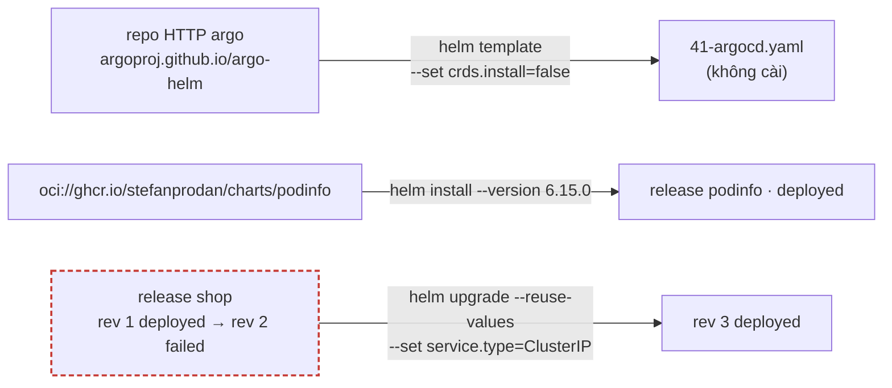
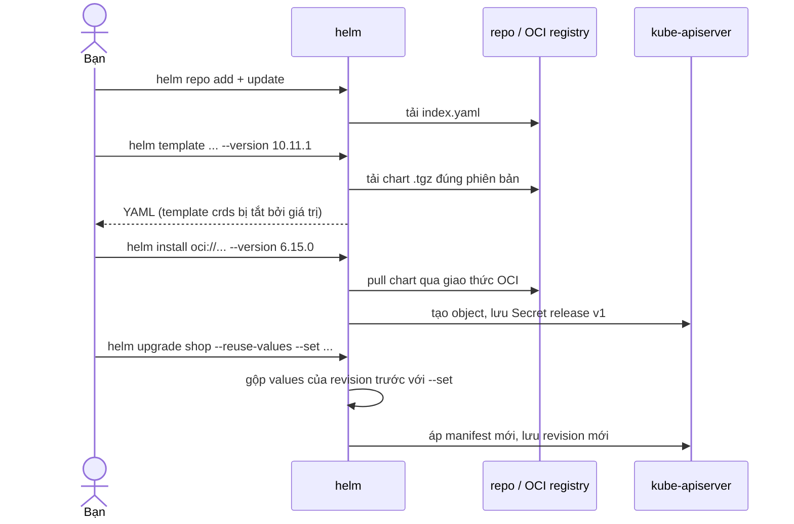

# Lab 41 · Helm với repo và OCI - Argo CD, sửa release lỗi

**Cấp độ 7 · Vận hành cluster** · khoảng 35 phút · môi trường: kind hoặc kubeadm

Năng lực CKA: Cluster Architecture › Cài thành phần bằng Helm và Kustomize; Cluster Architecture › CRD, cài và cấu hình Operator

Mức hỗ trợ: **Tự lực**. Đề bài kiểu phòng thi. Phần này chỉ đưa quy trình làm việc và cách kiểm chứng; chi tiết bạn tự tra như trong phòng thi.

## Mục tiêu

Làm các dạng câu Helm mà người thi gần đây kể lại: thêm repo, render chart của Argo CD ra file mà **không** kèm CRD, cài chart từ OCI registry đúng phiên bản và giá trị, và cứu một release đang `failed`.

## Cần làm trước

- [Lab 26 · Helm từ chart đến rollback](../26-helm/README.md)

## Kiến thức cần nắm

- Chart lấy từ **repo HTTP**: `helm repo add <tên> <url>`, `helm repo update`, `helm search repo <tên>/<chart> --versions`. Từ **OCI registry**: dùng thẳng `oci://…` trong `helm install/template/show`, không cần `repo add`.
- `helm template` render ra YAML mà không cài; thêm `-n <ns>` để namespace trong YAML đúng. `--version` ghim phiên bản chart.
- Chart có thể cài CRD theo hai cách: thư mục `crds/` (bỏ bằng `--skip-crds`) hoặc template có điều kiện (bỏ bằng giá trị riêng của chart, như `crds.install=false` của Argo CD). Đọc `helm show values` để biết.
- Release `failed` vẫn còn trong `helm list -a`. Sửa bằng `helm upgrade` với giá trị đúng; `--reuse-values` giữ các giá trị cũ, chỉ đè cái bạn đặt.
- Mỗi revision lưu trong Secret `sh.helm.release.v1.<release>.v<N>` của namespace.

## Sơ đồ

### Lab dựng gì



### Luồng hoạt động



## Chuẩn bị

```bash
./lab start 41
```

Cần `helm` v3 hoặc v4 và internet. Setup tạo namespace `lab41` và cài release `shop` (chart `podinfo`) với một giá trị sai để nó ở trạng thái `failed`.

## Đề bài

1. Thêm repo Helm tên `argo` với URL `https://argoproj.github.io/argo-helm`. Render chart `argo/argo-cd` phiên bản **10.11.1**, release `argocd`, namespace `argocd`, **không kèm CRD**, ra file `~/cka-answers/41-argocd.yaml`. Không cài vào cluster.

2. Cài release `podinfo` vào `lab41` từ OCI registry `oci://ghcr.io/stefanprodan/charts/podinfo` phiên bản **6.15.0**, với 2 replica và `ui.message` là `CKA`. Release phải ở trạng thái `deployed` và cả 2 Pod sẵn sàng.

3. Release `shop` trong `lab41` đang `failed`. Tìm nguyên nhân và sửa để nó `deployed`, Service kiểu `ClusterIP`, **giữ** số replica đã đặt khi cài.

## Quy trình tư duy

### Quy trình

1. **Tìm chart:** `helm repo add`, `helm repo update`, `helm search repo <repo>/<chart> --versions | head`. Với OCI thì không cần repo: `helm show chart oci://…`.
2. **Đọc values trước khi đặt:** `helm show values <chart> --version <v> | less`, tìm đúng tên khóa (`replicaCount`, `crds.install`, `ui.message`…).
3. **Render để kiểm tra:** `helm template … > file`, rồi `grep` xem có đúng thứ mình muốn (và không có thứ mình cấm).
4. **Sửa release lỗi:** `helm list -a` → `helm history` → `helm get values` → `helm upgrade --reuse-values --set <giá trị đúng>`.

### Kiểm chứng

- `helm list -n lab41 -a`: mọi release `deployed`, cột CHART đúng phiên bản.
- `kubectl get deploy,svc -n lab41` khớp các giá trị đã đặt.
- File render không có `kind: CustomResourceDefinition`.

### Bẫy

- `helm template` không có `-n` thì namespace trong YAML là `default`.
- `--reuse-values` giữ cả giá trị **sai** cũ. Luôn đặt lại giá trị cần sửa bằng `--set`.
- Thiếu `--version` thì Helm lấy bản mới nhất, không phải bản đề yêu cầu.

## Gợi ý

<details><summary>Tìm cách bỏ CRD</summary>

`helm show values argo/argo-cd --version 10.11.1 | grep -n -A3 '^crds'`

</details>

<details><summary>Kiểm tra file render</summary>

`grep -c 'kind: CustomResourceDefinition' ~/cka-answers/41-argocd.yaml` phải là 0; `grep 'helm.sh/chart' … | sort -u` cho thấy phiên bản chart.

</details>

<details><summary>Vì sao shop failed?</summary>

`helm list -n lab41 -a`, `helm history shop -n lab41`, `helm get values shop -n lab41`. Lỗi nằm ở giá trị nào?

</details>

## Chấm bài

```bash
./lab check 41
```

Lời giải: [SOLUTION.md](SOLUTION.md) (chỉ mở sau khi đã tự làm).

## Dọn dẹp

```bash
./lab reset 41
```

## Tài liệu

- [Helm · Using Helm](https://helm.sh/docs/intro/using_helm/)
- [Helm · Registries (OCI)](https://helm.sh/docs/topics/registries/)
- [helm template](https://helm.sh/docs/helm/helm_template/)
- [Argo CD Helm chart](https://github.com/argoproj/argo-helm/tree/main/charts/argo-cd)

---

← [Lab 40 · Cài CNI Calico bằng Tigera Operator](../40-cni-tigera-operator/README.md) · [Lab 42 · Cài và dùng một Operator thật - cert-manager](../42-operator-cert-manager/README.md) →
