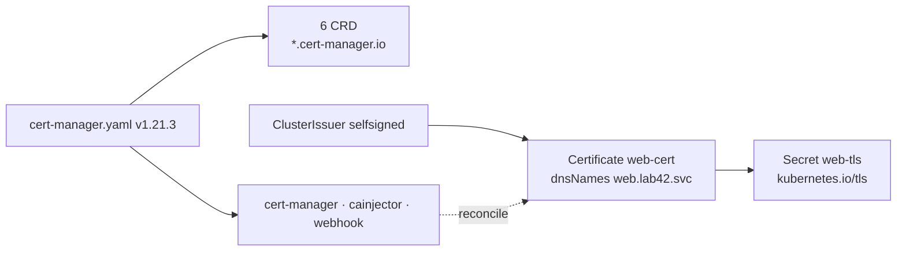
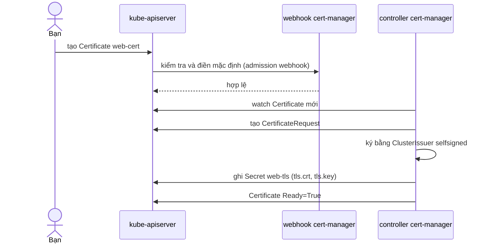

# Lab 42 · Cài và dùng một Operator thật - cert-manager

**Cấp độ 7 · Vận hành cluster** · khoảng 30 phút · môi trường: kind hoặc kubeadm

Năng lực CKA: Cluster Architecture › CRD, cài và cấu hình Operator; Cluster Architecture › Cài thành phần bằng Helm và Kustomize

Mức hỗ trợ: **Tự lực**. Đề bài kiểu phòng thi. Phần này chỉ đưa quy trình làm việc và cách kiểm chứng; chi tiết bạn tự tra như trong phòng thi.

## Mục tiêu

Cài một operator thật từ manifest chính thức, tìm và đọc tài liệu CRD của nó bằng `kubectl`, rồi dùng chính các CRD đó để operator làm việc cho bạn (cấp chứng chỉ TLS).

## Cần làm trước

- [Lab 28 · CustomResourceDefinition và Operator](../28-crd-operator/README.md)

## Kiến thức cần nắm

- Operator gồm **CRD** (kiểu object mới) + **controller** (Deployment theo dõi các object đó). cert-manager có 3 Deployment: `cert-manager`, `cert-manager-cainjector`, `cert-manager-webhook`.
- Liệt kê CRD của một operator: `kubectl get crd | grep <group>` hoặc `kubectl api-resources --api-group=<group>`.
- `kubectl explain <kind>.spec.<field>` đọc tài liệu từ schema của CRD, không cần internet. Đề thi có thể bắt ghi kết quả này ra file.
- Webhook của operator chỉ nhận request khi Pod webhook đã sẵn sàng. Tạo object quá sớm sẽ gặp lỗi `failed calling webhook`: chờ `kubectl wait --for=condition=Available` rồi thử lại.
- Luồng của cert-manager: `Issuer`/`ClusterIssuer` (ai ký) → `Certificate` (muốn chứng chỉ gì) → controller tạo `CertificateRequest`, ký, ghi kết quả vào **Secret** kiểu `kubernetes.io/tls`.

## Sơ đồ

### Lab dựng gì



### Luồng hoạt động



## Chuẩn bị

```bash
./lab start 42
```

Cần internet. Setup gỡ cert-manager nếu đã có (để bạn tự cài) và tạo namespace `lab42`.

## Đề bài

1. Cài cert-manager **v1.21.3** từ manifest chính thức của bản phát hành. Chờ cả 3 Deployment trong namespace `cert-manager` sẵn sàng.

2. Ghi tên mọi CRD của cert-manager (group kết thúc bằng `cert-manager.io`) vào `~/cka-answers/42-crds.txt`, mỗi dòng một tên, sắp xếp theo bảng chữ cái.

3. Ghi tài liệu của trường `spec.subject` trong `Certificate` (kết quả `kubectl explain`) vào `~/cka-answers/42-subject.txt`.

4. Tạo ClusterIssuer `selfsigned` kiểu self-signed. Trong `lab42`, tạo Certificate `web-cert` cho DNS `web.lab42.svc`, lưu vào Secret `web-tls`, ký bởi ClusterIssuer đó. Certificate phải `Ready`.

## Quy trình tư duy

### Quy trình

1. **Cài từ manifest phát hành:** `kubectl apply -f <URL release>`. Ghi nhớ mẫu URL `…/releases/download/<version>/<file>.yaml` của GitHub.
2. **Chờ đủ thành phần:** `kubectl -n <ns> wait --for=condition=Available deploy --all`. Operator có webhook thì webhook phải sẵn sàng trước khi tạo object.
3. **Khám phá API mới:** `kubectl get crd | grep <group>`, `kubectl api-resources --api-group=<group>`, `kubectl explain <kind>.spec`.
4. **Dùng CRD:** tạo object theo thứ tự phụ thuộc (Issuer trước Certificate). Đọc `status.conditions` để biết operator đã làm xong chưa.

### Kiểm chứng

- `kubectl get clusterissuer,certificate -A` cho thấy cột READY là `True`.
- `kubectl get secret web-tls -n lab42 -o jsonpath='{.type}'` trả về `kubernetes.io/tls`.

### Bẫy

- `failed calling webhook … connection refused` nghĩa là tạo quá sớm. Chờ rồi thử lại, đừng sửa YAML.
- `kubectl explain` cần đúng tên kind (`certificate`), không phải tên CRD đầy đủ.

## Gợi ý

<details><summary>URL manifest</summary>

Bản phát hành trên GitHub có file `cert-manager.yaml`: `https://github.com/cert-manager/cert-manager/releases/download/<version>/cert-manager.yaml`

</details>

<details><summary>Lỗi webhook khi tạo ClusterIssuer</summary>

Chờ `kubectl -n cert-manager wait --for=condition=Available deploy --all` rồi tạo lại.

</details>

## Chấm bài

```bash
./lab check 42
```

Lời giải: [SOLUTION.md](SOLUTION.md) (chỉ mở sau khi đã tự làm).

## Dọn dẹp

```bash
./lab reset 42
```

## Tài liệu

- [cert-manager · Install with kubectl apply](https://cert-manager.io/docs/installation/kubectl/)
- [Operator pattern](https://kubernetes.io/docs/concepts/extend-kubernetes/operator/)
- [kubectl explain](https://kubernetes.io/docs/reference/kubectl/generated/kubectl_explain/)

---

← [Lab 41 · Helm với repo và OCI - Argo CD, sửa release lỗi](../41-helm-repo-oci/README.md) · [Lab 33 · Troubleshooting ứng dụng: sáu Deployment hỏng](../33-troubleshoot-apps/README.md) →
