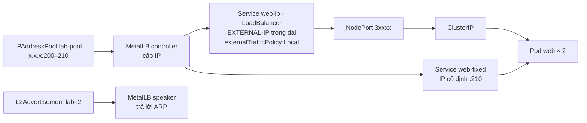
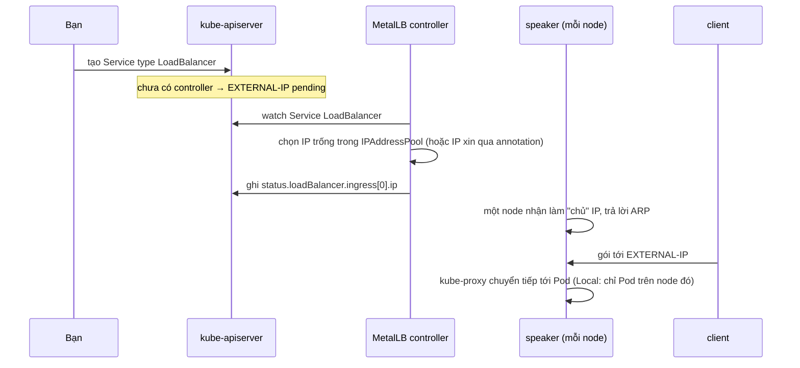

# Lab 43 · Service LoadBalancer với MetalLB

**Cấp độ 4 · Services & Networking** · khoảng 35 phút · môi trường: kind hoặc kubeadm

Năng lực CKA: Services & Networking › Service ClusterIP, NodePort, LoadBalancer và endpoints; Cluster Architecture › CRD, cài và cấu hình Operator

Mức hỗ trợ: **Dẫn hướng**. Mỗi câu chỉ ra chỗ tra tài liệu, khung lệnh và cách tự kiểm, nhưng không đưa đáp án. Hãy thử tự làm trước, kẹt mới mở.

## Mục tiêu

Hiểu Service `LoadBalancer` thật sự cần gì để có địa chỉ ngoài: một controller cấp IP. Cài MetalLB, cấu hình dải IP bằng CRD của nó, xin IP cố định, và đặt `externalTrafficPolicy`.

## Cần làm trước

- [Lab 15 · Service, EndpointSlice và kết nối giữa các Pod](../15-services/README.md)

## Kiến thức cần nắm

- `LoadBalancer` = `NodePort` + một IP ngoài do **load-balancer controller** cấp. Trên cloud, controller của nhà cung cấp làm việc này. Trên cluster tự dựng không có controller nên `EXTERNAL-IP` đứng `<pending>` mãi.
- **MetalLB** là controller cho bare-metal: `IPAddressPool` khai báo dải IP được cấp, `L2Advertisement` cho MetalLB trả lời ARP cho các IP đó trong mạng L2 của node.
- Xin một IP cụ thể: annotation `metallb.io/loadBalancerIPs: <ip>` (trường `spec.loadBalancerIP` đã deprecated).
- `externalTrafficPolicy: Cluster` (mặc định) cho phép mọi node chuyển tiếp traffic, nhưng mất IP gốc của client. `Local` giữ IP gốc và chỉ node có Pod mới nhận traffic.
- Mỗi Service LoadBalancer vẫn có `nodePort` và `clusterIP` bên dưới: ba lớp chồng lên nhau.

## Sơ đồ

### Lab dựng gì



### Luồng hoạt động



## Chuẩn bị

```bash
./lab start 43
```

Cần internet để tải MetalLB. Setup tạo namespace `lab43` với Deployment `web` (2 replica), và chọn một dải IP trống cùng mạng với các node. Dải này in ra màn hình và lưu trong ConfigMap `lab-state` của `lab43` (key `pool` và `last`).

## Đề bài

1. Expose Deployment `web` trong `lab43` thành Service `web-lb` kiểu `LoadBalancer`, cổng 80. Quan sát cột `EXTERNAL-IP` trước khi có controller.

2. Cài MetalLB **v0.16.1** từ manifest `metallb-native.yaml` chính thức. Chờ `controller` và `speaker` sẵn sàng.

3. Trong `metallb-system`, tạo `IPAddressPool` tên `lab-pool` với dải IP trong `lab-state`, và `L2Advertisement` tên `lab-l2` chỉ quảng bá pool này.

4. `web-lb` phải nhận IP trong dải đó. Đặt `externalTrafficPolicy: Local` cho `web-lb`. Ghi `nodePort` mà Kubernetes cấp cho `web-lb` vào `~/cka-answers/43-nodeport.txt`.

5. Tạo Service `web-fixed` kiểu `LoadBalancer` cho `web`, cổng 80, xin đúng IP `last` trong `lab-state`. Từ một Pod trong cluster gọi được `http://<IP đó>`.

## Cách tiếp cận

### Câu 1 · LoadBalancer khi chưa có controller

**Khung:** `kubectl expose deploy … --type=LoadBalancer --port=80 --name=…`.

**Tự kiểm:** `kubectl get svc -n lab43` hiện `EXTERNAL-IP <pending>`. Cột PORT(S) đã có dạng `80:3xxxx/TCP`: phần NodePort vẫn được cấp.

### Câu 2 · Cài MetalLB

**Tra:** trang *Installation* của MetalLB, mục *Installation by manifest*.

**Tự kiểm:** `kubectl get pods -n metallb-system`: `controller` 1/1, `speaker` trên mọi node.

### Câu 3 · Cấu hình bằng CRD

**Tra:** trang *Configuration* của MetalLB, mục *Layer 2 configuration*.

**Khung:** `IPAddressPool.spec.addresses` (dạng `a.b.c.d-a.b.c.e`) và `L2Advertisement.spec.ipAddressPools`. Dải lấy từ `kubectl get cm lab-state -n lab43 -o yaml`.

**Bẫy:** lỗi `failed calling webhook` nghĩa là controller chưa sẵn sàng, chờ rồi tạo lại.

### Câu 4 · IP được cấp và traffic policy

**Tự kiểm:** `kubectl get svc web-lb -n lab43 -w` cho tới khi có EXTERNAL-IP. `kubectl explain service.spec.externalTrafficPolicy` mô tả hai giá trị.

### Câu 5 · Xin IP cố định

**Tra:** trang *Usage* của MetalLB, mục *Requesting specific IPs*.

**Tự kiểm:** `kubectl run t -n lab43 --rm -it --image=busybox:1.36 --restart=Never -- wget -qO- -T3 http://<IP>`.

## Gợi ý

<details><summary>Vì sao EXTERNAL-IP pending?</summary>

`kubectl describe svc web-lb -n lab43`: không có event nào từ controller. Không có controller thì không ai cấp IP.

</details>

<details><summary>Lỗi webhook khi tạo IPAddressPool</summary>

Pod webhook của MetalLB (trong `controller`) chưa sẵn sàng. Chờ rồi tạo lại.

</details>

<details><summary>Khung YAML</summary>

Trang MetalLB "Configuration" có mẫu `IPAddressPool` và `L2Advertisement` (`spec.ipAddressPools`).

</details>

## Chấm bài

```bash
./lab check 43
```

Lời giải: [SOLUTION.md](SOLUTION.md) (chỉ mở sau khi đã tự làm).

## Dọn dẹp

```bash
./lab reset 43
```

## Tài liệu

- [Service type LoadBalancer](https://kubernetes.io/docs/concepts/services-networking/service/#loadbalancer)
- [External traffic policy](https://kubernetes.io/docs/concepts/services-networking/service/#traffic-policies)
- [MetalLB · Installation](https://metallb.io/installation/)
- [MetalLB · Configuration](https://metallb.io/configuration/)

---

← [Lab 19 · Gateway API, HTTPRoute và ReferenceGrant](../19-gateway-api/README.md) · [Lab 44 · Gateway API với controller thật - HTTPS và chuyển từ Ingress](../44-gateway-migrate-ingress/README.md) →
