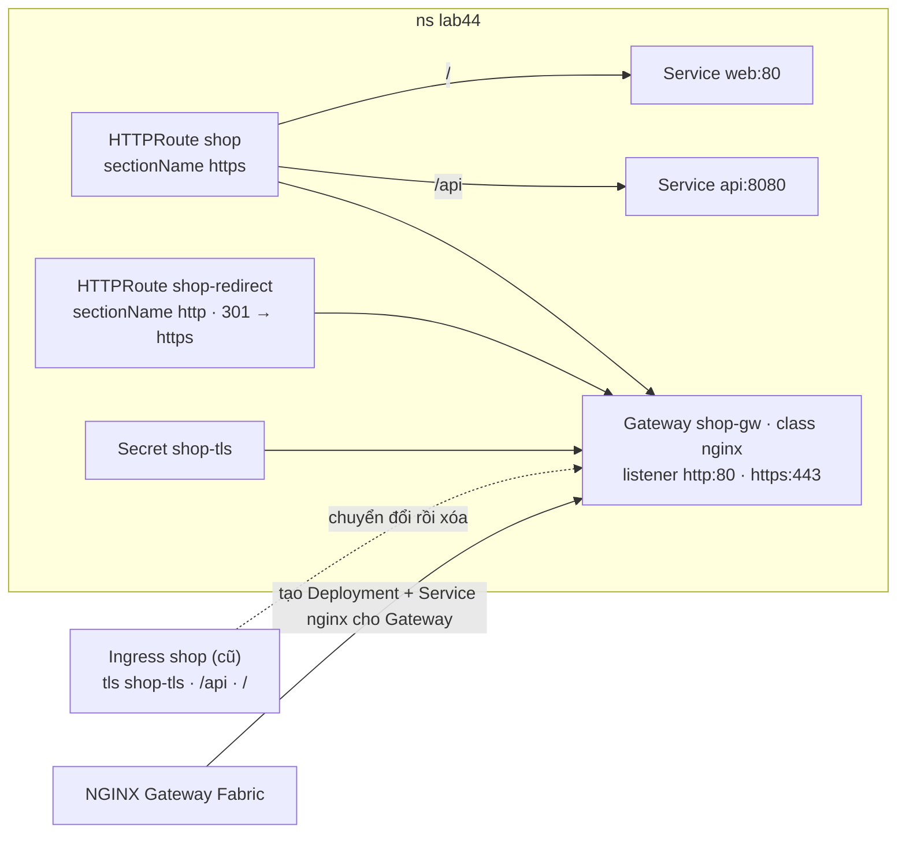
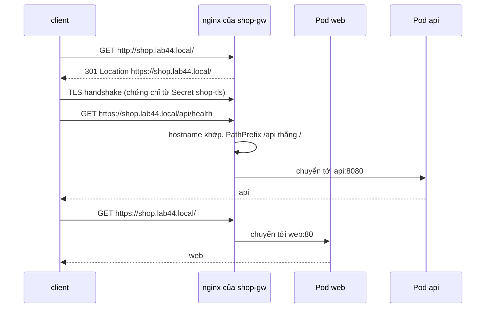

# Lab 44 · Gateway API với controller thật - HTTPS và chuyển từ Ingress

**Cấp độ 4 · Services & Networking** · khoảng 40 phút · môi trường: kind hoặc kubeadm

Năng lực CKA: Services & Networking › Gateway API; Services & Networking › Ingress controller và Ingress

Mức hỗ trợ: **Dẫn hướng**. Mỗi câu chỉ ra chỗ tra tài liệu, khung lệnh và cách tự kiểm, nhưng không đưa đáp án. Hãy thử tự làm trước, kẹt mới mở.

## Mục tiêu

Làm dạng câu Gateway API đề thi gần đây hay hỏi: đọc một Ingress đang chạy, tạo Gateway có listener HTTPS dùng Secret TLS sẵn có, viết HTTPRoute với cùng luật, chuyển HTTP sang HTTPS, kiểm tra bằng request thật, rồi gỡ Ingress cũ.

## Cần làm trước

- [Lab 18 · Ingress, IngressClass và TLS](../18-ingress/README.md)
- [Lab 19 · Gateway API, HTTPRoute và ReferenceGrant](../19-gateway-api/README.md)

## Kiến thức cần nắm

- Đổi từ Ingress sang Gateway API: `spec.tls` của Ingress thành **listener HTTPS** trên Gateway (`tls.mode: Terminate`, `certificateRefs`). Mỗi `rules[].host` + `paths` thành `hostnames` + `rules[].matches` của HTTPRoute.
- HTTPRoute gắn vào **một listener cụ thể** bằng `parentRefs[].sectionName`. Không ghi `sectionName` thì route gắn vào mọi listener của Gateway.
- Chuyển HTTP sang HTTPS: một HTTPRoute riêng gắn vào listener `http`, với filter `RequestRedirect` (`scheme: https`, `statusCode: 301`).
- Gateway có điều kiện `Accepted` và `Programmed`. Controller (ở bài này là NGINX Gateway Fabric) tạo Deployment và Service riêng cho từng Gateway trong namespace của Gateway.
- Kiểm tra bằng `curl --resolve <host>:<port>:<IP>` để gửi đúng hostname mà không cần DNS.

## Sơ đồ

### Lab dựng gì



### Luồng hoạt động



## Chuẩn bị

```bash
./lab start 44
```

Cần internet. Setup cài CRD Gateway API v1.6.3 và NGINX Gateway Fabric v2.8.0 (GatewayClass `nginx`) nếu chưa có, rồi tạo trong `lab44`: Service `web` (trả về `web`) và `api` (trả về `api` ở `/api/health`), Secret TLS `shop-tls` cho `shop.lab44.local`, và Ingress `shop` cần chuyển đổi.

## Đề bài

1. Đọc Ingress `shop` trong `lab44`. Tạo Gateway `shop-gw` (class `nginx`) có hai listener cho hostname `shop.lab44.local`: `http` (HTTP, cổng 80) và `https` (HTTPS, cổng 443, dùng Secret `shop-tls`).

2. Tạo HTTPRoute `shop` chỉ gắn vào listener `https`, có cùng luật với Ingress: `/api` (PathPrefix) tới `api:8080`, `/` tới `web:80`.

3. Tạo HTTPRoute `shop-redirect` gắn vào listener `http`, chuyển mọi request sang `https` với mã 301.

4. Kiểm tra bằng request thật tới Service mà controller tạo cho `shop-gw`: `https://shop.lab44.local/` trả `web`, `https://shop.lab44.local/api/health` trả `api`, `http://shop.lab44.local/` trả 301. Sau đó xóa Ingress `shop`.

## Cách tiếp cận

### Ánh xạ Ingress → Gateway API

| Ingress | Gateway API |
|---|---|
| `ingressClassName` | `Gateway.spec.gatewayClassName` |
| `spec.tls[].secretName` | listener HTTPS, `tls.certificateRefs` |
| `rules[].host` | `listeners[].hostname` và `HTTPRoute.spec.hostnames` |
| `paths[].path` + `pathType: Prefix` | `matches[].path` kiểu `PathPrefix` |
| `backend.service` | `backendRefs` |

### Câu 1 · Gateway hai listener

**Tra:** trang *HTTPS* (TLS) trong hướng dẫn Gateway API có Gateway mẫu với listener HTTPS.

**Tự kiểm:** `kubectl describe gateway shop-gw -n lab44`: mỗi listener có `Programmed True`, và `Attached Routes` tăng khi bạn tạo route.

### Câu 2 · Route chỉ cho HTTPS

**Khung:** `parentRefs: [{name: shop-gw, sectionName: https}]`.

**Tự kiểm:** `kubectl get httproute -n lab44`, rồi `describe` xem `Accepted` và `ResolvedRefs`.

### Câu 3 · Chuyển HTTP sang HTTPS

**Tra:** trang *HTTP redirects and rewrites*.

**Khung:** route thứ hai gắn `sectionName: http`, một rule không có `backendRefs`, chỉ có filter `RequestRedirect`.

### Câu 4 · Kiểm tra thật rồi gỡ Ingress

**Khung:** tìm ClusterIP của Service do controller tạo cho Gateway, rồi `curl -sk --resolve shop.lab44.local:443:<IP> https://shop.lab44.local/` từ Pod `curlimages/curl`.

**Bẫy:** chỉ xóa Ingress **sau khi** request qua Gateway đã đúng. Thứ tự này áp dụng y hệt khi chuyển đổi trên hệ thống thật.

## Gợi ý

<details><summary>Service của Gateway tên gì?</summary>

`kubectl get svc -n lab44`, hoặc theo label: `kubectl get svc -n lab44 -l gateway.networking.k8s.io/gateway-name=shop-gw`

</details>

<details><summary>Gửi request kèm hostname</summary>

`kubectl run t -n lab44 --rm -it --restart=Never --image=curlimages/curl:8.11.1 -- curl -sk --resolve shop.lab44.local:443:<ClusterIP> https://shop.lab44.local/`

</details>

<details><summary>Gateway chưa Programmed?</summary>

`kubectl describe gateway shop-gw -n lab44`: xem điều kiện của từng listener (Secret có đúng tên, đúng namespace không).

</details>

## Chấm bài

```bash
./lab check 44
```

Lời giải: [SOLUTION.md](SOLUTION.md) (chỉ mở sau khi đã tự làm).

## Dọn dẹp

```bash
./lab reset 44
```

## Tài liệu

- [Gateway API · Migrating from Ingress](https://gateway-api.sigs.k8s.io/guides/migrating-from-ingress/)
- [Gateway API · HTTPS (TLS)](https://gateway-api.sigs.k8s.io/guides/tls/)
- [Gateway API · HTTP redirects](https://gateway-api.sigs.k8s.io/guides/http-redirect-rewrite/)
- [NGINX Gateway Fabric · Install with manifests](https://docs.nginx.com/nginx-gateway-fabric/install/manifests/)

---

← [Lab 43 · Service LoadBalancer với MetalLB](../43-loadbalancer-metallb/README.md) · [Lab 20 · Volume: emptyDir, hostPath, projected và Downward API](../20-volumes/README.md) →
