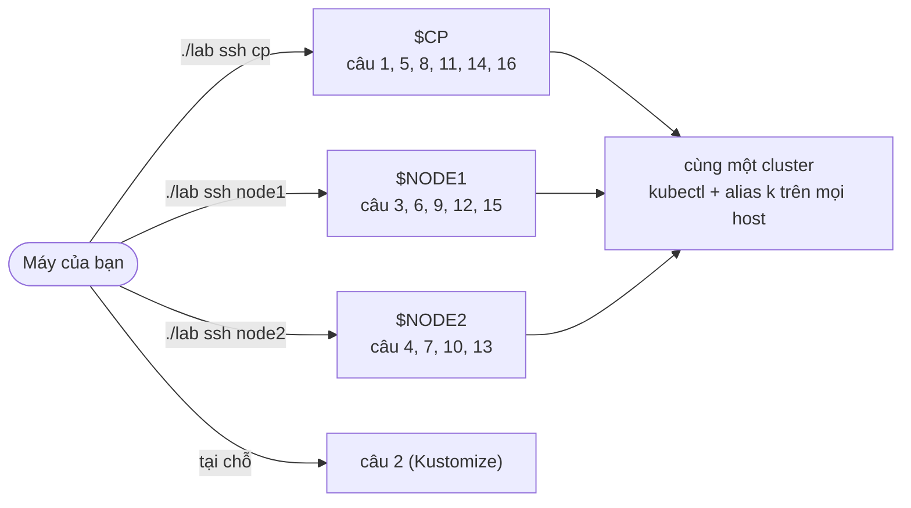
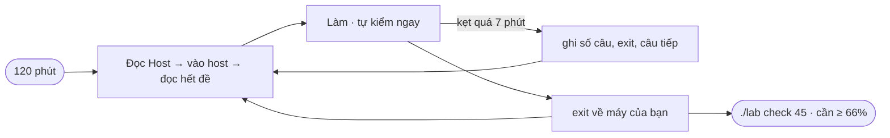

# Lab 45 · Đề thi thử 2 - chế độ phòng thi (2 giờ, 16 câu)

**Cấp độ 9 · Thi thử** · khoảng 120 phút · môi trường: kind hoặc kubeadm (cần vào node)

Năng lực CKA: Troubleshooting › Theo dõi tài nguyên cluster và ứng dụng; Troubleshooting › Quản lý và đánh giá output, log của container; Troubleshooting › Troubleshoot Service và networking; Cluster Architecture › Quản lý RBAC; Cluster Architecture › Cài thành phần bằng Helm và Kustomize; Cluster Architecture › Interface mở rộng: CNI, CSI, CRI; Cluster Architecture › CRD, cài và cấu hình Operator; Services & Networking › NetworkPolicy; Services & Networking › Service ClusterIP, NodePort, LoadBalancer và endpoints; Services & Networking › Gateway API; Workloads & Scheduling › Deployment, rolling update, rollback; Workloads & Scheduling › Primitive cho ứng dụng tự phục hồi; Workloads & Scheduling › Admission và scheduling của Pod; Storage › StorageClass và dynamic provisioning; Storage › Volume type, access mode, reclaim policy; Storage › PersistentVolume và PersistentVolumeClaim

Mức hỗ trợ: **Tự lực**. Đề bài kiểu phòng thi. Phần này chỉ đưa quy trình làm việc và cách kiểm chứng; chi tiết bạn tự tra như trong phòng thi.

## Mục tiêu

Đề tổng hợp thứ hai, làm theo đúng nhịp phòng thi v1.37: mỗi câu ghi **host** phải vào, câu có trọng số và chỉ được điểm khi đúng toàn bộ. Phân bố theo đề thật: Troubleshooting 30%, Cluster Architecture 25%, Services & Networking 20%, Workloads 15%, Storage 10%. Cần **66%** để đậu.

## Cần làm trước

Mọi lab từ 38 tới 44.

## Kiến thức cần nắm

- Mỗi câu bắt đầu bằng host. Vào bằng `./lab ssh <host>` (phòng thi thật: `ssh <host>` rồi `sudo -i`), làm, rồi `exit`. Setup đã cài kubectl, kubeconfig, `alias k` lên mọi node.
- Câu yêu cầu ghi file "trên host" thì file phải nằm trên chính host đó, không phải máy của bạn.
- Câu nào kẹt quá 7 phút thì ghi số câu ra giấy rồi đi tiếp.
- Làm đề 1 (lab 38) trước. Đề 2 khó hơn: nhiều câu sửa lỗi hơn và có Kustomize, CRD, CRI, Gateway API.

## Sơ đồ

### Lab dựng gì



### Luồng hoạt động



## Chuẩn bị

```bash
./lab start 45
```

Setup tạo các namespace `m2-ops`, `m2-app`, `m2-net`, `m2-mon`, `m2-store` cùng workload, CRD, PV và lỗi cài sẵn, rồi cài kubectl lên các node. Bấm đồng hồ 120 phút; trang hướng dẫn có đồng hồ đếm ngược.

## Đề bài

1. **Host `$CP`** · **(6%)** Tạo ServiceAccount `audit` trong `m2-ops`. Tạo ClusterRole `pv-viewer` cho phép `get, list, watch` trên `persistentvolumes` và `storageclasses`, và ClusterRoleBinding `pv-viewer` gắn nó cho `audit`.

2. **Máy của bạn** · **(5%)** Base Kustomize có sẵn ở `~/cka-answers/m2-kust/base`. Tạo overlay `~/cka-answers/m2-kust/overlays/prod` đưa Deployment `shop-ui` vào namespace `m2-app` với 2 replica và image `nginx:1.28`, rồi áp dụng overlay. Không sửa base.

3. **Host `$NODE1`** · **(6%)** Cluster có CRD `widgets.lab.example.com`. Tạo một `Widget` tên `blue` trong `m2-app` với `size` 3 và màu `blue`. Dùng `kubectl explain` để biết trường.

4. **Host `$NODE2`** · **(8%)** Pod `m2-beacon` (namespace `m2-ops`) chạy trên `$NODE2`. Dùng `crictl` trên host này để tìm container `beacon` và ghi **13 ký tự đầu** của container ID vào `/root/45-beacon.txt` trên `$NODE2`.

5. **Host `$CP`** · **(5%)** Deployment `m2-web` trong `m2-app` đã qua 3 revision và đang kẹt. Quay về **revision 1**. Cả 2 Pod phải sẵn sàng.

6. **Host `$NODE1`** · **(5%)** Tạo DaemonSet `m2-agent` (`busybox:1.36`, `sleep 3600`) trong `m2-app` chỉ chạy trên các node có label `m2-agent=true`, kể cả khi node đó là control plane.

7. **Host `$NODE2`** · **(5%)** Tạo Pod `m2-vip` (`nginx:1.27`) trong `m2-app` thuộc QoS `Guaranteed` với CPU `100m`, memory `64Mi`, dùng PriorityClass có sẵn `m2-high`.

8. **Host `$CP`** · **(6%)** Trong `m2-net`, tạo NetworkPolicy `db-guard`: Pod `app=db` chỉ nhận TCP 80 từ Pod `role=api` cùng namespace, **hoặc** từ mọi Pod trong namespace `m2-mon`.

9. **Host `$NODE1`** · **(8%)** Trong `m2-net`, tạo Gateway `m2-gw` (class `m2-gc`) có listener `https` (HTTPS, cổng 443, hostname `m2.local`, Secret `m2-tls`). Tạo HTTPRoute `m2-route` gắn vào listener đó, hostname `m2.local`, chuyển `/` tới Service `m2-api:80` và thêm header `x-env: exam` vào request.

10. **Host `$NODE2`** · **(6%)** Tạo Service `m2-api` (ClusterIP, cổng 80) cho Deployment `m2-api` trong `m2-net`, `targetPort` dùng **tên** cổng của container, và giữ client gắn với cùng một Pod (`sessionAffinity: ClientIP`).

11. **Host `$CP`** · **(5%)** PVC `m2-data` trong `m2-store` đứng `Pending`. Làm cho nó `Bound` với PV `m2-pv` mà **không sửa PV**. PVC vẫn tên `m2-data`, 1Gi.

12. **Host `$NODE1`** · **(5%)** Tạo StorageClass `m2-retain` dùng provisioner của StorageClass mặc định, reclaim `Retain`, `WaitForFirstConsumer`. Trong `m2-store` tạo PVC `m2-logs` 500Mi dùng lớp đó và Pod `m2-logs-pod` (`busybox:1.36`, `sleep 3600`) gắn nó tại `/logs`. PVC phải `Bound`.

13. **Host `$NODE2`** · **(10%)** Deployment `m2-shop` trong `m2-app` không có Pod nào sẵn sàng. Sửa để 2/2 sẵn sàng với image `nginx:1.27`, và biến `MODE` vẫn lấy từ ConfigMap `m2-shop-cfg` (giá trị `prod`).

14. **Host `$CP`** · **(8%)** Service `m2-backend` trong `m2-net` không trả lời. Sửa **Service** (không sửa Deployment) để `http://m2-backend.m2-net` trả trang nginx.

15. **Host `$NODE1`** · **(6%)** Pod `m2-logger` trong `m2-ops` có hai container. Ghi mọi dòng chứa `level=error` trong log của container `worker` vào `/root/45-errors.txt` trên `$NODE1`.

16. **Host `$CP`** · **(6%)** Ghi tên Pod trong `m2-ops` đang dùng **nhiều memory nhất** vào `/root/45-top.txt` trên `$CP`.

## Quy trình tư duy

### Trước khi bấm giờ

- Làm đề 1 (lab 38) trước. Đề 2 có nhiều câu sửa lỗi hơn và ba câu phải ghi file **trên host**.
- Thử một lần `./lab ssh $NODE1`, gõ `k get nodes`, rồi `exit`, để quen việc đổi host.

### Thói quen mỗi câu

1. Đọc dòng **Host**, vào đúng host. Câu ghi "Máy của bạn" thì làm ở máy của bạn.
2. Đọc hết đề, gạch chân namespace, tên object, cổng, phiên bản và **đường dẫn file**.
3. Làm xong tự kiểm ngay bằng `get`, `describe`, `auth can-i` hoặc một request thật, rồi `exit`.

### Phân bổ thời gian

| Phần | Câu | Gợi ý thời gian |
|---|---|---|
| Troubleshooting 30% | 13, 14, 15, 16 | 35 phút |
| Cluster Architecture 25% | 1, 2, 3, 4 | 30 phút |
| Services & Networking 20% | 8, 9, 10 | 25 phút |
| Workloads 15% | 5, 6, 7 | 15 phút |
| Storage 10% | 11, 12 | 15 phút |

### Chấm và ôn

```bash
./lab check 45                       # bảng điểm theo câu
./lab reset 45 && ./lab start 45     # làm lại
```
Câu nào sai, quay lại lab tương ứng trong mục "Cần làm trước".

## Gợi ý

<details><summary>Câu 4: crictl</summary>

`crictl ps --name beacon` (cột CONTAINER), hoặc `crictl ps --name beacon -q | cut -c1-13`.

</details>

<details><summary>Câu 11: vì sao Pending?</summary>

So `accessModes` và `storageClassName` của PVC với PV. Phần lớn trường của PVC không sửa được: xuất YAML, xóa, tạo lại.

</details>

<details><summary>Câu 13 có hai lỗi</summary>

Một lỗi làm container không tạo được, một lỗi làm image không kéo được. `kubectl describe pod` cho thấy cả hai.

</details>

## Chấm bài

```bash
./lab check 45
```

Lời giải: [SOLUTION.md](SOLUTION.md) (chỉ mở sau khi đã tự làm).

## Dọn dẹp

```bash
./lab reset 45
```

## Tài liệu

- [CKA · Important Instructions](https://docs.linuxfoundation.org/tc-docs/certification/tips-cka-and-ckad)
- [kubectl Quick Reference](https://kubernetes.io/docs/reference/kubectl/quick-reference/)

---

← [Lab 38 · Đề thi thử CKA (2 giờ, 16 câu)](../38-mock-exam/README.md)
