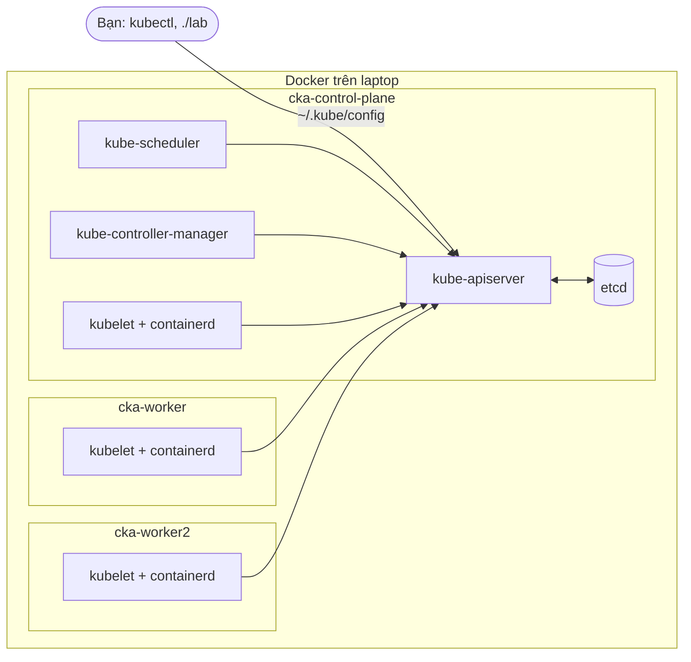
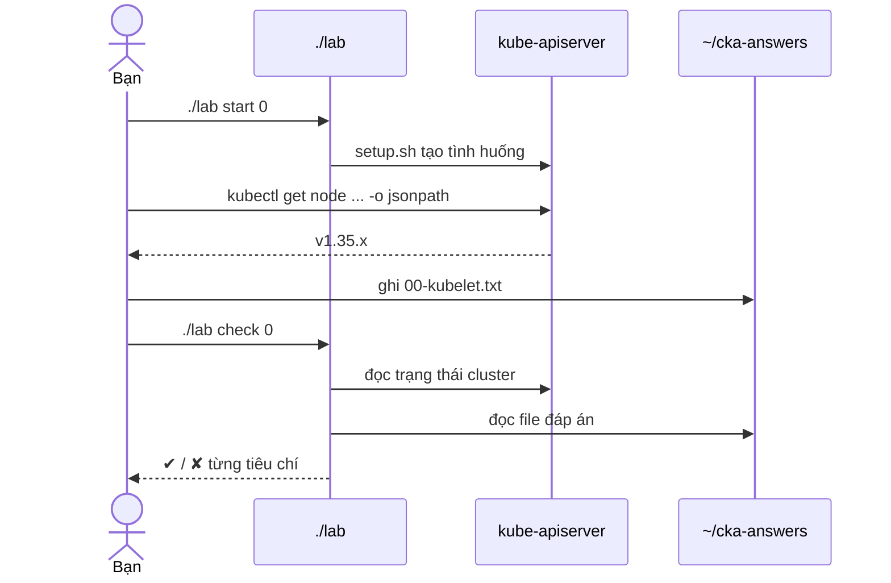

### Lab dựng gì

Mỗi node của kind là một container Docker. Control plane chạy dưới dạng static pod, do kubelet trên `cka-control-plane` khởi động.

### Luồng hoạt động

Mọi bài đều theo vòng này: `start` dựng tình huống, bạn sửa cluster hoặc ghi file, `check` so trạng thái thật với yêu cầu.
